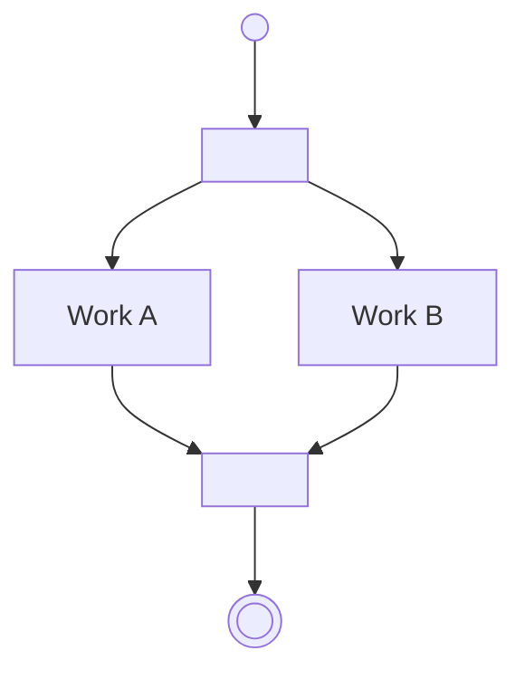

# Cheat sheet: Activity diagram

> [!REMEMBER]
> A **dot** starts, **boxes** are steps, **diamonds** decide, a **bar** splits work to run in parallel and a second
> bar waits for all of it. A ringed dot ends.

## Draw it when

A workflow with branches, loops or parallel work.

## The symbols

Dot = start · ringed dot = end · diamond = decision with `[guards]` · bars = fork / join.

## From C#

An `if` is a diamond with two guards; work you `await Task.WhenAll(...)` is a fork and a join.

## Mistakes

Unlabelled branches; a fork with no join; an object's lifecycle drawn as an activity.

## Interview one-liners

- "Processes, not objects."
- "Every diamond exit gets a guard."
- "Fork splits, join waits for all."
