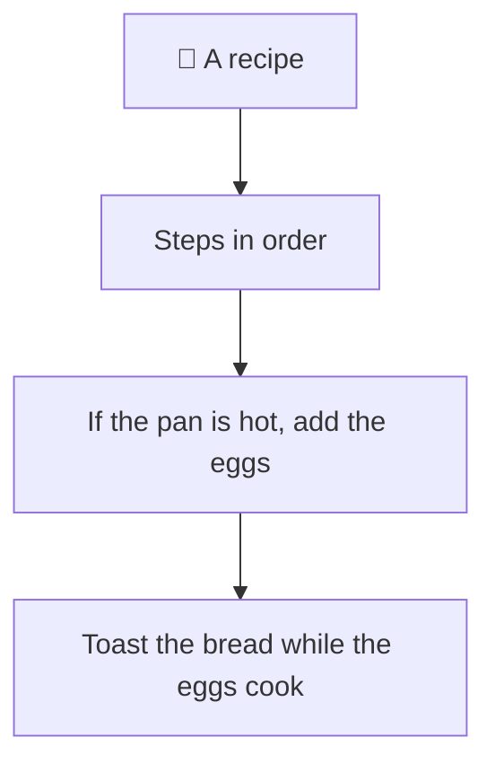
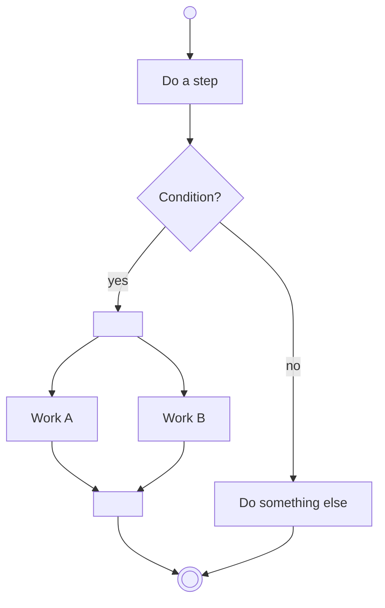
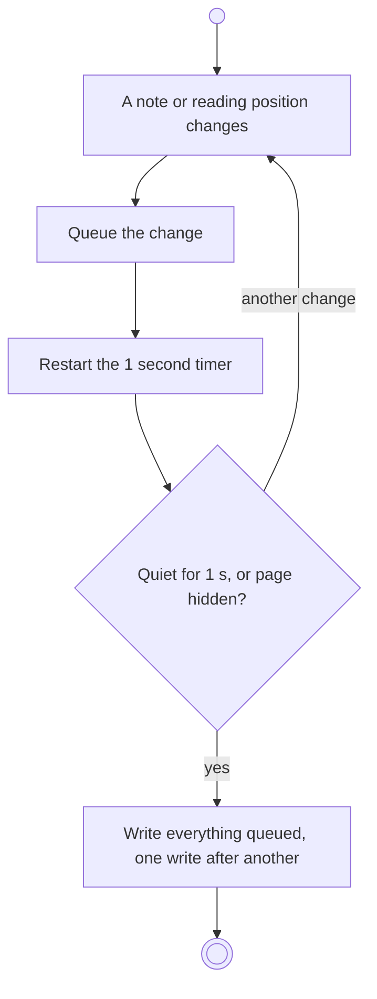
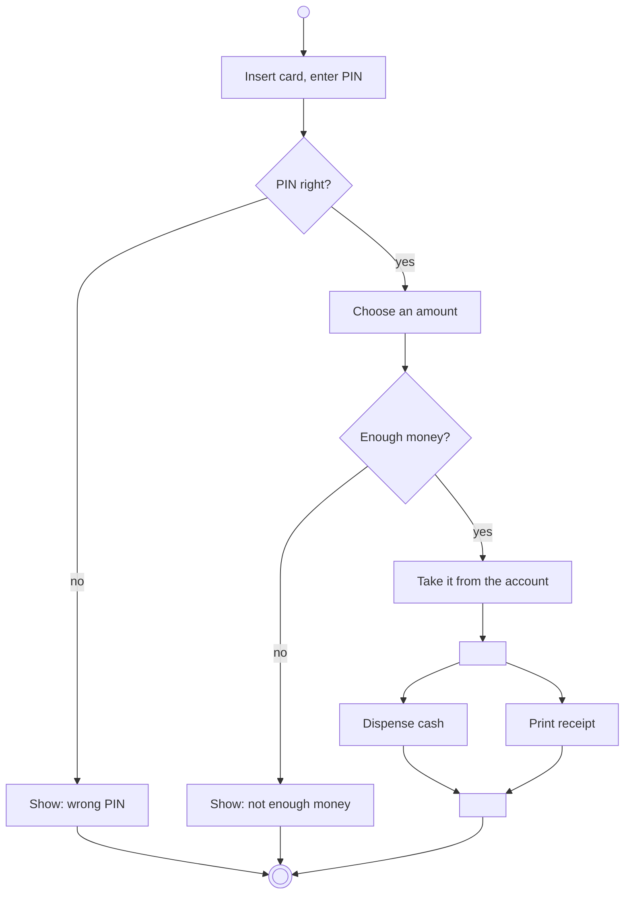

# Activity diagram

> [!REMEMBER]
> A **dot** starts, **boxes** are steps, **diamonds** decide, a **bar** splits work to run in parallel and a second
> bar waits for all of it. A ringed dot ends.



## The idea

An activity diagram shows a process: the steps, the decisions between them, and which steps run at the same time.
Where a sequence diagram asks "who calls whom?", an activity diagram asks "what happens next?".

*Draw it when:*

- The question is a workflow: checkout, withdrawal, an approval process, a sync job.
- There are branches and loops ("retry three times, then give up").
- Some work runs in parallel and has to be waited for.

## Notation



- **Initial node:** a filled dot. **Final node:** a ringed dot.
- **Action:** a rounded box with a verb ("Charge the card").
- **Decision / merge:** a diamond; each way out has a **guard** in brackets, `[yes]` / `[no]`.
- **Fork / join:** a thick bar. After a fork, the branches run in parallel; the join waits for all of them.
- **Swimlanes:** columns per actor or component (Mermaid: one `subgraph` each).

Press **step through** to walk it: at a diamond you choose the branch; after a fork both branches move together.

## Read it



This app's write-behind (`web/src/features/shared/writeBehind.ts`): typing a note doesn't save on every key.
Changes wait in a queue; one second of quiet (or the page going to the background) writes them all at once.

## From requirements

- "The customer enters a PIN; three outcomes: wrong PIN, not enough money, or cash."
- "When the money is taken from the account, the machine dispenses the cash and prints a receipt at the same time."



The same branches in code; the sample's tests take each one:

```csharp snippet="samples/Lld.Samples.Uml/Activity/CashMachine.cs#CashMachine.Withdraw"
```

## In an interview

- Use it for **processes**, not objects: if the question is about one entity's status, draw a state diagram.
- Put the guards on every branch out of a diamond, and make them cover all cases.
- Say which steps can fail and where the flow goes then; that is usually the interesting part.

> [!MISTAKES]
> - A decision with an unlabelled way out: which case is it?
> - A fork with no join, so nobody knows when the parallel work is done.
> - Using it for an object's lifecycle (that is a state diagram) or for calls between objects (a sequence diagram).

## Interview questions

### What is the difference between an activity and a state diagram?

An activity diagram models a process: steps and decisions. A state diagram models one object's states and the
events between them.

### What do fork and join mean?

A fork splits the flow into branches that run in parallel; a join waits until all incoming branches finish before
going on.

### What is a guard?

A condition on a way out of a decision, like `[PIN right]`. Exactly one guard should be true at a time.

### What are swimlanes?

Columns (or rows) that group actions by who does them: customer, machine, bank. They show hand-offs.

### When would you draw one in an LLD round?

For a workflow-heavy prompt (checkout, refunds, a booking flow) before or after the class diagram, to agree on the
steps and failure paths.

## Go deeper

### Object flow

UML can draw objects passing between actions (an `Order` box on the arrow from "Create order" to "Pay"). It shows
data, not just control.

### Signals and timers

An hourglass is a time event ("after 1 s"); a flag shape sends or receives a signal. The write-behind diagram's
"quiet for 1 s" is a time event.

### Merges

A diamond with several ways in and one way out is a **merge**: different branches join without waiting for each
other (unlike a join bar).

> [!WORK]
> **From my work:** a business process with a branch nobody had drawn. (Add your story here.)

### Related

- [State diagram](../state-diagram/lesson.md) · [Use case diagram](../use-case-diagram/lesson.md)
