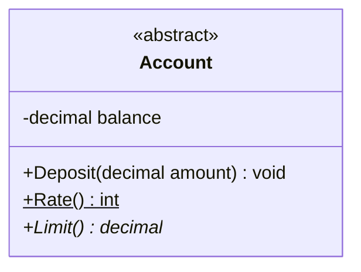

# Cheat sheet: Classes and members

> [!REMEMBER]
> A class box has three floors: **name**, **data**, **actions**. `+` anyone, `-` only me, `#` my children, `~` my project.

## Draw it when

"Design the classes for X"; agreeing on names; showing the public contract.

## The symbols



`$` underlined = static · `*` italic = abstract · «interface» / «abstract» above the name.

## From C#

```csharp snippet="samples/Lld.Samples.Uml/ClassBasics/BankAccount.cs#Card"
```

`abstract decimal Limit()` → `+Limit()* decimal`; `bool CanPay(...)` → `+CanPay(decimal amount) bool`.

## Mistakes

Every getter listed; no visibility marks; a table instead of a class.

## Interview one-liners

- "Name, attributes, operations."
- "Plus public, minus private, hash protected, tilde package."
- "Show the contract, hide the noise."
