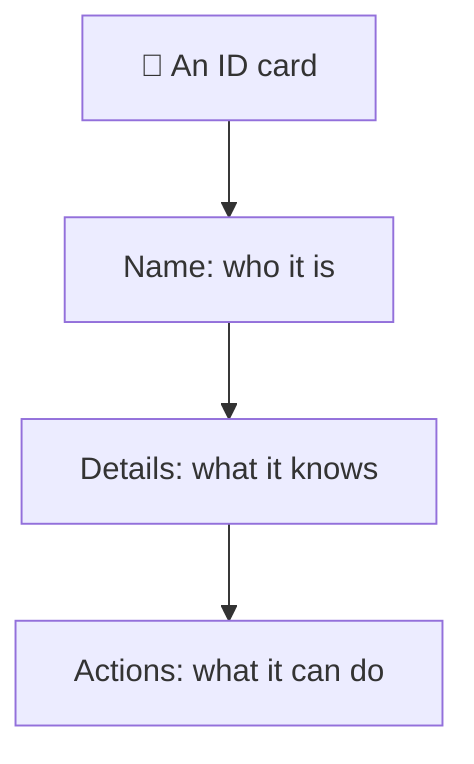
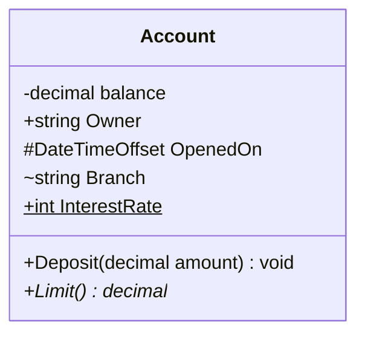
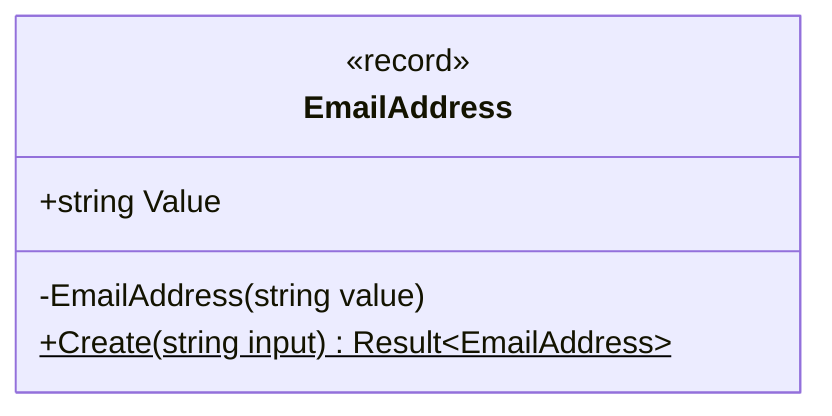

# Classes and members

> [!REMEMBER]
> A class box has three floors: **name**, **data**, **actions**. `+` anyone, `-` only me, `#` my children, `~` my project.



## The idea

A class diagram shows the classes of a design and what each one holds and does. It is the diagram interviewers
ask for most.

*Draw it when:*

- The question is "design the classes for X".
- You need to agree on names before writing code.
- You want to show what is public (the contract) and what is hidden.

## Notation



- **Top:** the class name. Add `«interface»` or `«abstract»` above it when it is one.
- **Middle:** fields and properties, `name : Type` (Mermaid writes `Type name`).
- **Bottom:** methods, `Name(parameters) : ReturnType`.
- **Marks:** `+` public, `-` private, `#` protected, `~` internal (package in UML).
- **Underlined** (`$` in Mermaid): static. **Italic** (`*` in Mermaid): abstract, no body.

## Read it



This app's `EmailAddress` (in `Lld.Domain`): the constructor is **private** (`-`), so the only way in is the
**static** `Create` (underlined), which returns a `Result`. One box tells the reader: "you can't build a bad email".

## Code ↔ UML

```mermaid code="samples/Lld.Samples.Uml/ClassBasics/BankAccount.cs#BankAccount,IStatement,Card"
classDiagram
    class BankAccount {
        -decimal balance
        +string Owner
        #DateTimeOffset OpenedOn
        ~string Branch
        +int InterestRatePercent$
        +Deposit(decimal amount) void
        +Balance() decimal
    }
    class IStatement {
        <<interface>>
        +Print(BankAccount account) string
    }
    class Card {
        <<abstract>>
        +Limit()* decimal
        +CanPay(decimal amount) bool
    }
    IStatement ..> BankAccount
```

Tap a box to see its code. Every member in the box is a line in the class.

## In an interview

- Draw the **boxes first** with names only; add members once the boxes feel right.
- Show only members that matter to the question: the public ones, plus private data that holds a rule.
- Spend about **5 minutes** here in a 45-minute LLD round.

> [!MISTAKES]
> - Writing every getter and setter: the box turns into noise.
> - Forgetting the marks, so nobody can tell the contract from the details.
> - Drawing a database table instead of a class (columns, no behaviour).

## Interview questions

### What goes in the three parts of a class box?

The name, then the attributes (data it holds), then the operations (what it can do). Interfaces and abstract classes
get a «stereotype» above the name.

### What do +, -, # and ~ mean?

Public, private, protected and package (internal in C#). They say who may use each member.

### How do you show a static or an abstract member?

Static is underlined (`$` in Mermaid). Abstract is in italics (`*` in Mermaid), and the class is marked «abstract».

### Do you list every property?

No. List what the design question needs: the public contract and the private data behind important rules.

### How is an interface drawn?

A box with «interface» above the name and only operations, or a small circle (lollipop) on the class that offers it.

## Go deeper

### Attribute and operation syntax

UML writes `visibility name : Type [multiplicity] = default`, for example `- tags : string [0..*]`, and
`visibility name(param : Type) : ReturnType`. Mermaid accepts `Type name` and `name(Type param) ReturnType`; both
are fine on a whiteboard as long as you are consistent.

### Stereotypes

`«interface»`, `«abstract»`, `«enumeration»`, `«record»`, `«service»`. They tag what kind of class a box is.
Use them sparingly: one stereotype that changes how the reader thinks is worth it; ten are noise.

### C# properties

UML has no properties. Draw a C# property as an attribute (`+ Owner : string`); draw a computed property
(`=> ...`) as an attribute too, or as an operation if computing it is the point.

> [!WORK]
> **From my work:** a class you once drew on a whiteboard, and what the box said that the code didn't. (Add your story here.)

### Related

- [Relationships: the six arrows](../class-relationships/lesson.md) · [Encapsulation](../../oop-solid/encapsulation/lesson.md)
