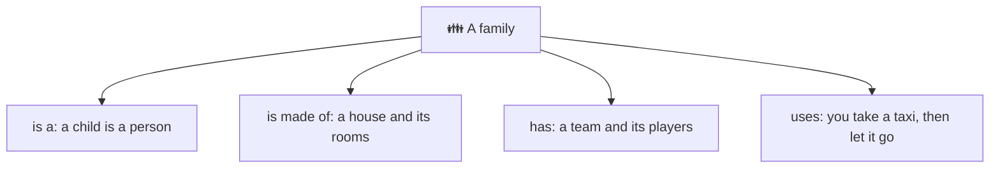
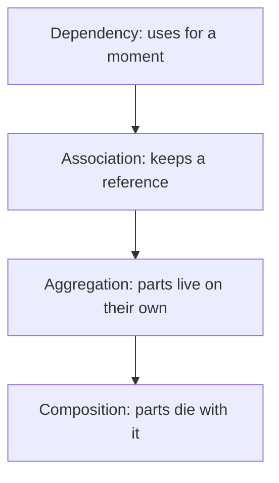
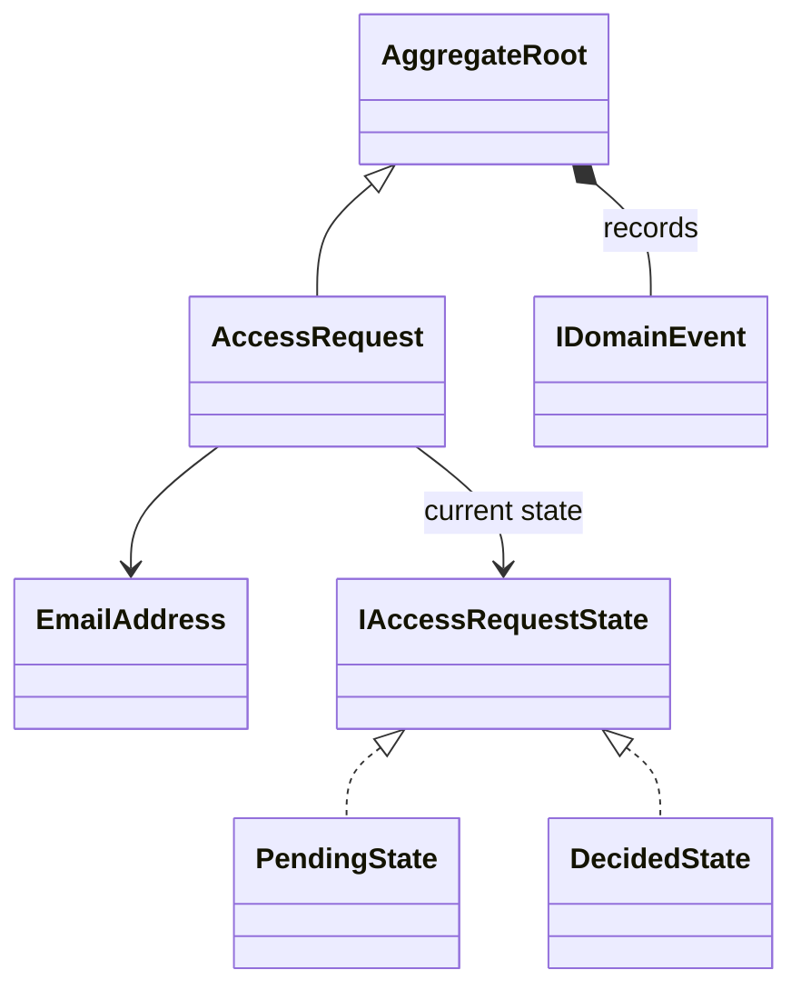

# Relationships: the six arrows

> [!REMEMBER]
> **Solid** line: it holds one. **Dashed**: it uses or implements one. **Triangle**: is a. **Diamond**: owns (filled =
> the parts die with it).



## The idea

The arrows say how classes depend on each other, and how strongly. Strong links (inheritance, composition) are hard
to change later; weak ones (dependency) are cheap.

*Draw it when:*

- Classes alone don't explain the design: who owns whom matters.
- You need to show where an interface sits between two classes.
- You want to show lifetimes: what dies with what.

## Notation

```uml-arrows
```

From weakest to strongest:



Inheritance (`<|--`) and realization (`<|..`) sit apart: they say what a class **is**, not what it holds.

## Read it



This app's access request (`Lld.Domain/Access`): it **is an** aggregate root, which **is made of** the events it
records; it **knows** its email and its current state; each state **implements** the state interface.

## Code ↔ UML

```mermaid code="samples/Lld.Samples.Uml/Relationships/Shop.cs#IPriced,Product,DigitalProduct,Customer,Order,OrderLine,TaxCalculator"
classDiagram
    IPriced <|.. Product
    Product <|-- DigitalProduct
    Customer o-- Order
    Order *-- OrderLine
    OrderLine --> Product
    Order ..> TaxCalculator
```

One of each arrow. Tap an arrow and the line of C# that makes it lights up: a base type, a field, a parameter.

## In an interview

- Default to **association** (`-->`); use a diamond only when you can say who owns the lifetime.
- Point the arrow from the class that **knows** to the class it knows about.
- Prefer realization (an interface) over inheritance between concrete classes: it is the OCP and DIP move.

> [!MISTAKES]
> - Arrows backwards: inheritance points **to the parent**.
> - Composition everywhere, even where the part is shared or outlives the whole.
> - Two arrows for one link (a line both ways) when only one side really knows the other.

## Interview questions

### What is the difference between aggregation and composition?

Both are "has a". In composition the whole creates and owns the parts and they die with it (an order and its
lines); in aggregation the parts exist on their own (a team and its players).

### How do you show an interface being implemented?

A dashed line with a hollow triangle pointing at the interface (realization), `IShape <|.. Square`.

### What is a dependency arrow?

A dashed arrow: one class uses another for a moment (a parameter, a local, a `new`) but doesn't keep it.

### How does C# show composition?

The whole creates the parts itself and never hands them out to be shared: `private readonly List<OrderLine> _lines
= [];` filled only by `Order.Add`.

### Which way does the inheritance arrow point?

From the child to the parent: the child knows its parent, the parent knows nothing about its children.

## Go deeper

### Navigability and labels

An arrowhead on an association means "can navigate this way". A label names the role (`current state`); a
small arrow next to the label says which way to read it. Labels are cheap and remove most arguments.

### Composition in a garbage-collected language

C# has no destructors that cascade, so "dies with it" means: nothing else holds a reference, and the whole controls
creation. EF Core owned types (`OwnsMany`) are composition in a database.

### Association classes

When the link itself has data (an enrolment between student and course has a grade), UML draws a class hanging
off the line. In code it becomes its own class: `Enrolment(Student, Course, Grade)`.

> [!WORK]
> **From my work:** a design where the wrong arrow (inheritance instead of composition) made a change hard. (Add your story here.)

### Related

- [Classes and members](../class-basics/lesson.md) · [Multiplicity](../multiplicity/lesson.md) ·
  [Composition over inheritance](../../oop-solid/composition-over-inheritance/lesson.md)
