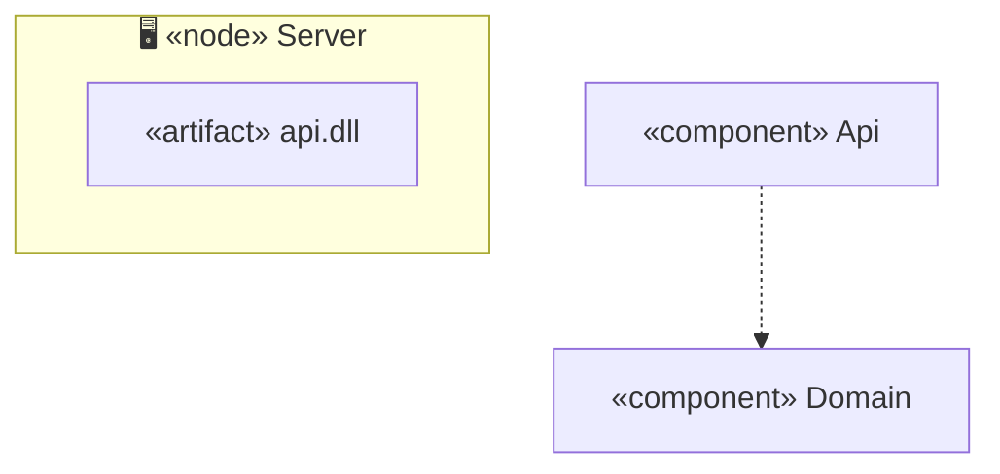

# Cheat sheet: Component and deployment diagrams

> [!REMEMBER]
> **Component:** which big pieces exist and who depends on whom. **Deployment:** which box runs where, and over what
> wire.

## Draw it when

Modules or layers (component); hosting, scale, offline or failure (deployment).

## The symbols

Lollipop `(( ))` = offered interface · dashed arrow = depends on · group = node · label links with the protocol.

## From C#

A `<ProjectReference>` in a `.csproj` is a dependency arrow between components; an interface in `Lld.Application`
is a lollipop that `Lld.Infrastructure` plugs into.

## Mistakes

Classes in a component diagram; arrows out of the domain; links with no protocol.

## Interview one-liners

- "Arrows point inwards, to the domain."
- "Nodes run things; artifacts are what you deploy."
- "Every wire gets a protocol."
