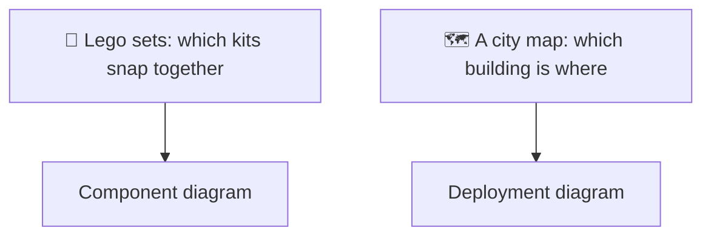
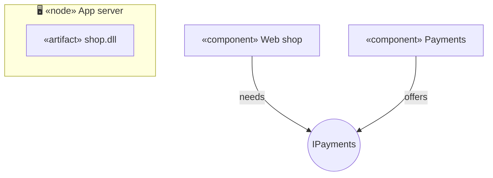
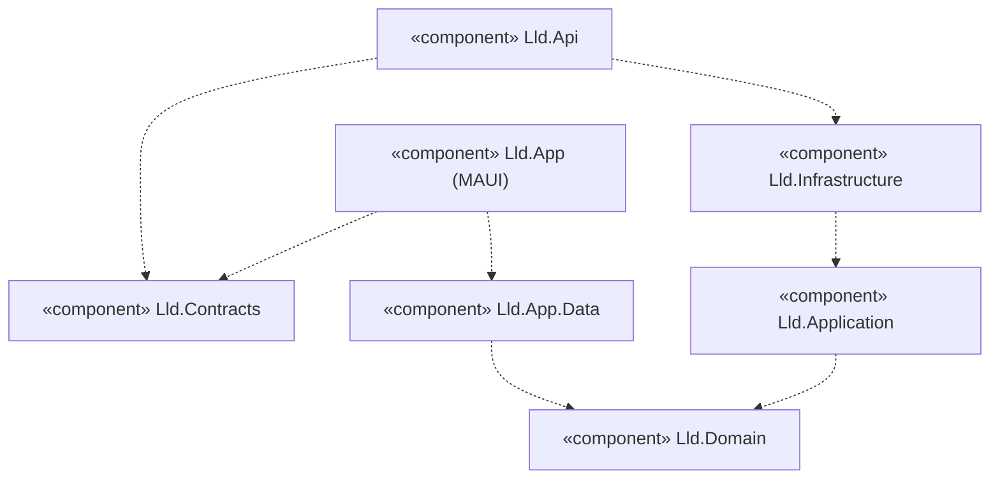
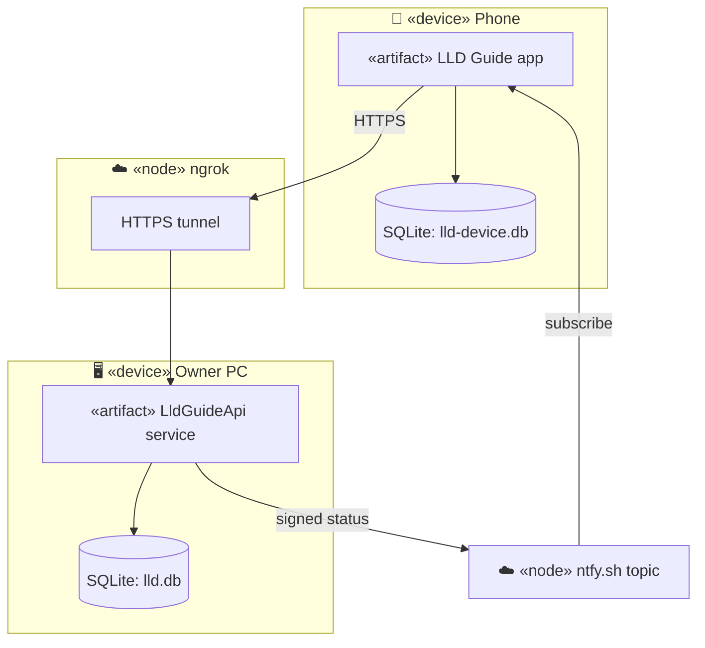

# Component and deployment diagrams

> [!REMEMBER]
> **Component:** which big pieces exist and who depends on whom. **Deployment:** which box runs where, and over what
> wire.

## The idea

A component diagram shows the modules of a system (projects, services, libraries) and the interfaces they offer and
need. A deployment diagram shows the hardware and runtimes (devices, servers, cloud services) and which component
runs on each.

*Draw it when:*

- The question goes beyond one process: "how do the app and the server fit together?".
- You need to show a dependency rule (domain depends on nothing).
- Hosting, networks or offline behaviour matter to the answer.

## Notation

- **Component:** a box with `«component»`. A small **circle** is an interface (a "lollipop") the component offers;
  a line to it from another component means "needs it".
- **Dependency:** a dashed arrow from the component that uses to the one it uses.
- **Node:** a 3D box (here a group) for a device or runtime: phone, server, cloud service.
- **Artifact:** the file that is deployed (`shop.dll`, an `.apk`), drawn inside its node.
- **Link between nodes:** a line labelled with the protocol (`HTTPS`, `SQL`).

Mermaid has no component or deployment diagram, so these are flowcharts with stereotypes and groups.

## Read it

This app's projects: every dashed arrow points **inwards**, towards `Lld.Domain`, which depends on nothing. The
app and the API share only `Lld.Contracts`, the shapes of the messages between them.

## From requirements

- "The guide runs on the owner's PC as a Windows service, with its own SQLite file."
- "Phones reach it through an ngrok tunnel over HTTPS, and keep working offline from a local database."
- "The server announces whether it is online on an ntfy.sh topic the app listens to."

## In an interview

- Draw components when asked about **modules or layers**; draw deployment when asked about **scale, hosting or
  failure** ("what happens when the server is off?").
- Label every link between nodes with its protocol.
- Two minutes and five boxes is usually enough; the class diagram is still the main event in an LLD round.

> [!MISTAKES]
> - Mixing classes into a component diagram: components are big pieces, not types.
> - Dependency arrows pointing outwards from the domain (the core depends on the database).
> - A deployment diagram with no protocols on the links.

## Interview questions

### What is a component?

A replaceable part of the system with clear interfaces: a project, a library, a service. It hides its classes
behind what it offers.

### What does a lollipop mean?

An interface the component provides. Another component connecting to it (a "socket") requires it.

### What is the difference between a node and an artifact?

A node is where things run (a phone, a server, a container); an artifact is the file deployed onto it (`.dll`,
`.apk`, a container image).

### How do you show the dependency rule of a clean architecture?

A component diagram whose dependency arrows all point inwards, to a domain component that depends on nothing.

### When does a deployment diagram matter in an LLD interview?

When the design has to survive the network: offline phones, a server that may be off, queues, caches. Show what runs
where and over which protocol.

## Go deeper

### Ports and adapters

Hexagonal architecture is a component diagram: the domain offers ports (interfaces), and adapters (EF Core, HTTP)
plug in from outside. This app's `Lld.Application` ports (`IUnitOfWork`, `IPasswordPolicy`) are those lollipops.

### Execution environments

Inside a node you can nest an execution environment («container», «runtime»): Phone → .NET MAUI runtime →
WebView → React bundle.

> [!WORK]
> **From my work:** a system you drew as boxes and wires, and the one link that surprised people. (Add your story here.)

### Related

- [Use case diagram](../use-case-diagram/lesson.md) · [DI vs Service Locator](../../enterprise-patterns/di-vs-service-locator/lesson.md)
