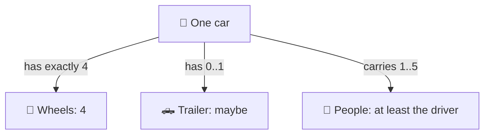
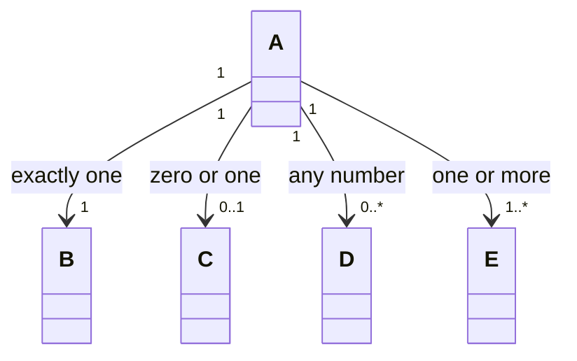
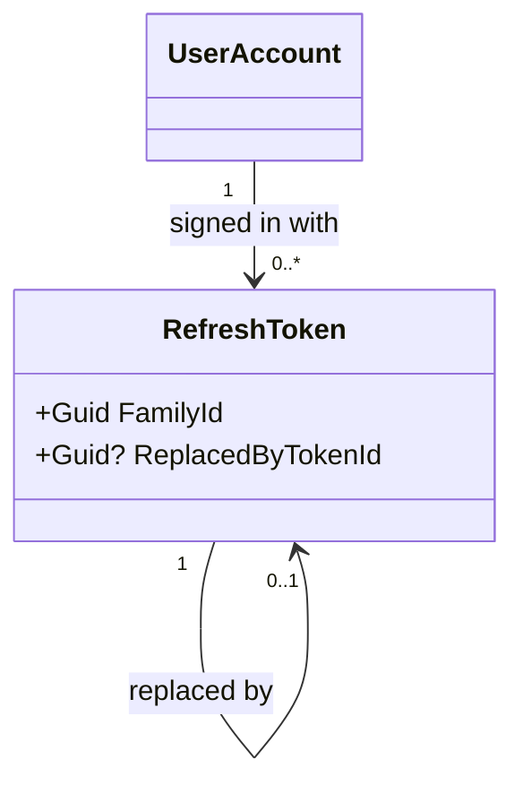

# Multiplicity and navigability

> [!REMEMBER]
> Read the number **at the far end**: "one library holds **0..\*** books". `0..1` is nullable, `1..*` is a list that
> is never empty. The arrowhead says who can find whom.



## The idea

Multiplicity puts numbers on a relationship; navigability puts a direction on it. Together they decide the C# types:
a single reference, a nullable one, or a collection, and on which side.

*Draw it when:*

- "How many?" changes the design (one active session or many?).
- A rule lives in a number: a book has **at least one** author.
- You need to show that one side doesn't know the other.

## Notation



| UML | Say | C# |
|---|---|---|
| `1` | exactly one | `B B { get; }` (required) |
| `0..1` | zero or one | `C? C { get; }` |
| `0..*` or `*` | any number | `IReadOnlyList<D>` |
| `1..*` | one or more | a list checked to be non-empty |
| arrowhead `-->` | only A can find B | B has no reference back |

## Read it



This app's refresh tokens (`Lld.Domain/Sessions`): a user has any number of them (one family per sign-in); each
token is replaced by **at most one** successor when it rotates. The arrows go one way: a token knows its user, the
user doesn't keep a list of tokens.

## Code ↔ UML

```mermaid code="samples/Lld.Samples.Uml/Multiplicity/Library.cs#Library,Book,Author,Member"
classDiagram
    Library "1" o-- "0..*" Book : holds
    Book "0..*" --> "1..*" Author : written by
    Book "0..*" --> "0..1" Member : on loan to
```

`0..*` books is a list, `1..*` authors is a list the constructor refuses to leave empty, `0..1` borrower is a
nullable property. `Member` has no arrow back: it doesn't know its books.

## In an interview

- Put numbers only where they carry a rule or change a type; `1` and `0..*` on everything is noise.
- Say the rule out loud: "a spot holds **0..1** cars, so `ParkingSpot.Car` is nullable".
- Default to **one-way** arrows; add the way back only when a use case needs it.

> [!MISTAKES]
> - Reading the number at the wrong end ("each book has 0..* libraries").
> - Two-way links everywhere: twice the code to keep in sync.
> - `1..*` drawn, but nothing in the code stops an empty list.

## Interview questions

### Where do you read a multiplicity?

At the far end of the line: from Library, "1 library holds 0..* books".

### How does 0..1 map to C#?

A nullable reference (`Member? Borrower`), or an optional value object.

### How do you enforce 1..*?

In the constructor or factory: refuse an empty list, and never offer a way to remove the last item.

### What is navigability?

Which side can reach the other. An arrowhead from Book to Member means a book knows its borrower, not the reverse.

### Why avoid bidirectional associations?

Both ends must be kept in sync, which spreads one rule over two classes. Add the second direction only when a real
query needs it.

## Go deeper

### Ranges and exact numbers

`2..4`, `3`, `0..5` are all valid. Exact upper bounds usually become a check in code (`if (players.Count == 11)
throw`), not a type.

### Many-to-many

`Student "0..*" -- "0..*" Course` becomes a join in a database. In the domain, ask whether the link has data (a
grade): if so, make it a class (`Enrolment`) with two `1` ends.

### Qualified associations

A small box on the line (`Library [isbn] --> 0..1 Book`) says "look up by key": in C#, a `Dictionary<Isbn, Book>`.

> [!WORK]
> **From my work:** a bug that came from a wrong "how many" (a 0..1 that was really 0..*). (Add your story here.)

### Related

- [Relationships: the six arrows](../class-relationships/lesson.md) · [Object diagram](../object-diagram/lesson.md)
