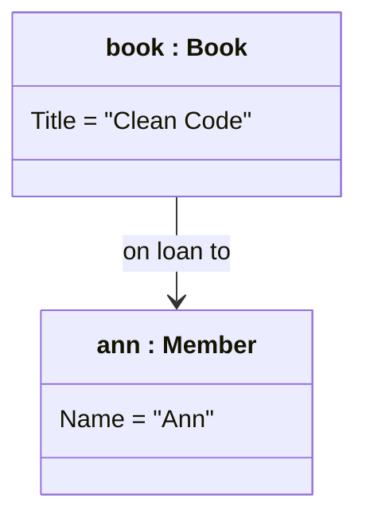

# Cheat sheet: Object diagram

> [!REMEMBER]
> A class diagram is the **blueprint**; an object diagram is a **photo**: `name : Class`, real values, one moment.

## Draw it when

Checking an edge case; counting against multiplicities; explaining a bug's memory.

## The symbols

## From C#

An object diagram is the "arrange" step of a test: `var ann = new Member("Ann"); book.Lend(ann);` draws `book → ann`.

## Mistakes

Types instead of values; multiplicities on links; too many objects.

## Interview one-liners

- "Blueprint versus photo."
- "Three to six objects, named after the example."
- "Draw it to test the class diagram."
