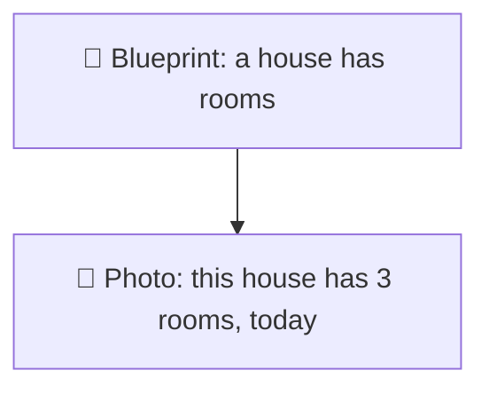
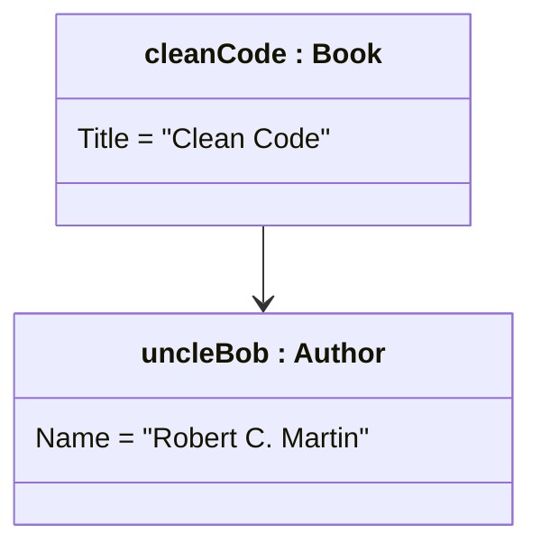
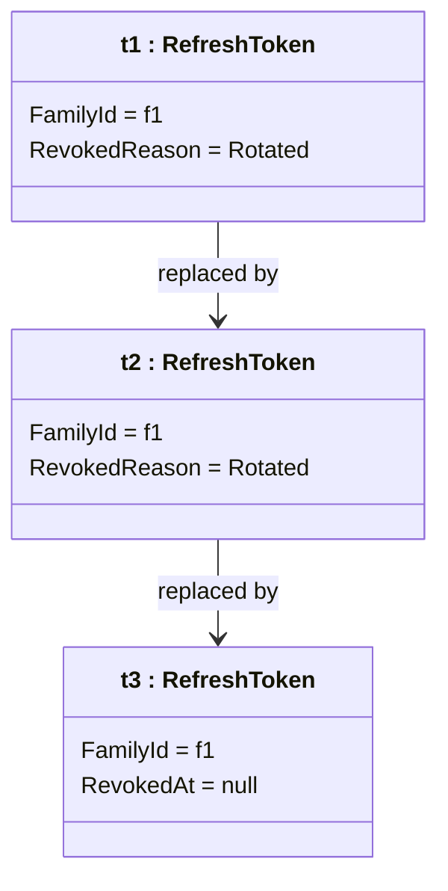
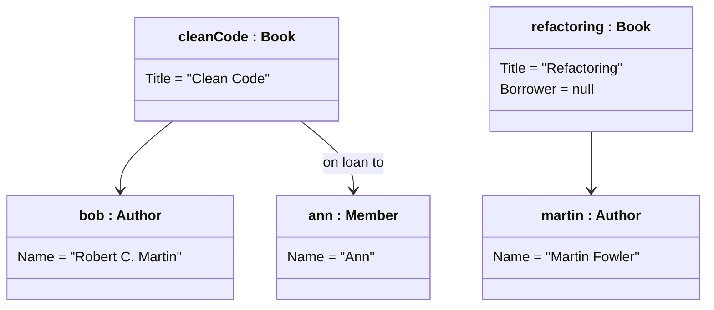

# Object diagram

> [!REMEMBER]
> A class diagram is the **blueprint**; an object diagram is a **photo**: `name : Class`, real values, one moment.

## The idea

An object diagram shows instances, not types: which objects exist at one moment, what their fields hold and which
objects point at which. It answers "does my class diagram really work for this case?".

*Draw it when:*

- A tricky case needs checking (a token rotated twice, a book with two authors).
- Multiplicities are in doubt: draw a real example and count.
- You explain a bug: "at this moment the cache held this, the database held that".

## Notation

- A box is an **object**: `name : Class` (underlined in UML; Mermaid can't underline it).
- The middle holds **values**, `field = value`, not types.
- Lines are **links**: one real reference each. No multiplicities: you are counting real objects.

## Read it

One sign-in in this app after two refreshes: three tokens in family `f1`, the first two revoked as `Rotated`, only
`t3` active. If someone now presents `t1` again, the app sees a revoked token and revokes the whole family.

## From requirements

- "Clean Code, by Robert C. Martin, is on loan to Ann."
- "Refactoring, by Martin Fowler, is on the shelf."

Every link matches an arrow of the [Multiplicity](../multiplicity/lesson.md) class diagram, and every count fits:
each book has one or more authors and at most one borrower.

## In an interview

- Draw one when the interviewer pushes on an edge case: "what does memory look like after two refreshes?".
- Keep it to **3–6 objects**. Name them after the example (`ann`, `cleanCode`), not `obj1`.
- Use it to **check** your class diagram, then go back to the classes.

> [!MISTAKES]
> - Writing types in the boxes instead of values.
> - Putting multiplicities on links (a link is always one reference).
> - Drawing every object in the system instead of the few that explain the case.

## Interview questions

### What is the difference between a class diagram and an object diagram?

A class diagram shows types and their possible relationships; an object diagram shows real instances, their
values and actual links at one moment.

### How is an object named?

`name : Class`, underlined in UML. The name is optional (`: Book`) if the object is anonymous.

### Why use an object diagram in an interview?

To test a design on a concrete case: count real objects and check them against the multiplicities.

### Do links have multiplicities?

No. A link is one reference between two objects; multiplicities belong to the class diagram.

### How is it related to a unit test?

An object diagram is the "arrange" part of a test drawn as a picture: the objects and values before the action.

## Go deeper

### Before and after

Two object diagrams side by side (before and after an operation) explain behaviour without a sequence diagram:
before `Rotate`, one active token; after, the old one revoked and a new one linked.

### Object diagrams in debugging

The debugger's watch window is an object diagram in text. Drawing it helps when references are shared by mistake
(two orders pointing at the same mutable address object).

> [!WORK]
> **From my work:** a bug you explained with a picture of the objects in memory. (Add your story here.)

### Related

- [Multiplicity](../multiplicity/lesson.md) · [Classes and members](../class-basics/lesson.md)
