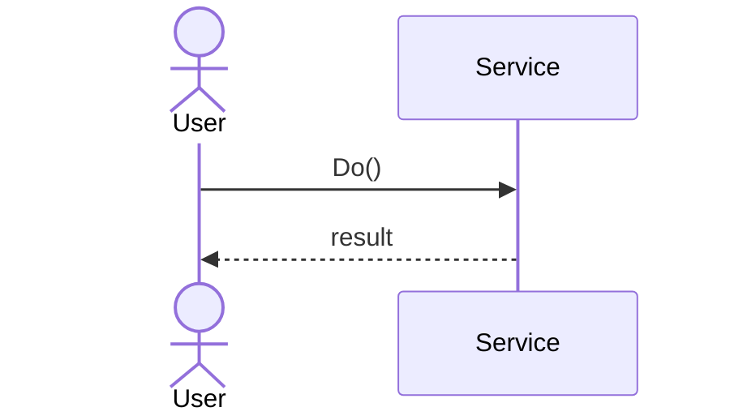

# Cheat sheet: Sequence diagram

> [!REMEMBER]
> **Time runs down the page.** Objects across the top, a solid arrow for each call, a dashed one for each reply.
> `alt` is an if, `loop` is a loop.

## The symbols



`->>` call · `-->>` reply · `-)` async · `alt` / `opt` / `loop` / `par`.

## From C#

```csharp snippet="samples/Lld.Samples.Uml/Sequence/Checkout.cs#CheckoutService.Checkout"
```

Draw it for "walk me through…": each call to another object is one arrow; the `if` is the `alt` box.

## Mistakes

Every getter drawn; messages with no matching method; one diagram for all paths.

## Interview one-liners

- "One scenario per diagram."
- "Every arrow is a method on the receiver."
- "Happy path first, then one alt for the failure."
