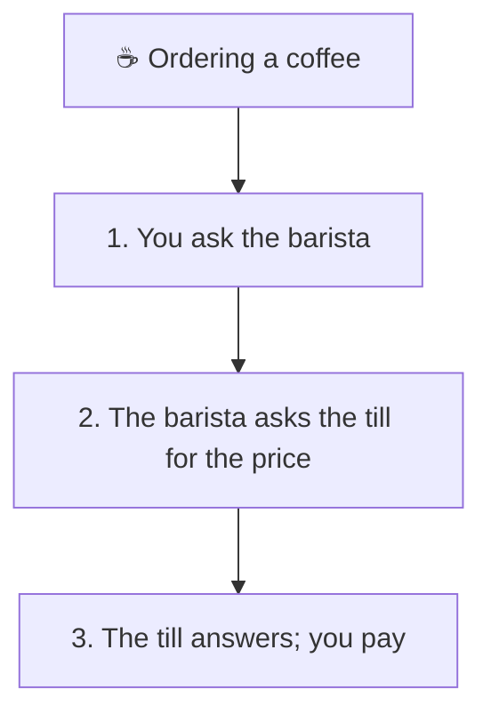
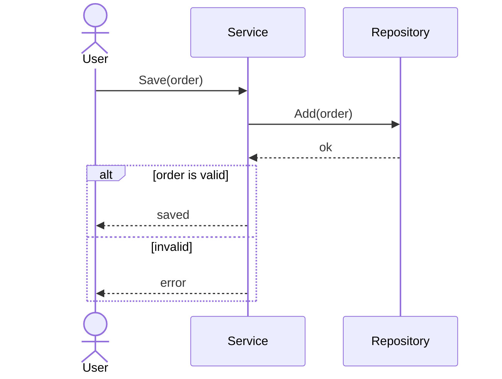
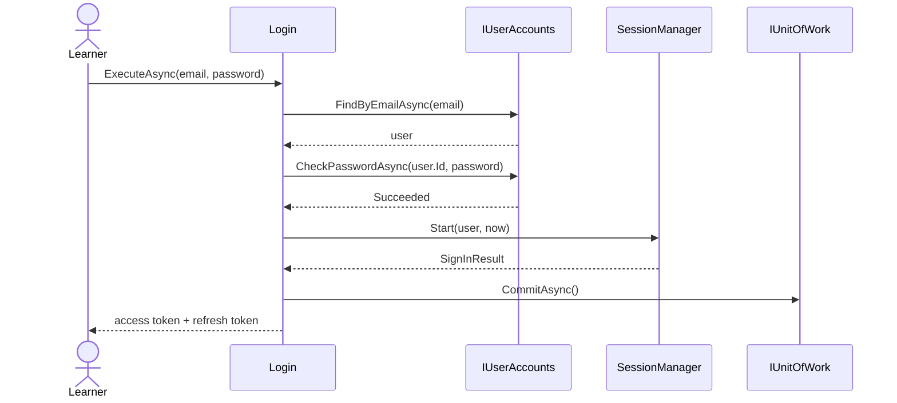

# Sequence diagram

> [!REMEMBER]
> **Time runs down the page.** Objects across the top, a solid arrow for each call, a dashed one for each reply.
> `alt` is an if, `loop` is a loop.



## The idea

A sequence diagram shows one scenario of one use case: which objects take part and which messages they send, in
order. It is the best way to check that the classes on a class diagram can really do the job.

*Draw it when:*

- The interviewer asks "walk me through what happens when…".
- A flow crosses several classes and the order matters (charge, **then** send the receipt).
- You need to show what happens when something fails.

## Notation



- **Lifeline:** a participant across the top with a dashed line down. People are `actor`s.
- **Message:** a solid arrow `->>` is a call; a dashed arrow `-->>` is the reply. Label it like the method.
- **Activation:** the thin bar on a lifeline while it is busy (Mermaid: `+` / `-` on an arrow).
- **Fragments:** `alt` / `else` (if), `opt` (if with no else), `loop`, `par` (in parallel).

## Read it



This app's sign-in (`Lld.Application/Auth/Login.cs`): find the user, check the password, then the
`SessionManager` issues an access token and a new refresh token, and one commit saves everything. Press *Step
through* to play it one message at a time.

## Code ↔ UML

```mermaid code="samples/Lld.Samples.Uml/Sequence/Checkout.cs#CheckoutService,Cart,IPaymentGateway,IReceiptSender"
sequenceDiagram
    actor U as Shopper
    participant C as CheckoutService
    participant Cart
    participant P as IPaymentGateway
    participant R as IReceiptSender
    U->>C: Checkout(cart, card)
    C->>Cart: Total()
    Cart-->>C: total
    C->>P: Charge(card, total)
    P-->>C: Payment
    alt approved
        C->>R: Send(receipt)
        C-->>U: Receipt
    else declined
        C-->>U: null
    end
```

Each arrow is one line of `Checkout`: the `if (!payment.Approved)` is the `alt` box. The sample's tests check the
order (charge, then send) and that a declined card sends nothing.

## In an interview

- One diagram per **scenario**: the happy path first, then one `alt` for the failure that matters.
- Use the **method names** from your class diagram; a message that has no method means a missing operation.
- Five or six participants at most; group the rest ("Infrastructure").

> [!MISTAKES]
> - Drawing every getter and log call: the story drowns.
> - Messages that don't exist on the receiving class.
> - One giant diagram for every path instead of one per scenario.

## Interview questions

### What does a sequence diagram show?

One scenario: the objects involved, the messages between them and their order in time, top to bottom.

### Solid versus dashed arrows?

Solid is a call (synchronous message); dashed is the return. An open arrowhead is an asynchronous message.

### How do you show an if or a loop?

With combined fragments: `alt` / `else` for if-else, `opt` for an optional step, `loop` for repetition, `par` for
parallel work.

### How does it relate to the class diagram?

Every message must be an operation on the receiver's class. Drawing the sequence often reveals a missing method or
a class that does too much.

### What is a lifeline?

The vertical dashed line under a participant: that object over time. An activation bar on it shows when it is busy.

## Go deeper

### Asynchronous calls

`-)` in Mermaid draws an async message: the sender doesn't wait (a queue, an event). Show the reply, if any, as a
separate message later.

### Creating and destroying

A message can point at a participant's box to show it is **created** at that moment (`new Receipt`), and an X at
the end of a lifeline shows it is destroyed. Mermaid supports `create participant` and `destroy` in recent versions.

### Sequence numbers

`autonumber` numbers every message; handy when you talk through it: "at step 4 the payment fails".

> [!WORK]
> **From my work:** a production incident you explained with a sequence of calls. (Add your story here.)

### Related

- [Use case diagram](../use-case-diagram/lesson.md) · [State diagram](../state-diagram/lesson.md) ·
  [Case study: Authentication](../../case-studies/auth/lesson.md)
