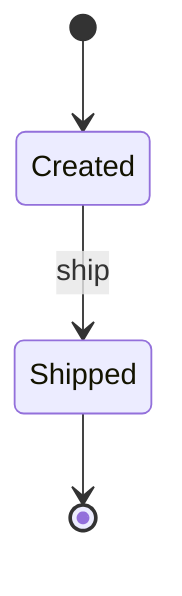

# Cheat sheet: State diagram

> [!REMEMBER]
> Rounded boxes are **states**, arrows are **events**. A black dot starts, a ringed dot ends. If there is no arrow,
> the action is **refused**.

## Draw it when

A status field; "what can happen next?"; a `switch (Status)` in several methods.

## The symbols



`event [guard] / action` on an arrow · self-transition · composite state.

## From C#

```csharp snippet="samples/Lld.Samples.Uml/State/Parcel.cs#Parcel"
```

Each method is allowed in one source state and moves to one target: one arrow each.

## Mistakes

States named as actions; no initial state; refused events not stated.

## Interview one-liners

- "No arrow, no transition: everything else is refused."
- "Events use the method names."
- "Too many states? Two machines in one."
