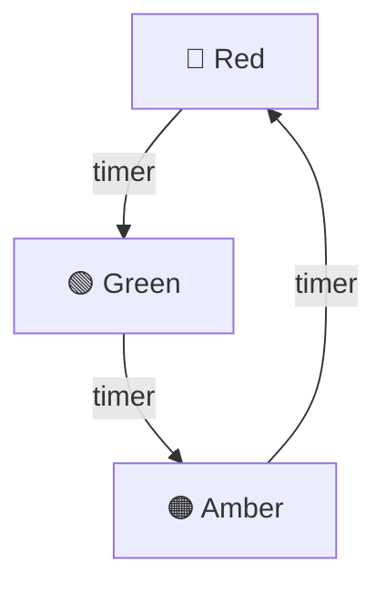
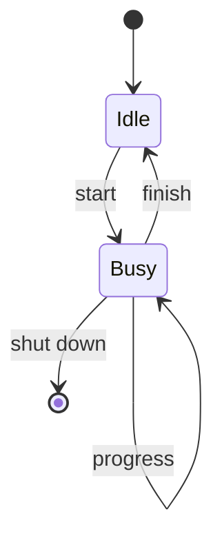
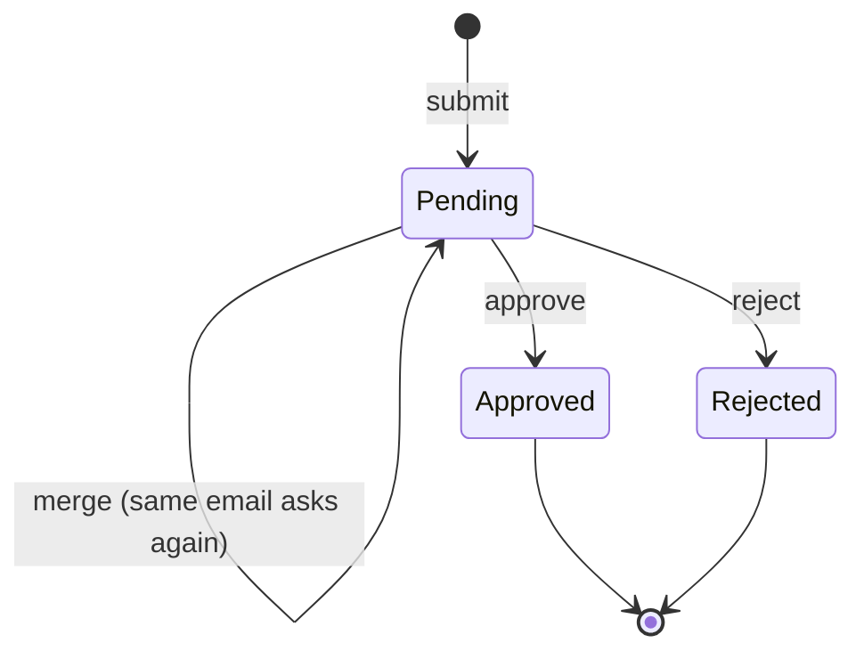

# State diagram

> [!REMEMBER]
> Rounded boxes are **states**, arrows are **events**. A black dot starts, a ringed dot ends. If there is no arrow,
> the action is **refused**.



## The idea

A state diagram (state machine) shows the lifecycle of one object: every state it can be in and the events that
take it from one state to another. It is the clearest way to state the rules of anything with a status column.

*Draw it when:*

- An entity has a status: an order, a ticket, a parcel, an elevator, a vending machine.
- The question is "what can happen next?" or "what if they cancel after shipping?".
- You are about to write a `switch (Status)` in several methods (consider the State pattern).

## Notation



- **State:** a rounded box. **Initial state:** the black dot `[*]` and its arrow. **Final state:** `[*]` as a target.
- **Transition:** an arrow labelled with the **event** that fires it, optionally `event [guard] / action`, e.g.
  `pay [amount ok] / print ticket`.
- **Self-transition:** an arrow back to the same state (the event is handled, the state doesn't change).
- **Composite state:** a state with its own little machine inside (Mermaid: `state Busy { … }`).

Tap a state to trace its transitions, or press **run** and fire events one at a time.

## Read it



This app's `AccessRequest` (`Lld.Domain/Access`): only a pending request can change; approving or rejecting it is
final, and the code returns `access_request.not_pending` for anything else. The State pattern implements this
diagram: `PendingState` and `DecidedState`.

## Code ↔ UML

```mermaid code="samples/Lld.Samples.Uml/State/Parcel.cs#ParcelStatus,Parcel"
stateDiagram-v2
    [*] --> Created
    Created --> Shipped : ship
    Created --> Cancelled : cancel
    Shipped --> Delivered : deliver
    Delivered --> [*]
    Cancelled --> [*]
```

Each state is a `ParcelStatus` member, and each arrow is one method that is allowed only in its source state. The
sample's tests try **every** action in **every** state: the three drawn ones work, the nine others are refused.

## In an interview

- Draw it as soon as you see a status field; walk the interviewer through one **illegal** event and say what
  happens (an error, ignored, or logged).
- Keep events in the domain's words (`approve`, `ship`), the same names as the methods.
- Ten states or more usually means two machines (payment state and delivery state) hiding in one.

> [!MISTAKES]
> - States named as actions ("Shipping") instead of conditions ("Shipped").
> - No initial state, or final states that still have arrows out.
> - Forgetting the refused events: the diagram is only half the rule without "everything else fails".

## Interview questions

### What is a state machine?

A model of an object that is always in exactly one of a finite set of states, and moves between them only on
defined events.

### What is a guard?

A condition in square brackets on a transition (`[balance >= amount]`): the event only moves the object when it
is true.

### How does a state diagram map to code?

An enum plus methods that check the current state, or the State pattern: one class per state, each handling the
events it allows.

### What is a self-transition?

An arrow from a state back to itself: the event is accepted and may run an action, but the state stays the same.

### When do you need a composite state?

When several states share the same exits (a "Cancel" that works from any of the "In progress" sub-states): draw them
inside one composite state with one Cancel arrow.

## Go deeper

### Entry, exit and do actions

Inside a state box UML can list `entry / start timer`, `exit / stop timer`, `do / poll`. In code these are what the
state class runs when it is entered, left, or while it is active.

### History states

An `H` in a composite state means "go back to the sub-state you were in last" (pause and resume a video).

### Tables

A state transition **table** (state × event → new state) is the same information as the diagram; it is easier to
check for gaps. The sample's test theory is exactly that table.

> [!WORK]
> **From my work:** a status field that grew too many states, and how you split it. (Add your story here.)

### Related

- [State pattern](../../gof-patterns/state/lesson.md) · [Sequence diagram](../sequence-diagram/lesson.md) ·
  [Activity diagram](../activity-diagram/lesson.md)
