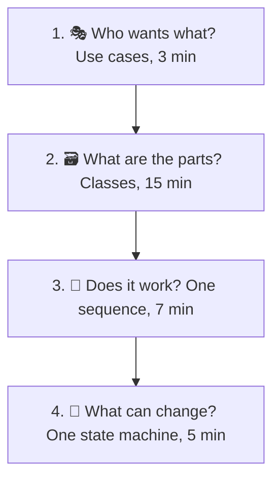
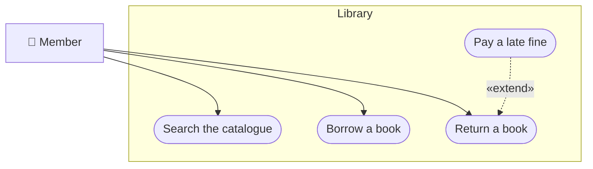
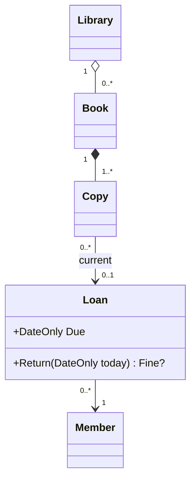
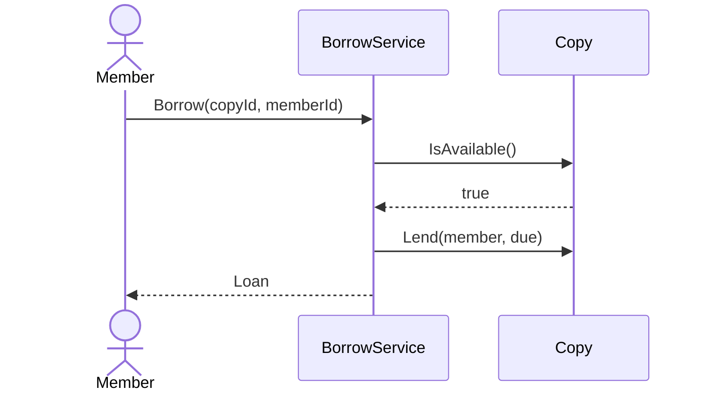
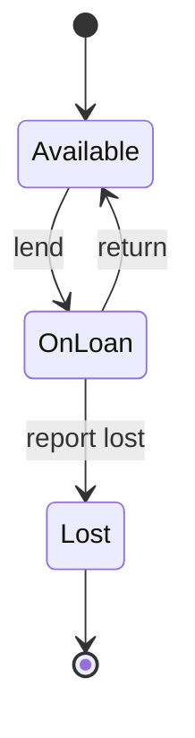

# UML in an LLD interview

> [!REMEMBER]
> Sketch in this order: **goals** (use cases) → **classes** → **one flow** (sequence) → **one lifecycle** (state).
> Draw only what answers the question in front of you.

## The idea

UML in an interview is a thinking tool, not a deliverable. Each diagram answers one kind of question; the skill is
picking the right one fast and drawing just enough of it. Use **Which diagram?** on the module page when unsure.

*Draw it when:*

- Always: a class diagram is expected in any LLD round.
- The other diagrams when the question leans their way (flows, lifecycles, workflows, hosting).
- To check yourself: a sequence diagram tests the classes; an object diagram tests the numbers.

## Which diagram for which question

| The interviewer asks… | Draw | Lesson |
|---|---|---|
| "What should it do? For whom?" | Use case | [Use case diagram](../use-case-diagram/lesson.md) |
| "Design the classes." | Class | [Classes and members](../class-basics/lesson.md), [Relationships](../class-relationships/lesson.md) |
| "How many X per Y?" | Class with multiplicities | [Multiplicity](../multiplicity/lesson.md) |
| "What does memory look like after…?" | Object | [Object diagram](../object-diagram/lesson.md) |
| "Walk me through what happens when…" | Sequence | [Sequence diagram](../sequence-diagram/lesson.md) |
| "What states can it be in?" | State | [State diagram](../state-diagram/lesson.md) |
| "What's the process / workflow?" | Activity | [Activity diagram](../activity-diagram/lesson.md) |
| "How is it split up and deployed?" | Component, deployment | [Component and deployment](../component-deployment/lesson.md) |

## Worked example

*"Design a library system."* Four sketches, in order.

### 1. Goals (3 minutes)

Ask: "Shall I focus on borrowing and returning?" The interviewer usually says yes.

### 2. Classes (15 minutes)

A **copy** is the thing on the shelf; a **book** is the title. Splitting them answers "two copies of the same book".

### 3. One flow (7 minutes)

### 4. One lifecycle (5 minutes)

Then go to code for the remaining time; the diagrams have already answered most follow-up questions.

## In an interview

- Say what you are drawing and why: "a quick use case sketch to agree on scope".
- Draw **boxes before details** and **names before arrows**; add members last.
- Keep diagrams consistent: every message in the sequence is a method in a class; every event in the state machine
  is a method too.
- When short on time, skip the use case and state diagrams; never skip the class diagram.

> [!MISTAKES]
> - Starting with code and drawing nothing, so the interviewer can't follow the design.
> - Drawing five diagrams in full detail and running out of time for code.
> - Diagrams that disagree with each other (a message with no method, an event with no transition).

## Interview questions

### Which UML diagrams matter most in an LLD interview?

The class diagram always; then sequence (to prove a flow works) and state (for anything with a status). Use case
and activity help with scope and workflows.

### How do you start an LLD round?

Clarify requirements, sketch the use cases in a minute or two, agree on which flows to design, then go to classes.

### How much detail do you put on a class diagram?

Names, key attributes, the public methods the flows need, the relationships with multiplicities that carry rules.
No getters, no logging.

### How do you check your class diagram?

Draw one sequence diagram for the main use case: every message must be a method on the receiver, and the data each
step needs must be reachable.

### What if the interviewer doesn't care about UML?

Draw boxes and arrows anyway, informally: the point is a shared picture. Use UML's arrows because they are precise,
not because they are expected.

## Go deeper

### A 45-minute plan

| Minutes | Do |
|---|---|
| 0–5 | Clarify requirements; use case sketch |
| 5–20 | Class diagram; patterns where they fit |
| 20–27 | One sequence diagram for the main flow |
| 27–32 | State machine for the entity with a status |
| 32–45 | Code the core classes; talk through tests and extensions |

### Whiteboard tips

- Leave space between boxes; arrows always need more room than you think.
- Write the method names exactly as you will code them.
- Put the actor on the left of a sequence diagram; time flows down.

> [!WORK]
> **From my work:** an interview (on either side of the table) where one diagram turned it around. (Add your story here.)

### Related

- [Case study: Authentication](../../case-studies/auth/lesson.md) · [Use case diagram](../use-case-diagram/lesson.md) ·
  [Classes and members](../class-basics/lesson.md)
