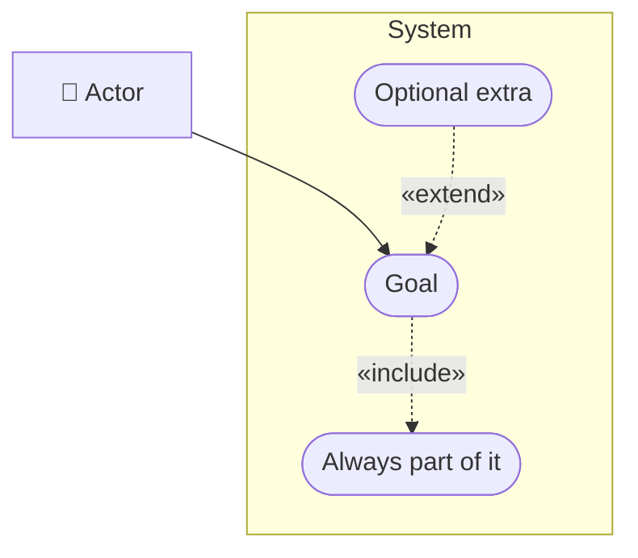

# Cheat sheet: Use case diagram

> [!REMEMBER]
> **Actors** stand outside the box, **goals** sit inside as ovals. A use case is a verb phrase the actor would say:
> "Park a car", not "ParkingService".

## Draw it when

The prompt is vague; scope needs agreeing; several roles want different things.

## The symbols

## From C#

Each use case often becomes one application-layer class: this app's `SubmitAccessRequest`, `Login`, `ApproveAccessRequest`.

## Mistakes

Classes or screens as use cases; steps as use cases; «include» and «extend» swapped.

## Interview one-liners

- "What, not how."
- "Include always runs; extend sometimes."
- "Sketch it first, then ask which flow to design."
