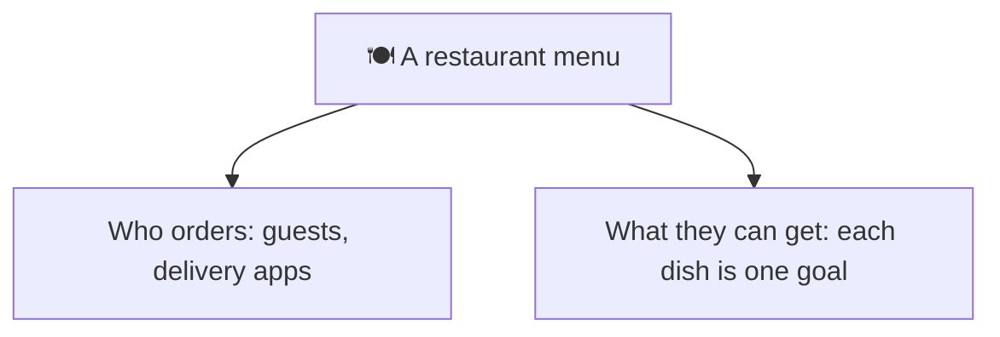
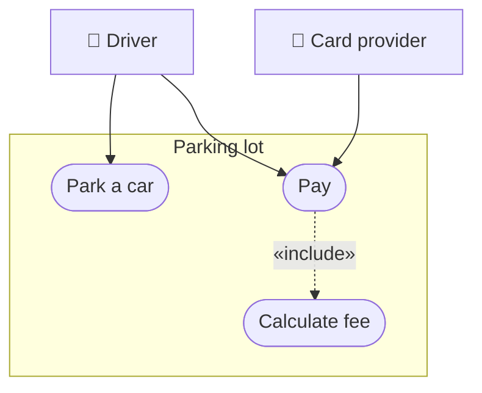
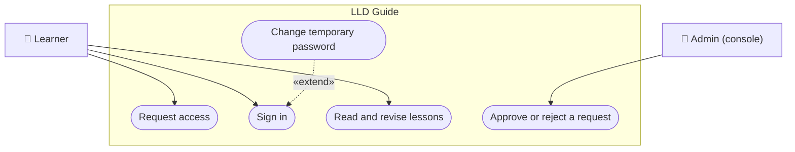
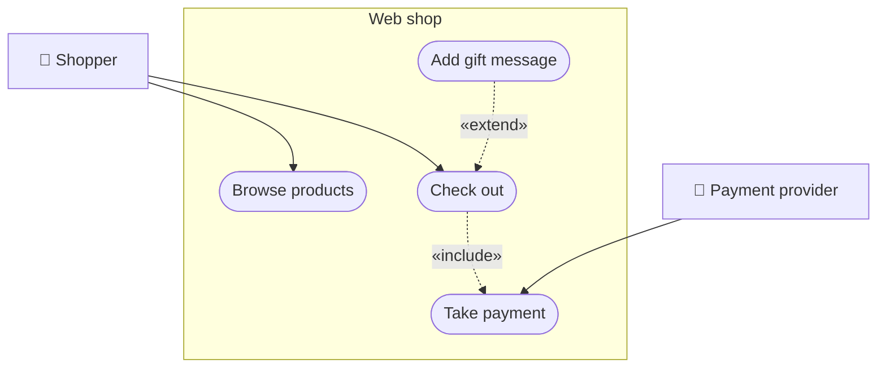

# Use case diagram

> [!REMEMBER]
> **Actors** stand outside the box, **goals** sit inside as ovals. A use case is a verb phrase the actor would say:
> "Park a car", not "ParkingService".

## The idea

A use case diagram shows the system's boundary, the people and systems that use it (actors), and what each of them
can achieve (use cases). It is about **what**, never **how**.

*Draw it when:*

- The interview starts with a vague prompt: "design a parking lot".
- You need to agree on scope: what is in, what is out.
- Different roles want different things (driver, attendant, admin).

## Notation

- **Actor:** a stick figure (here an emoji) outside the box. It can be a person or another system.
- **Use case:** an oval inside the **system boundary**, named as a goal.
- **Association:** a plain line between an actor and a use case it takes part in.
- **«include»:** a dashed arrow to a step that **always** happens as part of it (paying always calculates a fee).
- **«extend»:** a dashed arrow from an **optional** extra back to the use case it extends.

Mermaid has no use case diagram; this is a flowchart with an emoji actor, stadium-shaped ovals and a group box.

## Read it

This app: there is no sign-up, so a learner **requests access** and an admin **approves** it from the console.
On the first sign-in the learner must change the temporary password: an optional extra on sign in, so «extend».

## From requirements

- "A shopper browses products and checks out."
- "Checking out always takes a payment; the shopper may add a gift message."
- "The payment provider confirms each payment."

## In an interview

- Sketch it in the **first 3 minutes**, then ask: "which of these should I design?". Interviewers often pick one.
- Each use case you keep becomes one [sequence diagram](../sequence-diagram/lesson.md) later.
- Leave out login unless the question is about it; it is in every system.

> [!MISTAKES]
> - Use cases named after classes or screens ("OrderService", "Login page") instead of goals.
> - Steps drawn as use cases ("Click Pay", "Validate card"): those are flows, not goals.
> - Mixing up the arrows: «include» points to the step that always happens; «extend» points from the optional extra.

## Interview questions

### What is an actor?

A role outside the system that interacts with it: a person (driver), another system (payment provider) or a timer.

### What is the difference between «include» and «extend»?

«include»: the base use case always runs the included one (checkout includes payment). «extend»: an optional
behaviour that adds to the base under some condition (a gift message extends checkout).

### What makes a good use case name?

A goal in the actor's words, verb first: "Park a car", "Request access". Not a class, screen or button.

### Why draw a use case diagram in an LLD interview?

To agree on scope in a minute before designing classes, and to pick which flows to go deep on.

### Can an actor be a system?

Yes. Anything outside the boundary that exchanges messages with it: a payment provider, an email service, a cron
job.

## Go deeper

### Use case descriptions

Each oval usually has a text card: actor, preconditions, main flow (numbered steps), alternative flows, and
postconditions. The main flow is what a sequence diagram draws; the alternatives become `alt` blocks.

### Generalisation

Actors can inherit (an "Admin" is a "Learner" who can also approve), drawn with a hollow triangle. Use it rarely;
it confuses more than it helps on a whiteboard.

> [!WORK]
> **From my work:** a project where the first scope talk changed what got built. (Add your story here.)

### Related

- [Sequence diagram](../sequence-diagram/lesson.md) · [Activity diagram](../activity-diagram/lesson.md) ·
  [UML in an LLD interview](../uml-in-interviews/lesson.md)
