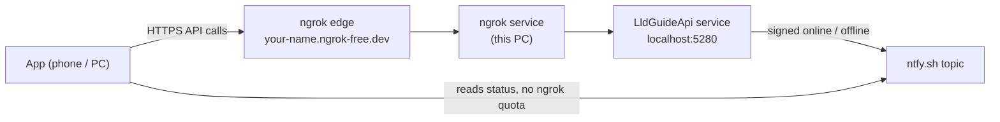

# Hosting the API on this PC

How the LLD Guide API is exposed to real devices (spec 002). The API runs as a Windows service on this PC.
**ngrok** gives it a public HTTPS address, and **ntfy.sh** tells apps whether it's online.



| What | Where |
|---|---|
| API binaries | `C:\LldGuide\api` (service `LldGuideApi`, virtual account `NT SERVICE\LldGuideApi`) |
| Admin console (hosted copy) | `C:\LldGuide\admin\lld-admin.exe` |
| Database | `C:\ProgramData\LldGuide\data\lld.db` |
| Secrets (DPAPI-protected) | `C:\ProgramData\LldGuide\secrets\*.secret` |
| ngrok config (holds the authtoken) | `C:\ProgramData\LldGuide\ngrok.yml` (service `ngrok`) |
| Backups | `D:\Applications\LldGuide\backups` (task `LldGuide Backup`, daily 13:00, keeps 14 days) |
| Settings | `src/Lld.Api/appsettings.Production.json` (no secrets) |

## 1. ngrok account and static domain (one-time, ~5 minutes)
1. Sign up (free) at <https://dashboard.ngrok.com/signup>.
2. Get your free static domain: in the dashboard open **Universal Gateway → Domains**. Free accounts get one
   `*.ngrok-free.dev` domain; create or claim it if one isn't listed. Write it down; it becomes the app's
   API base URL (`https://<your-domain>`).
   The domain shows **Offline** until an agent connects to it, which is expected. **Don't create an endpoint in the
   dashboard** (no Cloud Endpoint, no traffic policy). The agent on this PC creates the endpoint when it starts:
   step 5 below for a quick test, and the `ngrok` Windows service after `install.ps1`. The domain then shows
   **Online**.
3. Copy your **authtoken** from **Getting Started → Your Authtoken**. Treat it like a password: it never goes into the
   repo. `install.ps1` asks for it once and stores it only in `%ProgramData%\LldGuide\ngrok.yml`.
4. Install the agent (PowerShell). The winget ID is case-sensitive with `-e`, and the winget package lags
   behind (3.3.x), so update the agent right after installing it:
   ```powershell
   winget install --id Ngrok.Ngrok -e
   # open a new terminal so ngrok is on PATH, then:
   ngrok update
   ngrok version   # expect 3.2x or newer
   ```
   Alternative: download the Windows zip from <https://ngrok.com/download>, extract `ngrok.exe` to a folder on
   your PATH (e.g. `C:\Tools\ngrok`), then run `ngrok version`.
5. Optional smoke test (before installing): start the API locally, then
   ```powershell
   dotnet run --project src/Lld.Api --launch-profile http     # terminal 1 (port 5281)
   ngrok config add-authtoken <your-authtoken>                # terminal 2, once
   ngrok http 5281 --url https://<your-domain>
   ```
   and open `https://<your-domain>/health` from your phone on mobile data. It should answer `Healthy` (a browser
   shows ngrok's warning page first; the app skips it with the `ngrok-skip-browser-warning` header).
   Stop both with `Ctrl+C`; the domain goes back to Offline.

Free-plan limits the app is designed around: **20,000 HTTP requests and 1 GB data per month**. Check when your
monthly usage resets in the dashboard (**Billing / Usage**) and note the day; if it isn't the 1st, set
`Budget:ResetDayOfMonth` in `src/Lld.Api/appsettings.Production.json` before installing.

## 2. Install the services
Run in an **elevated** PowerShell (Run as administrator) from the repo root:
```powershell
.\deploy\install.ps1 -Domain <your-domain>          # e.g. -Domain example-name.ngrok-free.dev
```
- It asks for the ngrok authtoken once (hidden input) and reuses it on later runs. **Paste it with right-click or
  Ctrl+Shift+V**: in Windows PowerShell, Ctrl+V types a control character into a hidden prompt instead of pasting.
  If you already ran `ngrok config add-authtoken`, it reuses that token and doesn't ask.
- Re-run it after pulling new code: it stops the service, republishes and restarts.
- `-WhatIf` shows every step without changing anything.
- At the end it checks `http://localhost:5280/health` and `https://<your-domain>/health`.

`lld-admin hosting init` (run by the installer) prints the **app build settings**. Keep that output:

| Setting | Where it goes |
|---|---|
| `ServerStatus:PublicKey` | `src/Lld.App/appsettings.json` (committed; it's public) |
| `ServerStatus:Topic` | `src/Lld.App/appsettings.local.json` (git-ignored) |
| `Api:BaseUrl` | `src/Lld.App/appsettings.local.json` (git-ignored) |

`appsettings.local.json` looks like this:
```json
{
  "Api": { "BaseUrl": "https://<your-domain>" },
  "ServerStatus": { "Topic": "lld-<32 hex characters>" }
}
```

Then create your admin account and check the budget, using the **hosted** admin console (the `dotnet run`
copy uses the development database):
```powershell
C:\LldGuide\admin\lld-admin.exe users create <you@example.com> --role admin
C:\LldGuide\admin\lld-admin.exe status budget
```

### Everyday commands
| Task | Command |
|---|---|
| Is it running? | `Get-Service LldGuideApi, ngrok` |
| Stop / start the API | `Stop-Service LldGuideApi` / `Start-Service LldGuideApi` (apps switch to offline / online) |
| Planned maintenance notice | `C:\LldGuide\admin\lld-admin.exe status publish offline` |
| Backup now / list | `C:\LldGuide\admin\lld-admin.exe backup run` / `backup list` |
| Replace the status signing key | `lld-admin.exe status keygen --force`, restart the service, rebuild the apps |
| Remove everything except data | `.\deploy\uninstall.ps1` (elevated) |

### Security notes
- Kestrel listens on `localhost:5280` only, so the API isn't reachable from your LAN; ngrok is the only way in.
- Secrets are encrypted with DPAPI (machine scope). DPAPI ties them to this PC, but any process on the PC could
  decrypt them, so the folder ACL is the real control: SYSTEM, Administrators, the API service and your account.
- The ntfy topic ships inside the app, so treat it as public. Apps trust only messages signed with the PC's
  private key; a forged or replayed message is ignored.
- Backups contain password hashes. The backup folder is restricted to SYSTEM, Administrators and your account.

## 3. Dev Tunnels fallback
Use this only if ngrok is unavailable. Microsoft Dev Tunnels has no published request cap (5 GB/month), but the URL is
generated, and an unused tunnel is deleted after 30 days. Switching means **rebuilding the app** with the new
`Api:BaseUrl`.
```powershell
devtunnel user login                                 # once
devtunnel create lld-api --allow-anonymous           # a persistent tunnel
devtunnel port create lld-api -p 5280 --protocol http
devtunnel host lld-api                               # keep running; prints https://<id>-5280.<region>.devtunnels.ms
```
- Stop the ngrok service first (`ngrok service stop`), then put the printed URL in `appsettings.local.json`
  (`Api:BaseUrl`), run `lld-admin.exe hosting init --public-url <url>`, restart `LldGuideApi` and rebuild the app.
- `devtunnel host` isn't a service. To survive reboots, add a scheduled task "At startup" that runs it as your
  user ("Run whether user is logged on or not").

## 4. Troubleshooting
| Symptom | Check |
|---|---|
| `install.ps1`: "ngrok not found" | Open a new terminal after installing ngrok (PATH), or use the zip download |
| `ngrok config check` fails on `endpoints` | Old agent: run `ngrok update` (needs 3.2x+) |
| Local health OK, public health fails | `Get-Service ngrok`; dashboard → Domains shows Online? Check the authtoken in `ngrok.yml`; agent log: `ngrok service start` errors appear in Event Viewer → Application |
| Public health returns ngrok error `ERR_NGROK_8012` | The API isn't running: `Start-Service LldGuideApi`; then Event Viewer → Application → source `LldGuideApi` |
| Service starts then stops | Event Viewer → Application. Common causes: missing secret (re-run `install.ps1`), port 5280 in use (`netstat -ano \| findstr 5280`) |
| Apps stay "Server offline" while it's up | Topic or public key in the app doesn't match `hosting init` output; or `status budget` is ≥ 95 % |
| `lld-admin.exe` "access denied" on the database | Run it as the user who ran `install.ps1`, or from an elevated terminal |
| Budget differs from ngrok's dashboard | The app's count is an estimate (headers are approximated); trust ngrok's dashboard |
