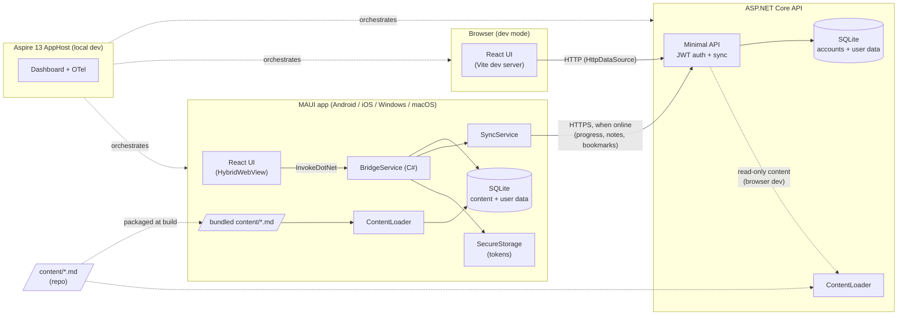
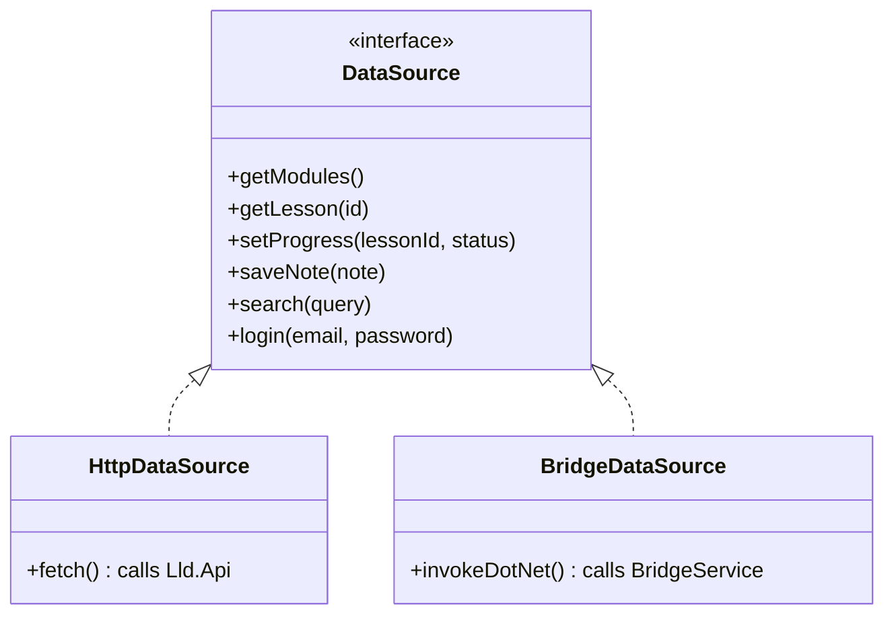

# Implementation Plan — LLD Guide

Companion to [`PRD.md`](./PRD.md). This describes **how** the app is built: architecture,
solution layout, spec roadmap, workflow and testing.

## 1. Architecture



### One UI, two transports

`createDataSource()` picks the implementation at startup based on whether
`window.HybridWebView` exists. This is the Strategy + Adapter pattern and becomes lesson material.

### Who owns which data
| Data | Lives on | Synced? | Notes |
|---|---|---|---|
| Lessons + cheat sheets | **Device** (bundled with the app → local SQLite) | No | Updated by app updates; Phase 2 admin UI may add server-delivered lessons |
| Progress, notes, bookmarks | **Device** (local SQLite) | Yes, via API | Saved locally first; `SyncService` pushes/pulls when online |
| Accounts, refresh tokens | **API** | — | Device keeps only its tokens in `SecureStorage` |
| Content (copy) | API, read-only | — | Only for the browser dev mode and Playwright tests |

The UI **never waits on the network**. In MAUI, React → `BridgeService` → local SQLite.
In the browser (dev only) there is no local DB, so `HttpDataSource` calls the API.

### Aspire AppHost (sketch)
```csharp
var builder = DistributedApplication.CreateBuilder(args);

var api = builder.AddProject<Projects.Lld_Api>("api")
                 .WithEnvironment("ConnectionStrings__lld", "Data Source=lld.db");

builder.AddViteApp("web", "../../web")
       .WithReference(api);

var maui = builder.AddMauiProject("app", "../Lld.App/Lld.App.csproj");
maui.AddWindowsDevice().WithReference(api);
maui.AddAndroidEmulator().WithOtlpDevTunnel().WithReference(api /* via dev tunnel */);

builder.Build().Run();
```
Exact APIs are verified in spec 000 against the current Aspire 13 packages
(`Aspire.Hosting.Maui`, `Aspire.Hosting.JavaScript`).

## 2. Solution layout
```
LowLevelDesignGuide/
├─ .claude/skills/            # emilkowalski skills + lld-case-study
├─ docs/                      # PRD.md, plan.md, adr/
├─ specs/NNN-name/            # spec.md, plan.md, tasks.md
├─ content/                   # lessons + cheat sheets (Markdown + front-matter); packaged into the app
│  ├─ oop-solid/  patterns/  uml/  case-studies/
├─ web/                       # React + Vite + TS
├─ src/
│  ├─ Lld.AppHost/            # Aspire orchestration
│  ├─ Lld.ServiceDefaults/    # OTel, health checks, resilience
│  ├─ Lld.Domain/             # entities, value objects (no dependencies)
│  ├─ Lld.Application/        # use cases + ports (IAuthService, ITokenService, ...)
│  ├─ Lld.Infrastructure/     # EF Core SQLite, Identity, repositories, seeder
│  ├─ Lld.Api/                # Minimal API endpoints
│  ├─ Lld.Contracts/          # DTOs shared by Api + App
│  ├─ Lld.Content/            # Markdown + front-matter parser (ContentLoader), shared by App + Api
│  └─ Lld.App/                # MAUI: HybridWebView shell, BridgeService, local DB, sync
├─ tests/
│  ├─ Lld.Domain.Tests/  Lld.Application.Tests/  Lld.Api.Tests/
│  └─ Lld.IntegrationTests/   # Aspire.Hosting.Testing
└─ LowLevelDesignGuide.slnx
```
Dependency rule: `Domain ← Application ← Infrastructure ← Api`; `Contracts` has no
dependencies; `App` depends on `Contracts` (+ its own local infrastructure).

## 3. Spec roadmap

Build order is **interleaved** (decided 2026-10-14): once the reader exists (002),
feature specs and content specs alternate, so the app is useful for learning early
and every feature is tested with real lessons. Spec numbers follow build order.

| # | Kind | Spec | Scope | Done when |
|---|---|---|---|---|
| **000** | Feature | Foundation | Solution skeleton (.NET 10), Aspire AppHost, ServiceDefaults, empty API with health endpoint, React shell (routing, layout, `DataSource`), MAUI app hosting the React build, GitHub Actions CI | `aspire run` shows api + web + app (Windows) healthy; Android emulator loads the UI; CI green on all targets and added as required checks on `main` |
| **001** | Feature + Content | Auth (Case Study #1) | Identity, custom JWT + rotating refresh tokens, register/login/logout UI, SecureStorage | Integration test register → login → refresh → logout passes; Auth lesson + cheat sheet written from real code |
| **002** | Feature | Content engine (reader) | `Lld.Content` parser, content packaged into the app + loaded into local SQLite, read-only content API for browser dev, reader (C# highlighting, Mermaid), cheat-sheet "Revise" view | Fresh install in airplane mode shows lessons; a new `.md` file appears after rebuild |
| **003** | Content | OOP & SOLID | Lessons + cheat sheets | Module complete and readable in the app |
| **004** | Feature | Progress | Mark done, % per module, resume | Progress persists and is visible per user |
| **005** | Content | GoF design patterns | 23 patterns, C# samples, cheat sheets | Module complete; samples compile |
| **006** | Feature | Notes & bookmarks | Per-lesson notes, bookmarks, list view | CRUD works offline on device |
| **007** | Content | UML | Class / sequence / state / activity with Mermaid | Module complete |
| **008** | Feature | Search | FTS5 on API + device, highlighted results | Query → results under 200 ms on device |
| **009** | Feature | Offline sync | Device ↔ API sync, LWW conflict rule | Airplane-mode scenario passes |
| **010+** | Content | Case studies | One spec per case study; **each starts by asking the owner** (`lld-case-study` skill) | Lesson + cheat sheet + compiling code |
| **P2** | — | Phase 2 | Admin UI, iOS/macOS verification on a Mac, deployment decision | — |

## 4. Per-spec workflow
1. Branch from latest `main`: `spec/NNN-short-name`.
2. Write `specs/NNN-name/spec.md`: goal, user stories, acceptance criteria, out of scope, open questions.
3. **Owner reviews the spec.** Open questions get answered; nothing is assumed.
4. Write `plan.md` (design, classes, diagrams) and `tasks.md` (checklist).
5. Implement task by task; tests alongside; commits as `spec-NNN: ...` on the branch.
6. Verify (see §5), push the branch, and **open a PR to `main`** (spec link, summary, verification).
7. CI must pass. **Owner reviews and squash-merges.** The branch is auto-deleted.
8. Owner OK → next spec, branched from the updated `main`.

### Main branch protection (GitHub ruleset "Protect main")
| Rule | Setting |
|---|---|
| Direct push / force-push / deletion | Blocked for everyone |
| Pull request required | Yes, 1 approval, stale approvals dismissed, conversations resolved |
| Merge method | Squash only, linear history |
| Bypass | Repo admin, **only via PR** (lets the solo owner merge their own PR) |
| Required status checks | Added in spec 000 once CI exists |

## 5. Testing strategy
| Layer | Tool | What |
|---|---|---|
| Domain / Application | xUnit + FluentAssertions | Business rules, token rotation logic, sync conflict rules |
| API | xUnit + `WebApplicationFactory` | Endpoint contracts, auth policies |
| End to end (backend) | Aspire.Hosting.Testing | Spin up the AppHost; exercise real HTTP flows |
| React | Vitest + Testing Library | Components, `DataSource` implementations (mocked) |
| UI smoke | Playwright | Browser run against Vite + API under Aspire |
| MAUI | Manual checklist per spec (Windows + Android) | HybridWebView loads, bridge calls work, SecureStorage |
| CI | GitHub Actions | `windows-latest`: build + test + Windows/Android MAUI build; `macos-latest`: iOS + MacCatalyst compile |

## 6. Skills used during the build
- `clean-code-csharp`: all C# code and reviews.
- `pick-ui-library`: component, toast, Markdown and Mermaid library choices for React.
- `emil-design-eng`, `apple-design`: visual and motion design language.
- `mobile-native`: make the WebView feel native (safe areas, tap highlight, 100vh, input zoom).
- `animate`, `review-animations`, `animation-performance`: motion.
- `break-ui`: edge-case data checks per screen.
- `ask-sonner`: toasts.
- `lld-case-study`: every case study (asks the owner first).

## 7. Decisions log
| Date | Decision |
|---|---|
| 2026-10-14 | License: **MIT** |
| 2026-10-14 | App display name **"LLD Guide"**, app/bundle ID **`com.akus0ni.lldguide`** |
| 2026-10-14 | Build order: **interleaved** feature + content specs after the reader (see §3) |
| 2026-10-14 | Every change goes through a PR; `main` protected by ruleset (see §4) |
| 2026-10-14 | Data: **content bundled in the app** → local SQLite; device is the UI's source of truth; API = accounts + sync hub for user data (+ read-only content for browser dev) |
