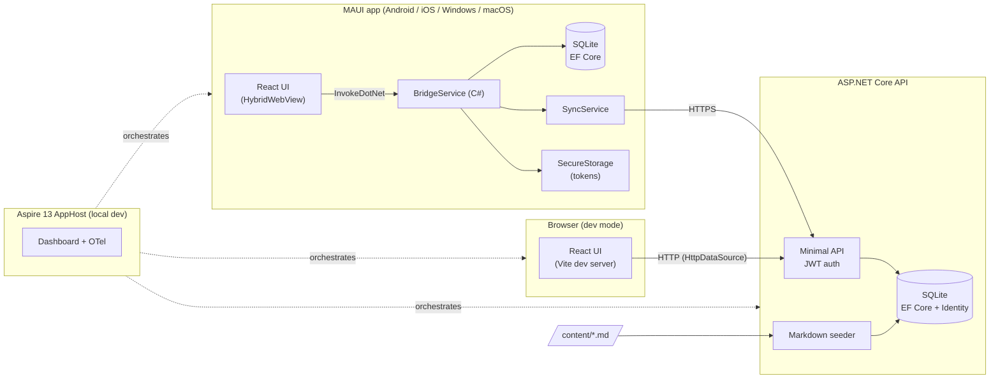
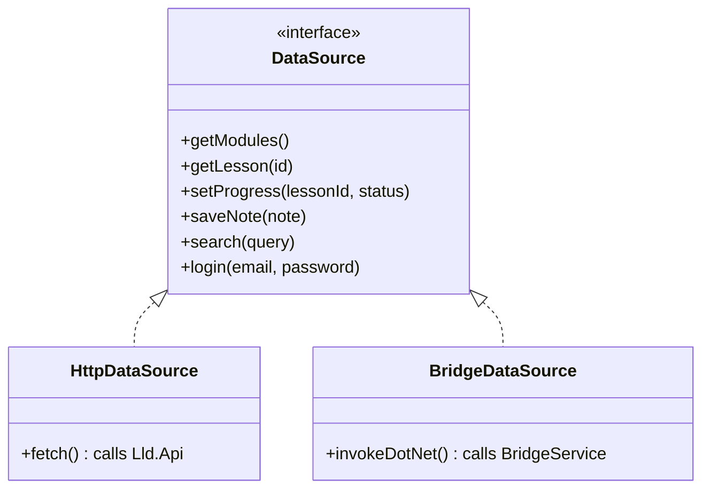

# Implementation Plan — LLD Guide

Companion to [`PRD.md`](./PRD.md). This describes **how** the app is built: architecture,
solution layout, spec roadmap, workflow and testing.

## 1. Architecture



### One UI, two transports

`createDataSource()` picks the implementation at startup based on whether
`window.HybridWebView` exists. This is the Strategy + Adapter pattern and becomes lesson material.

### Aspire AppHost (sketch)
```csharp
var builder = DistributedApplication.CreateBuilder(args);

var api = builder.AddProject<Projects.Lld_Api>("api")
                 .WithEnvironment("ConnectionStrings__lld", "Data Source=lld.db");

builder.AddViteApp("web", "../../web")
       .WithReference(api);

var maui = builder.AddMauiProject("app", "../Lld.App/Lld.App.csproj");
maui.AddWindowsDevice().WithReference(api);
maui.AddAndroidEmulator().WithOtlpDevTunnel().WithReference(api /* via dev tunnel */);

builder.Build().Run();
```
Exact APIs are verified in spec 000 against the current Aspire 13 packages
(`Aspire.Hosting.Maui`, `Aspire.Hosting.JavaScript`).

## 2. Solution layout
```
LowLevelDesignGuide/
├─ .claude/skills/            # emilkowalski skills + lld-case-study
├─ docs/                      # PRD.md, plan.md, adr/
├─ specs/NNN-name/            # spec.md, plan.md, tasks.md
├─ content/                   # lessons + cheat sheets (Markdown + front-matter)
│  ├─ oop-solid/  patterns/  uml/  case-studies/
├─ web/                       # React + Vite + TS
├─ src/
│  ├─ Lld.AppHost/            # Aspire orchestration
│  ├─ Lld.ServiceDefaults/    # OTel, health checks, resilience
│  ├─ Lld.Domain/             # entities, value objects (no dependencies)
│  ├─ Lld.Application/        # use cases + ports (IAuthService, ITokenService, ...)
│  ├─ Lld.Infrastructure/     # EF Core SQLite, Identity, repositories, seeder
│  ├─ Lld.Api/                # Minimal API endpoints
│  ├─ Lld.Contracts/          # DTOs shared by Api + App
│  └─ Lld.App/                # MAUI: HybridWebView shell, BridgeService, local DB, sync
├─ tests/
│  ├─ Lld.Domain.Tests/  Lld.Application.Tests/  Lld.Api.Tests/
│  └─ Lld.IntegrationTests/   # Aspire.Hosting.Testing
└─ LowLevelDesignGuide.slnx
```
Dependency rule: `Domain ← Application ← Infrastructure ← Api`; `Contracts` has no
dependencies; `App` depends on `Contracts` (+ its own local infrastructure).

## 3. Spec roadmap

| # | Spec | Scope | Done when |
|---|---|---|---|
| **000** | Foundation | Solution skeleton (.NET 10), Aspire AppHost, ServiceDefaults, empty API with health endpoint, React shell (routing, layout, `DataSource`), MAUI app hosting the React build, GitHub Actions CI | `aspire run` shows api + web + app (Windows) healthy; Android emulator loads the UI; CI green on all targets |
| **001** | Auth (Case Study #1) | Identity, custom JWT + rotating refresh tokens, register/login/logout UI, SecureStorage | Integration test register → login → refresh → logout passes; Auth lesson + cheat sheet written from real code |
| **002** | Content engine | Markdown seeder, modules/lessons API, reader (C# highlighting, Mermaid), cheat-sheet "Revise" view | Dropping a `.md` file into `content/` shows it in the app |
| **003** | Progress | Mark done, % per module, resume | Progress persists and is visible per user |
| **004** | Notes & bookmarks | Per-lesson notes, bookmarks, list view | CRUD works offline on device |
| **005** | Search | FTS5 on API + device, highlighted results | Query → results under 200 ms on device |
| **006** | Offline sync | Device ↔ API sync, LWW conflict rule | Airplane-mode scenario passes |
| **007** | OOP & SOLID content | Lessons + cheat sheets | Module complete |
| **008** | GoF patterns content | 23 patterns, C# samples, cheat sheets | Module complete |
| **009** | UML content | Class / sequence / state / activity with Mermaid | Module complete |
| **010+** | Case studies | One spec per case study; **each starts by asking the owner** (`lld-case-study` skill) | Lesson + cheat sheet + compiling code |
| **P2** | Phase 2 | Admin UI, iOS/macOS verification on a Mac, deployment decision | — |

Content specs (007–009) can be interleaved with feature specs if preferred.

## 4. Per-spec workflow
1. Write `specs/NNN-name/spec.md`: goal, user stories, acceptance criteria, out of scope, open questions.
2. **Owner reviews the spec.** Open questions get answered; nothing is assumed.
3. Write `plan.md` (design, classes, diagrams) and `tasks.md` (checklist).
4. Implement task by task; tests alongside.
5. Verify (see §5), then commit as `spec-NNN: ...` and push.
6. Owner OK → next spec.

## 5. Testing strategy
| Layer | Tool | What |
|---|---|---|
| Domain / Application | xUnit + FluentAssertions | Business rules, token rotation logic, sync conflict rules |
| API | xUnit + `WebApplicationFactory` | Endpoint contracts, auth policies |
| End to end (backend) | Aspire.Hosting.Testing | Spin up the AppHost; exercise real HTTP flows |
| React | Vitest + Testing Library | Components, `DataSource` implementations (mocked) |
| UI smoke | Playwright | Browser run against Vite + API under Aspire |
| MAUI | Manual checklist per spec (Windows + Android) | HybridWebView loads, bridge calls work, SecureStorage |
| CI | GitHub Actions | `windows-latest`: build + test + Windows/Android MAUI build; `macos-latest`: iOS + MacCatalyst compile |

## 6. Skills used during the build
- `clean-code-csharp`: all C# code and reviews.
- `pick-ui-library`: component, toast, Markdown and Mermaid library choices for React.
- `emil-design-eng`, `apple-design`: visual and motion design language.
- `mobile-native`: make the WebView feel native (safe areas, tap highlight, 100vh, input zoom).
- `animate`, `review-animations`, `animation-performance`: motion.
- `break-ui`: edge-case data checks per screen.
- `ask-sonner`: toasts.
- `lld-case-study`: every case study (asks the owner first).

## 7. Open questions (to confirm before spec 000)
1. License: MIT?
2. App display name and bundle ID: "LLD Guide" / `com.akus0ni.lldguide`?
3. Order of content specs vs feature specs: strictly sequential, or interleave?
