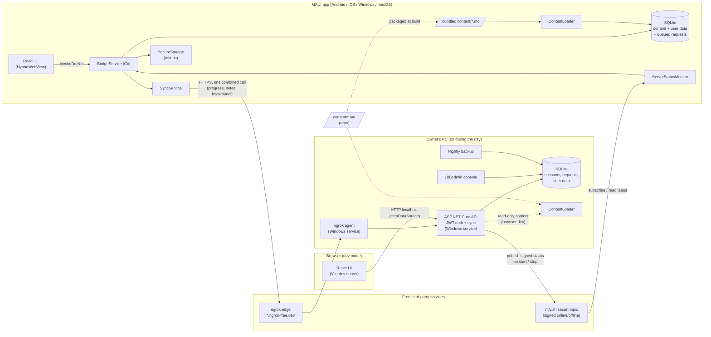
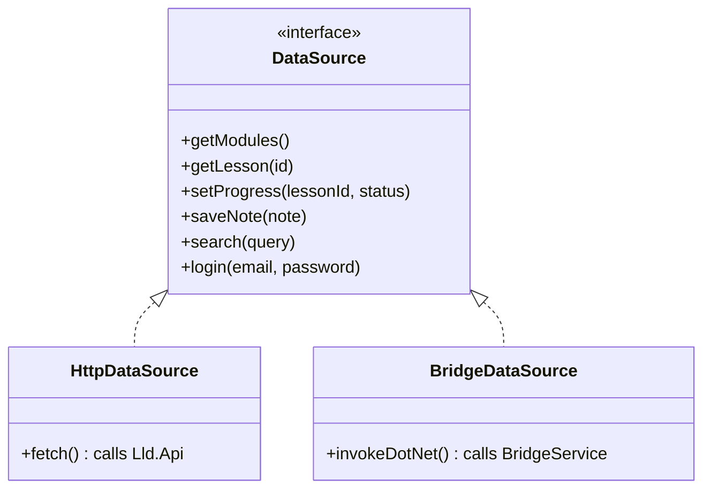

# Implementation Plan — LLD Guide

Companion to [`PRD.md`](./PRD.md). This describes **how** the app is built: architecture,
solution layout, spec roadmap, workflow and testing.

## 1. Architecture


Aspire (local dev) orchestrates the API, the Vite dev server and the MAUI app
together; in hosting mode the API runs as a Windows service behind ngrok.

### One UI, two transports

`createDataSource()` picks the implementation at startup based on whether
`window.HybridWebView` exists. This is the Strategy + Adapter pattern and becomes lesson material.

### Who owns which data
| Data | Lives on | Synced? | Notes |
|---|---|---|---|
| Lessons + cheat sheets | **Device** (bundled with the app → local SQLite) | No | Updated by app updates; Phase 2 admin UI may add server-delivered lessons |
| Progress, notes, bookmarks | **Device** (local SQLite) | Yes, via API | Saved locally first; `SyncService` pushes/pulls when online |
| Accounts, refresh tokens | **API** | — | Device keeps only its tokens in `SecureStorage` |
| Access requests | **API**; queued on device while offline | Sent once | Approved/rejected in `Lld.Admin` |
| Server status | **ntfy.sh** topic (signed) | — | Read by devices; costs no ngrok quota |
| Content (copy) | API, read-only | — | Only for the browser dev mode and Playwright tests |

The UI **never waits on the network**. In MAUI, React → `BridgeService` → local SQLite.
In the browser (dev only) there is no local DB, so `HttpDataSource` calls the API.

### Hosting and server status (spec 002)
| Concern | Design |
|---|---|
| Public address | ngrok free fixed domain `*.ngrok-free.dev` → API on the PC. Fallback: Microsoft Dev Tunnels. Base URL is an app setting. |
| Browser warning page | App's `HttpClient` adds `ngrok-skip-browser-warning` via a `DelegatingHandler`. |
| Uptime | API (`UseWindowsService`) and ngrok (`ngrok service install`) run as Windows services; PC sleep disabled while plugged in. |
| Server status | On start/stop, `ServerStatusPublisher` posts a signed message (`{status, at, nonce}` + signature) to a secret ntfy.sh topic. Devices' `ServerStatusMonitor` subscribes while open and reads the latest message on launch; verifies the signature with the bundled public key. A failed sync also sets status to offline. |
| Offline UX | Status = offline → "Server offline" banner, Sync button disabled, access requests queued. Status = online → button enabled, queued requests and pending changes sent. |
| Request budget (ngrok: 20k req, 1 GB / month) | Bundled content (0 requests to read); one combined `/sync` call; sync only on open (>15 min since last), "Sync now", app backgrounded with pending changes, or status → online; ~1 h access tokens; API rate limiting; client back-off; request counter metric. |
| Quota exhausted | Treated exactly like server offline until the monthly reset. |
| Backups | Scheduled task runs `VACUUM INTO` nightly into a synced folder; keeps 14 days. |
| Admin | `Lld.Admin` runs on the PC against the same database through `Lld.Application`; no admin HTTP endpoints exist. |

### Aspire AppHost (sketch)
```csharp
var builder = DistributedApplication.CreateBuilder(args);

var api = builder.AddProject<Projects.Lld_Api>("api")
                 .WithEnvironment("ConnectionStrings__lld", "Data Source=lld.db");

builder.AddViteApp("web", "../../web")
       .WithReference(api);

var maui = builder.AddMauiProject("app", "../Lld.App/Lld.App.csproj");
maui.AddWindowsDevice().WithReference(api);
maui.AddAndroidEmulator().WithOtlpDevTunnel().WithReference(api /* via dev tunnel */);

builder.Build().Run();
```
Exact APIs are verified in spec 000 against the current Aspire 13 packages
(`Aspire.Hosting.Maui`, `Aspire.Hosting.JavaScript`).

## 2. Solution layout
```
LowLevelDesignGuide/
├─ .claude/skills/            # emilkowalski skills + lld-case-study
├─ docs/                      # PRD.md, plan.md, adr/
├─ specs/NNN-name/            # spec.md, plan.md, tasks.md
├─ content/                   # lessons + cheat sheets (Markdown + front-matter); packaged into the app
├─ samples/                   # compiled C# the lessons quote by symbol (Lld.Samples.OopSolid, spec 004)
│  ├─ oop-solid/  patterns/  uml/  case-studies/
├─ web/                       # React + Vite + TS
├─ src/
│  ├─ Lld.AppHost/            # Aspire orchestration
│  ├─ Lld.ServiceDefaults/    # OTel, health checks, resilience
│  ├─ Lld.Domain/             # entities, value objects (no dependencies)
│  ├─ Lld.Application/        # use cases + ports (IAuthService, ITokenService, ...)
│  ├─ Lld.Infrastructure/     # EF Core SQLite, Identity, repositories, seeder
│  ├─ Lld.Api/                # Minimal API endpoints (runs as a Windows service when hosted)
│  ├─ Lld.Admin/              # Admin console: access requests, users, temporary passwords
│  ├─ Lld.Contracts/          # DTOs shared by Api + App
│  ├─ Lld.Wire/               # user data (progress) domain ↔ contracts mapping, shared by Api + App (spec 005)
│  ├─ Lld.App.Data/           # device SQLite: content catalog, schema steps, progress store
│  ├─ Lld.Content/            # Markdown + front-matter parser (ContentLoader), shared by App + Api
│  └─ Lld.App/                # MAUI: HybridWebView shell, BridgeService, local DB, sync
├─ tests/
│  ├─ Lld.Domain.Tests/  Lld.Application.Tests/  Lld.Api.Tests/  Lld.Content.Tests/
│  ├─ Lld.Progress.Tests/     # one progress-store contract run against in-memory, device SQLite and EF Core
│  └─ Lld.IntegrationTests/   # Aspire.Hosting.Testing
└─ LowLevelDesignGuide.slnx
```
Dependency rule: `Domain ← Application ← Infrastructure ← Api` (and `← Admin`); `Contracts` has no
dependencies; `App` depends on `Contracts` (+ its own local infrastructure: `Lld.App.Data`, which uses `Domain` and
`Wire`). `Wire` depends only on `Contracts` and `Domain`.

## 3. Spec roadmap

Build order is **interleaved** (decided 2026-10-14), with **self-hosting right after Auth**. Once the reader exists (003),
feature specs and content specs alternate, so the app is useful for learning early
and every feature is tested with real lessons. Spec numbers follow build order.

| # | Kind | Spec | Scope | Done when |
|---|---|---|---|---|
| **000** | Feature | Foundation | Solution skeleton (.NET 10), Aspire AppHost, ServiceDefaults, empty API with health endpoint, React shell (routing, layout, `DataSource`), MAUI app hosting the React build, GitHub Actions CI | `aspire run` shows api + web + app (Windows) healthy; Android emulator loads the UI; CI green on all targets and added as required checks on `main` |
| **001** | Feature + Content | Auth & access (Case Study #1) | Identity with **email as username**; custom JWT + rotating refresh tokens; **Request access** page (email required); `AccessRequest` state machine; **`Lld.Admin` console** (approve/reject, create user, reset password → temporary password); **forced password change on first login**; login/logout/refresh UI; SecureStorage | Integration test: request → admin approve → temp-password login → forced change → refresh → logout; Auth lesson + cheat sheet written from real code |
| **002** | Feature | Self-hosting & server status | API + ngrok as Windows services; base-URL setting + ngrok header; Dev Tunnels fallback doc; **signed ntfy.sh status** publisher (PC) and monitor (app); "Server offline" banner; **offline queue for access requests**; rate limiting + request budget metric; nightly backup | Real phone outside the home network can request access and log in; stopping the API flips open apps to offline within seconds; restarting flips them back and sends queued requests |
| **003** | Feature | Content engine (reader) | `Lld.Content` parser, content packaged into the app + loaded into local SQLite, read-only content API for browser dev, reader (C# highlighting, Mermaid), cheat-sheet "Revise" view | Fresh install in airplane mode shows lessons; a new `.md` file appears after rebuild |
| **004** | Content | OOP & SOLID | Lessons + cheat sheets | Module complete and readable in the app |
| **005** | Feature | Progress | Mark done, % per module, resume | Progress persists and is visible per user |
| **006** | Content | GoF + Enterprise patterns | 23 GoF + 5 Enterprise patterns, compiled samples, cheat sheets; periodic table, "Which pattern?" picker, look-alike compare (PRD R93–R100) | Modules complete; samples compile and are tested |
| **007** | Feature | Notes & bookmarks | Lesson and section notes, bookmarks (lesson / section / cheat sheet), Notes tab, tags, starters, notes in Revise, export (PRD R102–R108) | CRUD works offline on device |
| **008** | Content | UML | 10 lessons (class ×3, object, component / deployment, use case, sequence, state, activity, interview); template `diagram`; Code ↔ UML pairs checked against compiled C#; arrow legend, state Run, activity step-through, "Which diagram?" (PRD R109–R116) | Module complete; pairs match their code |
| **009** | Feature | Search | FTS5 on device (stemmed + unstemmed index, notes by triggers), `content/search.yml` synonyms and suggestions, Search tab, marks in the reader with a match bar, quick search; dev API copy (PRD R117–R124) | Query → results under 200 ms on device |
| **010** | Feature | Offline sync | One combined `/sync` call, LWW conflict rule, sync triggers, **Sync button disabled while server offline**, auto-sync when status → online | Airplane-mode scenario passes; offline → online auto-sync passes; monthly request estimate under budget |
| **011+** | Content | Case studies | One spec per case study; **each starts by asking the owner** (`lld-case-study` skill) | Lesson + cheat sheet + compiling code |
| **P2** | — | Phase 2 | Admin UI for content; **Apple builds** (re-enable Apple CI, iOS/macOS on a Mac, see §8); optional cloud hosting | — |

## 4. Per-spec workflow
1. Branch from latest `main`: `spec/NNN-short-name`.
2. Write `specs/NNN-name/spec.md`: goal, user stories, acceptance criteria, out of scope, open questions.
3. **Owner reviews the spec.** Open questions get answered; nothing is assumed.
4. Write `plan.md` (design, classes, diagrams) and `tasks.md` (checklist).
5. Implement task by task; tests alongside; commits as `spec-NNN: ...` on the branch.
6. Verify (see §5), push the branch, and **open a PR to `main`** (spec link, summary, verification).
7. CI must pass. **Owner reviews and squash-merges.** The branch is auto-deleted.
8. Owner OK → next spec, branched from the updated `main`.

### Main branch protection (GitHub ruleset "Protect main")
| Rule | Setting |
|---|---|
| Direct push / force-push / deletion | Blocked for everyone |
| Pull request required | Yes, 1 approval, stale approvals dismissed, conversations resolved |
| Merge method | Squash only, linear history |
| Bypass | Repo admin, **only via PR** (lets the solo owner merge their own PR) |
| Required status checks | `backend`, `web`, `maui-windows-android` (strict: branch must be up to date). `maui-apple` joins in Phase 2 |

## 5. Testing strategy
| Layer | Tool | What |
|---|---|---|
| Domain / Application | xUnit + FluentAssertions | Business rules, token rotation logic, sync conflict rules |
| API | xUnit + `WebApplicationFactory` | Endpoint contracts, auth policies |
| End to end (backend) | Aspire.Hosting.Testing | Spin up the AppHost; exercise real HTTP flows |
| React | Vitest + Testing Library | Components, `DataSource` implementations (mocked) |
| UI smoke | Playwright | Browser run against Vite + API under Aspire |
| Admin console | xUnit (command handlers) + integration test against a temp SQLite DB | Approve/reject, temporary password, reset |
| Server status | xUnit | Signature verification, spoofed/expired messages rejected, offline/online state transitions |
| MAUI | Manual checklist per spec (Windows + Android) | HybridWebView loads, bridge calls work, SecureStorage |
| CI | GitHub Actions | `ubuntu-latest`: backend + web; `windows-latest`: Windows/Android MAUI build. Apple build is manual-only until Phase 2 (§8) |

## 6. Skills used during the build
- `clean-code-csharp`: all C# code and reviews.
- `pick-ui-library`: component, toast, Markdown and Mermaid library choices for React.
- `emil-design-eng`, `apple-design`: visual and motion design language.
- `mobile-native`: make the WebView feel native (safe areas, tap highlight, 100vh, input zoom).
- `animate`, `review-animations`, `animation-performance`: motion.
- `break-ui`: edge-case data checks per screen.
- `ask-sonner`: toasts.
- `lld-case-study`: every case study (asks the owner first).

## 7. Decisions log
| Date | Decision |
|---|---|
| 2026-10-14 | License: **MIT** |
| 2026-10-14 | App display name **"LLD Guide"**, app/bundle ID **`com.akus0ni.lldguide`** |
| 2026-10-14 | Build order: **interleaved** feature + content specs after the reader (see §3) |
| 2026-10-14 | Every change goes through a PR; `main` protected by ruleset (see §4) |
| 2026-10-14 | Data: **content bundled in the app** → local SQLite; device is the UI's source of truth; API = accounts + sync hub for user data (+ read-only content for browser dev) |
| 2026-10-14 | Hosting: **owner's PC** (on during the day) + **ngrok** free domain; **Dev Tunnels** fallback; no Cloudflare; server DB stays SQLite |
| 2026-10-14 | Deployment built **right after Auth** (spec 002); later specs renumbered |
| 2026-10-14 | Server status via **signed ntfy.sh topic** (devices can't receive webhooks); Sync disabled for everyone while offline; auto-sync when back online |
| 2026-10-14 | **No self-registration**: Request access (email required, queued offline) → admin approves in **`Lld.Admin`** (direct DB, no admin API) → temporary password shared manually → forced change at first login |
| 2026-10-14 | **Email is the username** for requests and login |
| 2026-10-14 | PRD v0.2 keeps a full requirements register (PRD §13) |
| 2026-10-14 | **Apple CI deferred to Phase 2**: the `maui-apple` job moved to a manual-only workflow; required checks are `backend`, `web`, `maui-windows-android` (see §8) |
| 2026-10-16 | **No EF Core on the device**: plain `Microsoft.Data.Sqlite` behind repository ports (EF Core cost 1–5 s per launch on Android; spec 003 plan §4). EF Core stays on the API (PRD R67) |
| 2026-10-16 | **Open reading**: Learn and Revise need no account; content API only in Development (PRD R68) |
| 2026-10-16 | Content **validated and packed at build time** by `lld-content`; C# parses and validates, React renders the Markdown (PRD R70, R71) |
| 2026-10-16 | Visual identity **"the curriculum as a class diagram"** and **interactive learning without quizzes** (spec 003 amendment §3.7–3.8; PRD R73, R74) |
| 2026-10-16 | Lesson C# is **quoted from compiled code by symbol** (Roslyn 5.0.0, the version EF Core Design pins); concept modules can't contain inline C# (PRD R77) |
| 2026-10-16 | The **module map is drawn by the app** as «package» boxes from a Mermaid flowchart parsed at pack time (PRD R81) |
| 2026-10-17 | Lessons are **short visual cards with memory aids** and a folded "Go deeper" (owner: simple, memorable, little text; PRD R82, R83) |
| 2026-10-19 | **Progress per user, guest on the device** adopted at sign-in; stored on device and API now, synced in spec 010 (PRD R85–R88) |
| 2026-10-19 | **Activity strip instead of a streak**: the one exception to "no gamification" (PRD §3, R89) |
| 2026-10-19 | Progress transitions live in the web app; the domain only stores, compares (last-write-wins) and merges records, shared through `Lld.Wire` |
| 2026-10-20 | **Notes like progress**: per owner (user or device guest, adopted at sign-in), device SQLite (schema step 6) + API tables, soft deletes for spec 010; tags derived from the text, never stored (PRD R102–R108) |
| 2026-10-20 | **Android keyboard resizes the page** (`WindowSoftInputModeAdjust.Resize`), so editors and sheets stay above it |

## 8. Phase 2: Apple builds (deferred 2026-10-14)
Owner decision: Apple CI does not block PRs until Phase 2. The job is kept, ready to run, in
`.github/workflows/ci-apple.yml` (**manual trigger only**: Actions → "CI (Apple, manual)" → Run workflow).

### What we learned in spec 000
| Topic | Finding |
|---|---|
| Xcode requirement | Each .NET for iOS workload needs an exact Xcode. iOS **27.0.10722** (workload sets `10.0.401.1`, `10.0.402`) requires **Xcode 27**; no GitHub runner had it on 2026-10-14 (`macos-26` image: up to Xcode 26.5; `macos-latest`: up to 26.6) |
| Pinned combination | Workload set **`10.0.401`** = iOS/Mac Catalyst **26.5.10318**, which requires **Xcode 26.6** (`macos-latest` + `setup-xcode` `'26.6'`). With this, the Xcode check passed |
| Analyzer fixes | Template bootstrap code failed warnings-as-errors: `Program` made `static` (iOS + Mac Catalyst); CA1711 (`AppDelegate` name) disabled for `src/Lld.App/Platforms/**` in `.editorconfig`. A full green Apple build was **not yet confirmed** |
| Version drift | The pinned set ships MAUI workload 10.0.20 while packages use 10.0.110; watch for mismatches when re-enabling |
| Target frameworks | iOS/Mac Catalyst TFMs are only added on macOS hosts (`Lld.App.csproj`); use `-p:SkipAndroid=true` there to avoid needing the Android workload |
| Signing | Builds are simulator/unsigned only. Device builds and TestFlight need an Apple Developer account (paid) |

### To do in Phase 2
- [ ] Re-run `ci-apple.yml` manually; fix any remaining build errors.
- [ ] When runners ship Xcode 27, drop the `--version 10.0.401` pin and use the current workload set + matching Xcode.
- [ ] Move the job back into `ci.yml` and add `maui-apple` as a required check on `main`.
- [ ] On a Mac: run iOS simulator + Mac Catalyst via Aspire (`AddiOSSimulator` needs Dev Tunnels; `AddMacCatalystDevice` uses localhost).
- [ ] Verify iOS safe areas (WKWebView should report `env(safe-area-inset-*)`; Android needed a native fallback) and the status bar colour.
- [ ] Decide on signing / distribution (Apple Developer Program).
