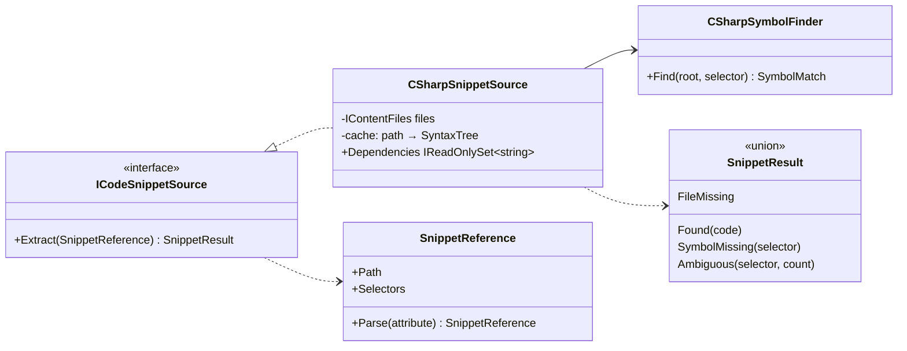

# Spec 004: Implementation plan

Companion to [`spec.md`](./spec.md). Versions checked against NuGet and npm on 2026-10-16.

## 1. Packages
| Package | Version | Used by |
|---|---|---|
| `Microsoft.CodeAnalysis.CSharp` | 5.9.0 | Content.Authoring: find a type or member by name in a `.cs` file (syntax trees only, no compilation) |
| `MessagePack` (pin) | 2.5.307 | Not used directly: lifts Aspire's transitive 2.5.302 (GHSA-qhrr-8q5h-9q3h), which broke CI on `main` |

No new npm packages: fence meta, callouts and Q&A are small rehype plugins; the map reuses Mermaid.

Roslyn lives in the build-time authoring library only (CLI and dev API). The device never ships it, as with Markdig.

## 2. Design

### 2.1 Projects
```
samples/Lld.Samples.OopSolid   NEW  class library: one folder per lesson, Before / After namespaces (compiled, zero warnings)
tests/Lld.Samples.Tests        NEW  xUnit + FluentAssertions: each design's claimed behaviour, violations included
Lld.Content.Authoring          + Snippets/, fence info, callouts, Q&A, module map, edits; new rules
Lld.Content                    PackedModule.Map, pack format 2
Lld.Contracts                  ModuleDetail.Map
Lld.App.Data                   schema step 3 (module map), catalog reads it
Lld.Api                        dev catalog fingerprint includes the .cs files lessons quote
web/                           fence meta, CodeCompare, Callout, InterviewQuestions, ModuleMap
```
`LowLevelDesignGuide.slnx` gets a `/samples/` folder; CI `backend` runs `tests/Lld.Samples.Tests`.

### 2.2 Fence info (`Parsing/FenceInfo.cs`)
One value object for a code fence's info string, used by rules and the packer:
```
csharp before title="Before: one class, three jobs" snippet="samples/.../Srp/Before/ReportService.cs#ReportService"
└lang─┘ └flag┘ └──────── attributes (key="value") ────────────────────────────────────────────────────────────┘
```
- `FenceInfo.Parse(string) → FenceInfo` with `Language`, `Flags` (`before`, `after`), `Attributes` (`snippet`, `title`,
  `mark`) and `Problems` (unknown flag / attribute, unclosed quote). `ToInfoString()` writes it back.
- `LineRanges` parses and formats `mark="3-5,9"`.

### 2.3 Editing the body (refactor, no behaviour change)
Today `LinkRewriter` edits the text directly. Two edit sources now touch the same body, so:
- `TextEdit(Start, Length, Replacement)`; `IBodyEditSource.EditsFor(SourceDocument)`.
- `LinkEdits` (today's `LinkRewriter` logic) and `FenceEdits` (snippets, compare marks, attribute clean-up).
- `BodyComposer` applies all edits from the end backwards and cuts the front-matter. Edits never overlap: links live in
  inlines, fences are blocks.
- Regression guard: the pack version of the existing content (Start here, Auth) is identical before and after.

### 2.4 Snippets (`Snippets/`)

- Selector `Type` matches any type declaration (class, record, struct, interface, enum, delegate) with that name at any
  nesting depth; `Outer.Inner` narrows nested types; `Type.Member` matches all members with that name (overloads,
  constructors via `Type.Type`). Two different matches for `Type` → `Ambiguous`.
- Output: the declaration with its doc comments and attributes (leading trivia from the first `///` or `[`), blank
  lines trimmed, de-indented (`Dedent`), several selectors joined by one blank line. No selector: the file without
  `using` lines and with the file-scoped namespace line dropped.
- `ContentContext.Snippets` exposes one cached source per build, so rules and the packer parse each file once.
- `ContentBuildResult.Dependencies` lists every quoted file; `DevContentCatalog` adds them to its fingerprint (A11).

### 2.5 Before / After (`Packing/LineDiff.cs`)
- `LineDiff.Compare(before, after)`: LCS over lines (trailing whitespace ignored); snippets are small, O(n·m) is fine.
- The packer writes `mark="..."` on both fences: lines only in *Before* (removed), lines only in *After* (added or
  changed). The web knows which is which from the `before` / `after` flag.
- Pairing: a `before` fence must be followed directly by an `after` fence of the same language.

### 2.6 Callouts, interview questions, concept template
- `Callouts.Of(document)`: blockquotes whose first line is `[!TYPE]`. Types in `CalloutTypes` (shared constant list).
- `module.yml` gains optional `template: concept`. Concept modules get three extra rules (below).
- Outline: h3 headings under `## Interview questions` are left out (`DocumentHeadings.Outline`), so a lesson's outline
  shows one entry for the section.

### 2.7 New validation rules (one class each, `IssueCodes` added)
| Rule | Codes |
|---|---|
| `FenceInfoRule` | `fence.unknown_attribute`, `fence.bad_mark`, `fence.mark_on_compare` |
| `SnippetFenceRule` | `snippet.has_code` (fence has inline code too), `snippet.not_csharp` |
| `SnippetFileRule` | `snippet.file_missing` |
| `SnippetSymbolRule` | `snippet.symbol_missing`, `snippet.symbol_ambiguous` |
| `ComparePairRule` | `compare.unpaired`, `compare.language_mismatch` |
| `CalloutTypeRule` | `callout.unknown_type` |
| `InterviewQuestionsRule` (concept) | `interview.missing`, `interview.count` (5–8 questions, each with an answer) |
| `ConceptCodeFromSnippetsRule` (concept) | `code.inline_csharp` (lessons and cheat sheets) |
| `ModuleMapRule` | `map.not_flowchart`, `map.unknown_node`, `map.lesson_missing` |

`FlowchartMap.Parse` reads the subset of Mermaid flowcharts a map uses: `subgraph id["Title"]` ... `end` (groups),
nodes with an optional `[label]` (ignored: the app shows lesson titles), links `-->` / `-.->` / `==>` with an optional
`|label|`, chains and `&`. Tokens are separated by spaces. Mermaid itself accepts kebab-case slugs as node ids
(checked with a real render), so the same source previews in any Mermaid editor.

### 2.8 Pack, contracts, device
- Contracts: `ModuleMap(Groups, Links)`, `MapGroup(Title, Lessons)`, `MapLink(From, To, Label?)`.
  `PackedModule(..., ModuleMap? Map)` and `ModuleDetail(..., ModuleMap? Map)`; `web/src/data/types.ts` mirrors them.
  `ContentPack.CurrentFormat = 2`. The app always ships with its own pack, so the format check only guards against
  mismatched builds.
- The map is parsed when content is packed, so the device and the web app never parse Mermaid for it.
- `V3ModuleMap`: `ALTER TABLE Modules ADD COLUMN MapJson TEXT NULL;`. The new pack version triggers a reload, which
  fills it. `SqliteContentCatalog` and `InMemoryContentCatalog` return it; the catalog contract suite covers both (LSP).

### 2.9 Web
| Piece | What |
|---|---|
| `markdown/fenceMeta.ts` | Parses `code.data.meta` (the info string after the language): flags, `title`, `mark` ranges |
| `markdown/rehypeCompare.ts` | Wraps an adjacent `before` + `after` `<pre>` pair in `<div data-compare>` |
| `CodeBlock` | + `title`, + line marks (`data-mark="del" \| "add" \| "mark"`) with a `−` / `+` gutter so meaning is not colour-only |
| `CodeCompare.tsx` | Side by side when both panes fit their longest line (measured with a `ResizeObserver`), else a *Before / After* segmented switch. Both panes stay rendered (one hidden), so the box keeps the taller height and nothing jumps. Arrow keys move between segments |
| `markdown/rehypeCallouts.ts` + `Callout.tsx` | `[!TYPE]` blockquote → `<aside>` with icon and a UML-style stereotype label (`«smell»`, `«interview tip»`, `«in this app»`, ...), one tinted rule per type |
| `reader/rehypeInterview.ts` + `InterviewQuestions.tsx` | Each h3 under `## Interview questions` becomes a disclosure (`button[aria-expanded]` + region), "Show all" at the top; the height animates with `grid-template-rows` (instant with reduced motion) |
| `content/ModuleMap.tsx` | Draws `module.map` on the module page in the app's identity: one `«package»` box per group, its lessons as members (toggle buttons). Tapping one highlights the lessons it links to, labelled with the relation, dims the rest and shows a lesson card (title, summary, minutes, *Open*); tap again, tap outside or Esc clears. A drawn Mermaid flowchart was rejected: 1480 px wide, unreadable on a phone |

Design work loads `frontend-design`, `emil-design-eng`, `apple-design`, `mobile-native`, `animate`; `break-ui` runs on the
compare, callouts, Q&A and map with worst-case data (long titles, 120-column code, 9 questions, a 15-node map at 320 px).

### 2.10 Samples
- `samples/Lld.Samples.OopSolid/<Lesson>/{Before,After,...}/*.cs`, namespaces
  `Lld.Samples.OopSolid.<Lesson>.<Variant>`. Public types, file-scoped namespaces, same analyzers as `src/`. If an
  analyzer fights a deliberately bad design, the suppression is local and commented (none expected).
- Tests prove the claims: e.g. `Lsp/Before`: a `Square` passed to `Rectangle`-based code breaks the area expectation;
  `Ocp/After`: a new discount is added without touching the calculator.

### 2.11 Content plan
"In this app" sources per lesson (checked against the code before writing each one):

| Lesson | Real code | `WORK` slot (owner, later) |
|---|---|---|
| Encapsulation | `AccessRequest` (transitions only through methods), `RefreshToken.Rotate`, `AggregateRoot` events | An anaemic model you inherited |
| Abstraction | `IContentFiles` (disk vs memory), `ITokenIssuer`, web `DataSource` | A leaky abstraction that bit you |
| Inheritance | `AggregateRoot` (the one base class), `sealed` by default; `LldDbContext : IdentityDbContext` (framework) | A deep hierarchy you untangled |
| Polymorphism | `IAccessRequestState` (State) vs `LinkTarget` + `switch` (closed set, pattern matching) | A `switch` on type that kept growing |
| Interfaces vs abstract | `AggregateRoot` vs `IContentRule`, `ISchemaMigration` | Breaking change to a shared interface |
| Composition | `ContentPipeline`, `ContentValidator(IEnumerable<IContentRule>)`, `AuditTrail` observer | Replacing a base class with composition |
| Value objects | `EmailAddress`, `Error`, `ContentIssue`, `BudgetWindow` | Primitive obsession bug (ids, money) |
| Coupling & cohesion | project layering; `Lld.Content` vs `Lld.Content.Authoring` split (device never ships Markdig) | A change that touched 20 files |
| Law of Demeter | `ContentContext.AnchorsOf` instead of rules walking Markdig trees | A train wreck in a code review |
| SRP | auth use cases (`Login`, `RefreshSession`, ...), reader vs validator vs packer | A "Manager" class with five actors |
| OCP | `IContentRule` + `DefaultRules`; `ISchemaMigration` steps | An extension point that paid off (or didn't) |
| LSP | catalog contract suite (in-memory vs SQLite); `IRefreshTokenTransport` (cookie vs body) | A subclass that threw `NotSupportedException` |
| ISP | small ports (`IAuditLog`, `IUserAccounts`, `IContentPackSource`) | A fat repository interface |
| DIP | `Lld.Application` ports, `Lld.Infrastructure` adapters, `DependencyInjection`; web `DataSource` | DI used without DIP |
| DRY / KISS / YAGNI | shared slugger test vector (C# + TS), plain SQLite over EF Core (R67), no images yet | Premature abstraction you removed |

Each lesson's samples and tests land in the same commit as the lesson.

## 3. Testing
| Layer | Tests |
|---|---|
| Authoring | `FenceInfo`, `LineRanges`, `Dedent`, `CSharpSymbolFinder` (type, nested, member, overloads, ctor, doc comments, attributes, ambiguous, whole file), `LineDiff`, `BodyComposer` (pack of today's content unchanged), outline without Q&A h3s, one fixture per new rule (`ValidRepo` gains a concept module, a sample file and a map) |
| Repo content | the existing "repo content is valid" test covers the new module; a test asserts every C# fence in `oop-solid` is a snippet |
| Device | migrator step 3, loader on format 2, catalog contract suite returns the map |
| API | dev catalog reloads when a quoted `.cs` file changes (A11) |
| Samples | `Lld.Samples.Tests` |
| Web (Vitest) | fence meta, compare grouping + switch, callouts, interview disclosure, flowchart analysis on a real Mermaid SVG fixture, `ModuleMap` |
| Playwright | A1 (15 lessons), A6 (compare phone + desktop, 320 px), A7, A8, A9, A10 (cheat sheet heights) |
| Manual | Windows + Android: module, compare, map, Q&A; A12 upgrade from the spec 003 build (format 1) on the emulator |

## 4. Outcomes
_Filled in during implementation._
