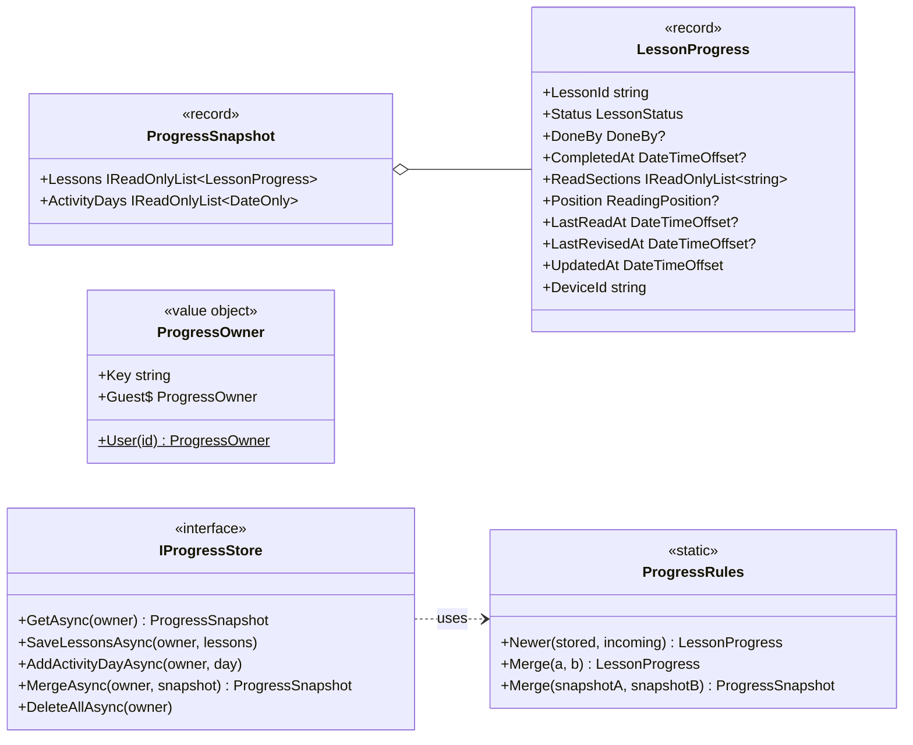

# Spec 005: Implementation plan

Companion to [`spec.md`](./spec.md). Written 2026-10-19 after the owner approved the spec.

## 1. Packages
None. The reset sheet reuses Base UI's `Drawer` (as the outline sheet does), toasts reuse Sonner, and the
animations are CSS only (`clip-path`, `transform`, `opacity`).

## 2. Design

### 2.1 Where the logic lives
| Concern | Lives in | Why |
|---|---|---|
| Status transitions (open, tick, auto done, mark / unmark, revised, reset) | **TypeScript** `web/src/features/progress/lessonProgress.ts` (pure functions) | The reader is where they happen; one implementation for both the app and the browser |
| Counts, Continue, activity week | **TypeScript** `progressMath.ts` (pure) | Only the UI uses them |
| Last-write-wins upsert and the guest **merge** rule | **C#** `Lld.Domain/Progress` (pure) | Both the device (adopting guest progress) and the API (adopting, later `/sync`) need them |
| Storage | `IProgressStore`: SQLite on the device, EF Core on the API, in-memory for tests; `localStorage` for a browser guest | Each runtime keeps data where it already keeps data |

The domain never needs the transitions (the server only stores and merges records), so nothing is written twice except
the record shape.

### 2.2 Domain (`Lld.Domain/Progress/`)

- `LessonStatus { NotStarted, InProgress, Done }`, `DoneBy { Auto, Manual }`, `ReadingPosition(Anchor, Offset)`.
- **`Newer`** (normal writes, same learner): keep the record with the later `UpdatedAt`; on a tie the incoming one wins.
- **`Merge`** (guest adoption, spec §3.9): furthest status wins (Done > InProgress > NotStarted); `DoneBy` /
  `CompletedAt` come from the Done side; ticks are the union; position from the more recently read side; dates are
  the latest; `UpdatedAt` = the later one. Snapshots merge per lesson; activity days are the union.
- **Why `IProgressStore` sits in the domain:** the device has no application layer, and the contract suite (LSP) must
  run against the device and API stores alike. It is the progress aggregate's repository and has no dependencies.
- A reset is a normal write (`NotStarted`, empty ticks, no dates, new `UpdatedAt`), never a delete, so spec 010 can
  sync it. `DeleteAllAsync` exists only to empty the guest after adoption (guest data never syncs).
- Limits as constants with guard checks: lesson id ≤ 120 chars, ≤ 200 sections, anchor ≤ 200 chars, ≤ 1,000 lessons
  per write.

### 2.3 Device (`Lld.App.Data` + `Lld.App`)
- `Lld.App.Data` gains a reference to `Lld.Domain` (no dependencies of its own).
- **Schema step V4** `V4Progress`:
  ```sql
  CREATE TABLE LessonProgress (Owner TEXT NOT NULL, LessonId TEXT NOT NULL, Status INTEGER NOT NULL,
      DoneBy INTEGER NULL, CompletedAt TEXT NULL, ReadSectionsJson TEXT NOT NULL DEFAULT '[]',
      PositionAnchor TEXT NULL, PositionOffset INTEGER NULL, LastReadAt TEXT NULL, LastRevisedAt TEXT NULL,
      UpdatedAt TEXT NOT NULL, DeviceId TEXT NOT NULL, PRIMARY KEY (Owner, LessonId)) WITHOUT ROWID;
  CREATE TABLE ActivityDays (Owner TEXT NOT NULL, Day TEXT NOT NULL, PRIMARY KEY (Owner, Day)) WITHOUT ROWID;
  ```
  No foreign key to `Lessons` on purpose: the content loader deletes and reinserts lessons, and progress for a lesson
  that left the content must survive (spec §3.2). Dates are ISO-8601 UTC text.
- `SqliteProgressStore : IProgressStore` (plain `Microsoft.Data.Sqlite`, one transaction per write, `Newer` applied in
  C# after reading the stored rows for the ids being written).
- `DeviceIdentity`: a GUID created once and kept in `DeviceMeta` (`device.id`).
- **Who owns progress on the device:** the account whose session is stored here. `SessionService` saves the user id
  next to the refresh token when a session is accepted and forgets it in `ClearAsync` (sign-out, 401 on restore).
  This survives an offline launch, where the restore call fails but the session is still there. *Finding:* the UI
  shows "signed out" in that case today (spec 001/002 behaviour), while progress correctly stays the user's.
- `ProgressService` (bridge-facing, like `ContentService`): resolves the owner, waits for `ContentGate` (schema),
  stamps `DeviceId`, and calls the store. `AdoptGuestAsync(userId)`: read guest → `MergeAsync(user, guest)` →
  `DeleteAllAsync(guest)`, in one transaction.
- `BridgeService`: `GetProgress()`, `SaveLessonProgress(records)`, `RecordActivity(day)`. After a successful `Login` or
  `RestoreSession` it calls `AdoptGuestAsync` before returning, so React's reload sees the merged data.
- **Guest rule as built:** guest progress goes to the next user who signs in on the device, and is then emptied. That
  covers "first sign-in" (spec §3.9) and anything a guest reads between two sign-ins.

### 2.4 API
- `Lld.Infrastructure`: `LessonProgressRow` / `ActivityDayRow` (EF entities with `OwnerId` = user id, FK to
  `AspNetUsers` with cascade delete), migration `AddProgress`, `EfProgressStore : IProgressStore`.
- `Lld.Application/Progress`: use cases `GetProgress`, `SaveLessonProgress`, `RecordActivityDay`, `AdoptGuestProgress`
  (validation → store), errors in `AppErrors` (`progress.invalid_*`).
- `Lld.Contracts/ProgressContracts.cs`: `LessonProgressDto`, `ProgressSnapshotDto`, `ActivityDayRequest`,
  `SaveLessonProgressRequest`.
- `Lld.Api/Endpoints/ProgressEndpoints.cs`, all `RequireAuthorization()`, always scoped to the caller's id:

  | Method | Path | Body → result |
  |---|---|---|
  | GET | `/api/progress` | → `ProgressSnapshotDto` |
  | PUT | `/api/progress/lessons` | `LessonProgressDto[]` (batch, last-write-wins) → 204 |
  | POST | `/api/progress/activity` | `{ day: "2026-10-19" }` → 204 (idempotent) |
  | POST | `/api/progress/adopt` | `ProgressSnapshotDto` (the browser guest) → merged `ProgressSnapshotDto` |

  **Change from spec §3.10:** no `DELETE /api/progress?module=`. The hosted API has no content, so it can't map a
  module to its lessons; the client resets by writing reset records through the batch `PUT` (a reset is a write, §3.7).
  The single-lesson `PUT /lessons/{id}` became the batch form for the same reason (one call for a module reset).
- Mapped in every environment, but only browser mode calls them in this spec (no request-budget impact on the app).

### 2.5 Contracts for content
`LessonSummary` gains `SectionCount` (outline entries), so "3 of 5 sections" and Continue need no lesson body. The
device computes it in SQL (`json_array_length(OutlineJson)`, no schema change); the dev catalog counts `Outline`.

### 2.6 Web
```
web/src/features/progress/
  lessonProgress.ts      record type + pure transitions (opened, sectionsRead, positionSaved, markDone, markNotDone, revised, reset)
  progressMath.ts        moduleCount, overallCount, continueTarget, activityWeek, sectionsRead (pure)
  progressStore.ts       external store: snapshot in memory, subscribe/getSnapshot, write-behind queue
  ProgressProvider.tsx   one store per data source + owner; reloads when the signed-in user changes
  useProgress.ts         hooks: useLessonProgress, useModuleProgress, useOverallProgress, useContinue, useActivityWeek
  StatusMark.tsx         ○ ◐ ✓ + accessible label (one component everywhere)
  ContinueCard.tsx       Learn
  DoneControl.tsx        end of lesson
  ActivityStrip.tsx      Profile
  ProgressSummary.tsx    Profile (counts per module + Reset progress)
  ResetSheet.tsx         Base UI Drawer, scope in the button
  legacyImport.ts        one-time import of spec 003 localStorage ticks + positions
```
- **`DataSource`** gains `getProgress()`, `saveLessonProgress(records)`, `recordActivity(day)`.
  - `BridgeDataSource`: bridge calls; C# picks the owner.
  - `HttpDataSource`: signed in → the API; signed out → a guest copy in `localStorage` (`lld.progress.guest`).
    `getProgress()` first awaits an in-flight session restore, so it never shows guest data to a signed-in user.
    After `login` / `restoreSession` succeed, a non-empty guest copy is sent to `/adopt` and cleared.
- **`ProgressStore`**: keeps the snapshot in memory; every change updates it at once (Learn, module, Revise and Profile
  re-render together through `useSyncExternalStore`), then queues the record. The queue flushes after 1 s of quiet, on
  `visibilitychange → hidden`, on `pagehide`, and before the owner changes. A failed flush keeps the records queued.
- **Reading:** `useReadingTracker` keeps its scroll logic but reads and writes ticks and position through the store
  instead of `readerStore`. When a new tick completes the outline, the store marks the lesson Done (Auto). After a
  manual unmark every section is still ticked, so auto done can't fire until the outline gains a section: that is the
  "until a section is newly ticked" rule with no extra flag.
- **Activity day:** recorded (local `YYYY-MM-DD`) when a section is ticked or a cheat sheet is revised, at most once per
  day per store.
- **Revised:** `CheatSheetPage` records it when a sentinel at the end becomes visible or the last recall block is
  revealed, once per page view.
- **Celebrations "once":** the ids already celebrated are a device preference in `localStorage`
  (`lld.celebrated.<owner>`), like text size. Not synced on purpose: replaying once on a second device is harmless.
- **Legacy import (A12):** on the first load, `lld.reader.read.*` and `lld.reader.position.*` become InProgress
  records for the **current owner** (spec said guest; for a signed-in user that is the same data, adopted at once),
  then the keys are removed. Text size and recall stay in `readerStore`.
- **Placement** as in spec §3.3 and §3.11; `StatusMark` + `SectionCount` drive every view.

### 2.7 Visual and motion details (from the spec critique, §9)
| Element | Implementation |
|---|---|
| Module hatching | `repeating-linear-gradient(135deg, …)` in the accent at low alpha, masked to `done/total` width with `clip-path: inset(0 X 0 0)`; no animation on normal visits |
| Inked frame | `border-color` ink token + 1.5 px at 100% (pencil = hairline token) |
| Done check | SVG check, `clip-path: inset(0 100% 0 0)` → `inset(0)`, 240 ms, `--ease-out` (`cubic-bezier(0.23, 1, 0.32, 1)`) |
| Module complete | frame ink + `«complete»` stamp: `scale(0.96)` + `opacity: 0` → 1, ≤ 600 ms total, once |
| Press feedback | existing button tokens (`scale(0.97)` on `:active`, 120 ms) |
| Reduced motion | opacity fade 150 ms only |
| Tokens | reuse existing `--ease-out`, ink / hairline / accent / amber tokens; no new palette |

## 3. Testing
| Layer | Tests |
|---|---|
| Domain | `ProgressRulesTests`: `Newer`, `Merge` (every status pair, ticks union, position, dates), snapshot merge |
| Store contract | `ProgressStoreContract` (abstract xUnit class) run against in-memory, `SqliteProgressStore` (temp file), `EfProgressStore` (SQLite in-memory): owner isolation, LWW, merge, delete guest, activity idempotent |
| Device | `V4Progress` upgrade from a V3 database; content reload keeps progress (A11); adoption in one transaction |
| Application | use-case validation (limits, bad day) |
| API integration (Aspire) | 401 without token; user A can't see or overwrite user B; adopt merges; batch PUT LWW (A5, A6, A9) |
| Web unit (Vitest) | transitions (A1), math (A2, A3), activity week with a fake clock (A8), store queue + flush, legacy import (A12), HttpDataSource guest/adopt |
| Web components (Vitest) | ContinueCard, DoneControl (once-only, reduced motion), StatusMark labels, Revise filter, ResetSheet (A7, A9, A10, A14) |
| Playwright | open → In progress → read to end → Done → unmark; Continue resumes position; Revise filter; reset; phone + desktop |
| Manual | Windows + Android: restart, airplane mode, two accounts on one device, guest adoption, upgrade from V3 (A4, A5, A11) |

## 4. Risks
- **Write volume while scrolling:** positions are debounced in the reader (250 ms) and again by the store queue (1 s),
  so a long read costs a handful of SQLite writes and, in the browser, a handful of API calls.
- **Clock skew** between devices affects last-write-wins only once sync exists (spec 010); noted there.
- **Offline launch shows "signed out"** (existing behaviour) while progress belongs to the stored account; reported as
  a finding, not changed here.

## 5. Outcomes

### Changes from this plan
1. **`Lld.Wire`** (new project): the API and the app bridge both map progress records ↔ DTOs, so the mapping lives
   once, in a library that depends only on `Contracts` and `Domain` (instead of two copies or breaking the rule that
   `Contracts` has no dependencies).
2. **`IProgressStore` has no `DeleteAllAsync`**: only the device needs it (emptying the guest), so it is
   `SqliteProgressStore.AdoptGuestAsync`, which merges and deletes in one transaction.
3. **Endpoints** as in §2.4: batch `PUT /api/progress/lessons`, no `DELETE` (a reset is a write).
4. **Changes made while progress is still loading** wait and are applied on top of the loaded data (found by a test:
   computing them against an empty state overwrote a stored "done").
5. **"Revised" needs the end on screen for 2 s** (`END_DWELL_MS`): a short cheat sheet's end is visible as soon as it
   opens, so a mistaken open would otherwise count.
6. **Celebrations remembered per owner** in localStorage (`lld.celebrated.<owner>`), not in the synced record.
7. **Legacy import keeps only real reading** (T14 finding): spec 003 saved a position for every lesson ever opened, so
   on the owner's Windows install the first upgrade turned all 15 opened lessons into "in progress". Now only ticks or
   a position below the top are imported.

### UI pass (T12)
Skills: `frontend-design`, `emil-design-eng`, `apple-design`, `animate`, `mobile-native`, `break-ui`.
- Revise: two adjacent "All" controls → the revised filter reuses Profile's segmented control ("All sheets" /
  "Not revised"); "Not revised yet" is ink, not action-blue.
- 320 px worst case: the Continue card grew a screen tall (title clamped to 3 lines, module name to 1); module rows
  squeezed titles to ~7 characters (reading time moved under the text).
- Learn: emoji touched the lesson title (spec 004 leftover; icon box widened).
- New `break-ui` case: a 40-lesson module nearly done, the longest title in progress, every day active.

### T14: manual run (2026-10-20)
| Check | Where | Result |
|---|---|---|
| A11 upgrade V3 → V4 | Windows (owner's spec 004 database) and Android (installed over the spec 004 Release build) | ✅ schema 4, progress tables added, all 17 lessons kept |
| A4 restart + offline | Windows (no server: Debug targets Aspire, not running); Android in airplane mode | ✅ mark done → force-stop → relaunch: still done, counts and Profile right |
| Bridge writes | both | ✅ guest rows with the device id; study day recorded |
| Legacy import | Windows | ✅ imported; found the over-import fixed in change 7 |
| A5 two accounts, guest adoption | — | ⚠️ not run by hand (needs the API and real sign-ins on a device); covered by `DeviceProgressTests`, `SqliteProgressStoreTests`, `progressData.test.ts` and the API adopt tests |

Screenshots: `screenshots/windows-*.png`, `screenshots/android-*.png`, plus the T12 set.

### Open question for the owner
Scrolling straight to the end of a lesson ticks every section (spec 003 rule), so a fast fling to the bottom marks the
lesson done by itself. Keep, or require time on each section?

**Decided (owner, after spec 006):** require time. A section also needs 2.5 s on screen in all before it ticks (PRD
R101, `fix/section-dwell-time`).

### Final numbers
.NET: domain 54 · application 38 · API 41 · admin 11 · server status 30 · content 252 · progress stores 40 · lesson
samples 63 · Aspire integration 4. Web: Vitest 205 · Playwright 69 (phone + desktop). 0 build warnings; lint and
guardrails clean.
