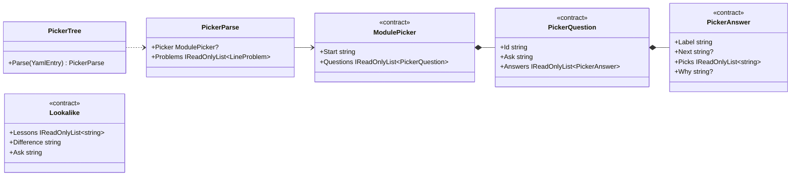

# Spec 006: Implementation plan

Companion to [`spec.md`](./spec.md). Written 2026-10-20 after the owner approved the spec as is.

## 1. Packages
None. YAML structure comes from YamlDotNet (already used), the picker sheet reuses Base UI's `Drawer` / `Dialog`
(as the outline and reset sheets do), the compare reuses the `CodeCompare` switch and the Mermaid renderer, and the
periodic table is plain CSS grid.

## 2. Design

### 2.1 Projects
```
samples/Lld.Samples.Patterns   NEW  class library: Creational/ Structural/ Behavioral/ Enterprise/<Pattern>/{Before,After,Modern}
tests/Lld.Samples.Tests        + Patterns/ tests, references the new library
Lld.Content.Authoring          + structured YAML values, phrase mnemonics, template `pattern`, `symbol`,
                                 PickerTree + Lookalikes parsers, new rules, OVERUSE callout
Lld.Content                    PackedLesson.Symbol, PackedModule.Picker / Lookalikes, pack format 3
Lld.Contracts                  LessonSummary.Symbol, ModuleDetail.Picker / Lookalikes
Lld.App.Data                   schema step 5, catalog reads the new columns
web/                           Overuse stamp, phrase mnemonic tiles, PeriodicTable, PatternPicker, LookalikeCompare
content/                       gof-patterns/, enterprise-patterns/; case-studies order 4 → 5
```
`LowLevelDesignGuide.slnx` adds the samples project under `/samples/`; CI `backend` already runs
`tests/Lld.Samples.Tests`.

### 2.2 Structured YAML values (`Parsing/YamlMap.cs`)
`module.yml` is read into a flat `YamlMap`; nested values are `YamlValueKind.Other` today and rejected.
- `YamlEntry` gains `YamlNode? Node` (set for `Other`), so a parser can walk it with line numbers
  (`node.Start.Line` + the file offset, as `ToEntry` already does for keys).
- `FieldKind.Structured`: the schema accepts a nested map or list for that key; the key's own parser and rule check
  the shape. `picker` and `lookalikes` use it; every other key keeps rejecting nested values.

### 2.3 Phrase mnemonics (`Parsing/Mnemonics.cs`)
- `Mnemonics.Letters(word)`: if the word contains whitespace, one letter per word (its first letter); otherwise
  today's rule (every letter, non-letters are decoration). `ParsedMnemonic` gains `Words` (the phrase split into
  words, empty for single words) so the web can draw the rest of each word under its letter.
- The contract stays `Mnemonic(Word, Lessons)`; the web splits the phrase the same way (`mnemonicTiles.ts`, one
  shared test vector with the C# tests, as with the slugger).
- `MnemonicRule` is unchanged apart from using `Letters`; `SOLID` and `A-PIE` keep their tiles.

### 2.4 Template `pattern`
- `ContentSchemas.PatternTemplate = "pattern"`, added to `Templates`.
- `ContentContext.ConceptLessons` → lessons of modules whose template is `concept` **or** `pattern` (the concept rules
  apply to both: REMEMBER stamp, icon, hook, interview questions, C# only from snippets). New
  `ContentContext.PatternLessons` for the pattern-only rules.
- Lesson schema: optional `symbol` (`FieldKind.Text`). Pack: `PackedLesson.Symbol`, `LessonSummary.Symbol`.
- `Callouts.Types` gains `OVERUSE` (C# list and `web/src/.../callouts.ts`).
- `PatternSections` (parsing helper): finds the `##` sections of a lesson by heading text, with their lines and the
  fences and callouts inside each. Used by the rules below and by tests.

### 2.5 Picker and look-alikes (`Parsing/PickerTree.cs`, `Parsing/Lookalikes.cs`)

- Shape problems (a missing `ask`, an answer with both `next` and `pick`, a non-map node) come from the parser with
  their line. Graph checks live in the rule, on the parsed tree: dangling `next`, cycles (DFS with colours), depth > 4,
  unknown `pick`, unreachable lessons.
- Both are parsed when content is packed, so the device and the web never read YAML.
- The compare shows each lesson's *The idea* summary and *Structure* diagram. The web takes them from the lesson
  body it already loads (`patternFacts.ts`: first paragraph under `## The idea`, first `mermaid` fence under
  `## Structure`). The validation rules guarantee both exist, so no extra contract or endpoint is needed.

### 2.6 New validation rules (one class each, `IssueCodes` added)
| Rule | Scope | Codes |
|---|---|---|
| `PatternSectionsRule` | pattern lessons | `pattern.section_missing`, `pattern.section_order` (The idea, Structure, See it, Modern C#, Seen in .NET, Travels with, then optional In this app, Interview questions) |
| `PatternStructureRule` | pattern lessons | `pattern.structure_no_class_diagram` (a `mermaid` fence starting with `classDiagram` under *Structure*) |
| `PatternCompareRule` | pattern lessons | `pattern.see_it_no_compare` (a `before` / `after` pair under *See it*) |
| `OveruseStampRule` | pattern lessons | `overuse.missing`, `overuse.duplicate` |
| `SymbolRule` | pattern modules | `symbol.missing`, `symbol.format` (`^[A-Z][a-z]$`), `symbol.duplicate` (in the module) |
| `PickerRule` | modules with `picker:` | `picker.shape`, `picker.unknown_next`, `picker.cycle`, `picker.too_deep`, `picker.unknown_lesson`, `picker.unreachable` |
| `LookalikesRule` | modules with `lookalikes:` | `lookalike.shape` (2–3 lessons, `difference` and `ask` ≤ 160), `lookalike.unknown_lesson`, `lookalike.duplicate` |

All registered in `DefaultRules`, each with a failing and a passing fixture in `ValidRepo` / its variants.

### 2.7 Pack, contracts, device
- `PackedLesson(..., string? Symbol = null)`, `PackedModule(..., ModulePicker? Picker = null,
  IReadOnlyList<Lookalike>? Lookalikes = null)`; `ContentPack.CurrentFormat = 3`.
- `LessonSummary.Symbol`, `ModuleDetail.Picker`, `ModuleDetail.Lookalikes`; `web/src/data/types.ts` mirrors them.
- `V5PatternAids`: `ALTER TABLE Modules ADD COLUMN PickerJson TEXT NULL; ALTER TABLE Modules ADD COLUMN LookalikesJson
  TEXT NOT NULL DEFAULT '[]'; ALTER TABLE Lessons ADD COLUMN Symbol TEXT NULL;`. The new pack version reloads content
  and fills them; progress tables (step 4) are untouched.
- `SqliteContentCatalog`, `InMemoryContentCatalog` and the dev catalog return them; the catalog contract suite
  covers both catalogs.

### 2.8 Web
| Piece | What |
|---|---|
| `Callout.tsx` | `OVERUSE` drawn as a stamp like REMEMBER, warning tokens (light / dark, AA), label «when it hurts» |
| `ModuleMnemonics.tsx` + `mnemonicTiles.ts` | A phrase is one tile per word: the letter big, the word small under it, then the lesson icon and title; wraps at 320 px |
| `content/patterns/PeriodicTable.tsx` | Shown instead of `ModuleMap` when every lesson has a `symbol`. One block per map group (category), category colour tokens `--category-1..4`; tile = symbol, icon, title, order number, Done ink mark (spec 005). Tap → tiles it travels with (map links) and its look-alikes highlighted, a card (hook, summary, minutes, *Open*, *Compare*). Esc / outside clears. Roving tabindex, arrow keys move across the grid. Reuses `mapRelations.ts` |
| `content/patterns/PatternPicker.tsx` | "Which pattern?" button on the module page when `picker` exists. Bottom `Drawer` on phone, `Dialog` on desktop. One question, large answer buttons, *Back* and a breadcrumb of the path. Escape (and so Android Back via `hardwareBack.ts`) steps back one question; at the first question it closes. The result shows the tile(s), *why* and *Open*. The question change slides/fades (≤ 200 ms, instant with reduced motion) |
| `content/patterns/LookalikeCompare.tsx` | Route `learn/:module/compare/:pair` (`pair` = slugs joined by `-vs-`, e.g. `strategy-vs-state`), lazy like the reader, `wide`. The difference + ask stamp on top; per lesson: tile, hook, idea, structure diagram. Columns when they fit (same `ResizeObserver` measurement as `CodeCompare`), else a segmented switch; panes stay mounted so the height does not jump |
| `reader/rehypeLookalikes.ts` + `LookalikeStrip.tsx` | After the `## Seen in .NET` section of a lesson in a module with look-alikes, a strip of links "Often confused with: Strategy ⇄ State" to each compare that lesson belongs to |
| Module page | Order: header, mnemonics, periodic table (or map), "Which pattern?" + "Look-alikes" list, lesson list |

Design work loads `frontend-design`, `emil-design-eng`, `apple-design`, `mobile-native`, `animate`. `break-ui` runs on the
table, picker, compare and phrase tiles with worst-case data (30 tiles at 320 px, 5 long answers, 3-way compare with
a large class diagram, an 11-word phrase).

### 2.9 Samples
- `samples/Lld.Samples.Patterns/<Category>/<Pattern>/{Before,After,Modern}/*.cs`, namespaces
  `Lld.Samples.Patterns.<Category>.<Pattern>.<Variant>`. Same analyzers and zero warnings as `src/`.
- Tests prove the claims, for example: Before and After give the same result; a new strategy / decorator / visitor is
  added without editing existing classes; the Singleton is the same instance across threads; the Memento restores
  state without exposing fields; the Specification composes with And / Or.
- Each pattern's samples and tests land in the same commit as its lesson.

### 2.10 Content plan
Pictures and examples are starting points; each lesson's "In this app" is checked against the code before writing.

**Creational**
| Pattern | Picture | Before → After | Modern C# | Seen in .NET | In this app |
|---|---|---|---|---|---|
| Singleton | the one office printer | global static mutable config → `sealed` + `Lazy<T>` | `AddSingleton`, `TimeProvider` | `ArrayPool<T>.Shared`, `EqualityComparer<T>.Default` | DI singletons in `Lld.Api` |
| Factory Method | a pizza franchise bakes its own style | `switch` + `new` in the service → creator subclasses override `Create` | `Func<T>` / static `Create` / `IServiceProvider` | `DbProviderFactory.CreateConnection`, `IHttpClientFactory` | `DesignTimeDbContextFactory` |
| Abstract Factory | a furniture collection that matches | `if (theme)` per widget → one factory per family | DI registers one family per environment / keyed services | `DbProviderFactory` (connection + command + parameter) | none |
| Builder | ordering a sandwich step by step | 8-parameter constructor → fluent builder with validating `Build()` | `required` / `init` + object initialisers; builder when building is complex | `StringBuilder`, `UriBuilder`, `WebApplication.CreateBuilder` | `MapBuilder` |
| Prototype | a photocopier / cookie cutter | field-by-field copies → `Clone()` (deep vs shallow) | `record` + `with` | `MemberwiseClone`, why `ICloneable` is discouraged | records with `with` |

**Structural**
| Pattern | Picture | Before → After | Modern C# | Seen in .NET | In this app |
|---|---|---|---|---|---|
| Adapter | a travel plug adapter | legacy payment API called inline → `IPaymentGateway` + adapter | thin wrapper / extension methods | `StreamReader` (Stream → TextReader) | `HttpDataSource` / `BridgeDataSource` |
| Facade | a hotel concierge | client drives stock, payment, shipping → `OrderFacade.Place` | an application service / endpoint | `File.ReadAllText`, `HttpClient` | `SessionManager` |
| Decorator | coffee with add-ons | subclass per combination → stacked `IMessageSender` wrappers (logging, retry) | DI decoration, `DelegatingHandler` | `BufferedStream`, `GZipStream`, `CryptoStream` | `TunnelHeadersHandler` |
| Proxy | a bank card stands in for the account | slow rates service called every time → caching / lazy proxy | `Lazy<T>`, `DispatchProxy` | EF Core lazy-loading proxies, gRPC client stubs | none |
| Composite | folders and files | `if (item is Folder)` recursion → `IFileSystemItem.Size` | records + pattern matching for closed trees | Roslyn `SyntaxNode`, `IConfigurationSection` | content outline tree (to check) |
| Bridge | one remote, many TV brands | `UrgentEmail`, `UrgentSms`... explosion → `Notification` has an `ISender` | DI composition | `ILogger` over logging providers | none |
| Flyweight | a forest that shares tree types | a million trees each with mesh data → shared `TreeType` | `string.Intern`, `ArrayPool`, caches | string interning, `ArrayPool<T>` | none |

**Behavioral**
| Pattern | Picture | Before → After | Modern C# | Seen in .NET | In this app |
|---|---|---|---|---|---|
| Strategy | route modes in a maps app | `switch (shipping)` → `IShippingCost` | `Func<T>`, keyed services | `IComparer<T>`, `StringComparer` | `IPasswordPolicy`, `IContentRule`, `DataSource` |
| Template Method | a recipe card with fixed steps | two exporters repeat steps → base `Export()` with abstract steps | delegates / composition | `BackgroundService.ExecuteAsync`, `DbContext.OnModelCreating` | to check |
| Observer | a subscribe bell | `Order.Place` calls email, SMS, analytics → observers | `event`, `IObservable<T>`, `Channel<T>` | `INotifyPropertyChanged`, `IChangeToken` | `IDomainEventObserver` |
| Command | a restaurant order ticket | buttons call the editor, no undo → `ICommand` + history | `Action`, request objects | MAUI `ICommand` | to check |
| Iterator | a playlist's Next button | exposing the inner `List` → hand-written `IEnumerator<T>` | `yield return`, `IAsyncEnumerable<T>` | `IEnumerable<T>`, LINQ | `yield return` in content parsing |
| State | a vending machine | `switch (status)` in every method → state classes | `switch` expressions for small machines | compiler-made state machines (`async`, iterators) | `AccessRequest` |
| Chain of Responsibility | support tiers: bot → agent → manager | `if / else if` approvals → handler chain | middleware, pipeline behaviours | ASP.NET Core middleware, `DelegatingHandler` | HTTP handlers, API middleware |
| Mediator | an air-traffic control tower | form controls call each other → a mediator | messenger / event aggregator; what MediatR is and is not | `WeakReferenceMessenger` (Community Toolkit) | none |
| Memento | a game save point | caller reads private fields to save → opaque snapshot + caretaker | immutable records as snapshots | none (honest) | none |
| Visitor | a tax inspector visiting shops | `ToJson` / `ToXml` on every shape → `IShapeVisitor` | `switch` pattern matching over sealed records | Roslyn `CSharpSyntaxWalker`, `ExpressionVisitor` | `CSharpSymbolFinder` |
| Interpreter | reading sheet music | string `if` chains for rules → expression classes | `Expression<T>` trees | `Regex`, LINQ expression trees | none |

**Enterprise**
| Pattern | Picture | Before → After | Modern C# | Seen in .NET | In this app |
|---|---|---|---|---|---|
| Repository | a librarian fetches books | queries in controllers → `IOrderRepository` (in-memory sample) | `DbSet<T>` already is one; generic-repository debate | EF Core `DbSet<T>` | `EfAccessRequestRepository` |
| Unit of Work | one checkout for the whole cart | each repository saves itself → one `Commit` | `SaveChanges` + transactions | EF Core `DbContext` | `IUnitOfWork` |
| Specification | a job's must-have list | `GetActiveCustomersIn...` explosion → `ISpecification<T>` with And / Or | `Expression<Func<T,bool>>` | LINQ `Where` + expressions | none |
| Null Object | a "do nothing" remote button | `if (logger != null)` everywhere → `NullLogger` | `NullLogger<T>.Instance`, `Enumerable.Empty<T>()` | `Stream.Null`, `NullLogger` | to check |
| DI vs Service Locator | a waiter brings the dish vs fetching it yourself | `Locator.Get<T>()` in methods → constructor injection | `Microsoft.Extensions.DependencyInjection` | `IServiceProvider` (and when injecting it is fine) | `Program.cs` composition roots |

**Picker (GoF) draft:** *What is your problem about?* → Creating objects (*one shared instance* → Singleton; *hide the
concrete class* → *one product or a family?* → Factory Method / Abstract Factory; *many optional parts* → Builder; *copy
a configured object* → Prototype) · Fitting objects together (*incompatible interface* → Adapter; *simple front door*
→ Facade; *add behaviour without changing the class* → *same interface, stacked* Decorator / *control access* Proxy;
*one and many the same* → Composite; *two things vary independently* → Bridge; *huge numbers of similar objects* →
Flyweight) · Behaviour (*swap an algorithm* → *who picks it?* Strategy / State / *fixed steps, some vary* Template
Method; *tell others about a change* → Observer / *many objects talk* Mediator; *a request as an object* → Command /
*undo needs saved state* Memento; *pass it along until handled* → Chain; *walk a collection* → Iterator; *new
operations on a fixed hierarchy* → Visitor; *a small language* → Interpreter). Final wording in the batches.

**Look-alikes (GoF):** `strategy-vs-state`, `strategy-vs-template-method`, `strategy-vs-command`,
`decorator-vs-proxy-vs-adapter`, `factory-method-vs-abstract-factory-vs-builder`, `facade-vs-mediator`,
`observer-vs-mediator`, `composite-vs-decorator`, `bridge-vs-adapter`, `chain-of-responsibility-vs-decorator`,
`command-vs-memento`. **Enterprise:** `repository-vs-unit-of-work`.

**Growing per batch:** a module's map, mnemonics, picker and look-alikes may only name existing lessons (and the
picker must reach every lesson), so each batch adds its lessons to all four. The Behavioral mnemonic lands with
batch B (it needs all 11 lessons).

**`WORK` slots** (owner, later): a Singleton that hurt testing; a factory that tamed a `switch`; a decorator stack in
production (retry / logging / caching); a state machine you replaced `switch` with; middleware you wrote; a generic
repository you removed.

## 3. Testing
| Layer | Tests |
|---|---|
| Authoring | structured YAML entry (lines kept), phrase `Letters` (shared vector), `PatternSections`, `PickerTree` and `Lookalikes` parsing (shape problems with lines), one fixture per new rule, pack format 3 round trip; the pack of existing content changes only by the format number and the case-studies order |
| Repo content | the "repo content is valid" test covers the new modules; every C# fence in both modules is a snippet |
| Device | migrator step 5 (from 4, progress rows kept), loader on format 3, catalog contract suite returns symbol, picker, look-alikes |
| Samples | `Lld.Samples.Tests/Patterns` |
| Web (Vitest) | phrase tiles, Overuse callout, `patternFacts`, periodic table (highlight, keyboard), picker (walk, Back / Escape steps back, result), compare (columns vs switch, pair parsing), look-alike strip |
| Playwright | `e2e/patterns.spec.ts`: A1 (23 + 5 lessons, order), A5–A9 on phone and desktop, 320 px no sideways scroll, A10 cheat sheet heights (loops over both modules) |
| Manual | Windows + Android: table, picker with Android Back, compare, a lesson; A11 upgrade from the spec 005 build (format 2, schema 4) on the emulator with existing progress |
