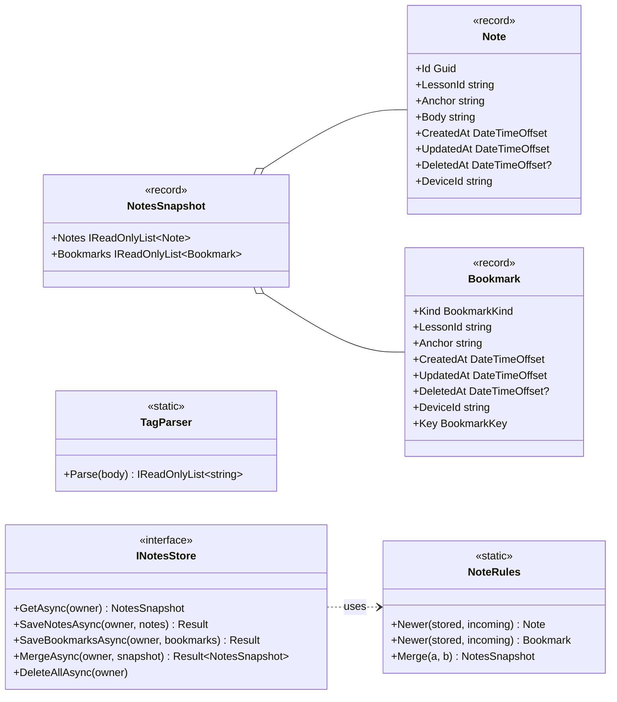

# Spec 007: Implementation plan

Companion to [`spec.md`](./spec.md). Written 2026-10-20 after the owner approved the spec.

## 1. Packages
None.
- **Web:** the sheet and the section popover reuse Base UI `Drawer` / `Popover`; toasts reuse Sonner; Preview reuses
  `react-markdown` + `remark-gfm` + Shiki from the reader.
- **App:** the export uses MAUI's built-in `Share` API.

## 2. Design

### 2.1 Where the logic lives
| Concern | Lives in | Why |
|---|---|---|
| Note and bookmark edits (create, edit, delete, undo, toggle) | **TypeScript** `features/notes/noteRecords.ts` (pure) | The UI is where they happen; one implementation for app and browser |
| Grouping, ordering, filters, the export file | **TypeScript** `notesQuery.ts`, `exportNotes.ts` (pure) | Only the UI uses them; the web already has the content titles |
| Later-edit-wins and the guest **merge** | **C#** `Lld.Domain/Notes/NoteRules` (pure) | The device (adoption) and the API (adoption, later `/sync`) both need them |
| Tag parsing | **C#** `TagParser` and **TS** `tags.ts`, checked by one shared vector | Spec §3.5: the web filters now; C# search (spec 009) uses the same rule |
| Limits | **C#** `NoteLimits` (every store) and the same numbers in TS (UI hints, guest copy) | Bridge and HTTP input is untrusted |
| Storage | `INotesStore`: SQLite on the device, EF Core on the API, in-memory for tests; `localStorage` for a browser guest | Same as progress (spec 005) |

### 2.2 Domain (`Lld.Domain/Notes/`)

- `BookmarkKind { Lesson, Section, CheatSheet }`. `Anchor` is `""` for a whole lesson, a lesson bookmark and a cheat-sheet
  bookmark, so keys never hold nulls. `BookmarkKey = (Kind, LessonId, Anchor)`.
- **Owner:** reuses `ProgressOwner` (guest or `user:<id>`). It already means "whose learner data". It is not renamed in
  this spec, because a rename would touch every spec 005 file for no behaviour change.
- **`Newer`:** the later `UpdatedAt` wins; on a tie, the incoming record wins (as in progress). A delete is a write with
  `DeletedAt` set; an undo is a later write with `DeletedAt = null`.
- **`Merge`** (adoption, §3.8): notes are matched by `Id`, bookmarks by key, each resolved by `Newer`. A guest's ids are
  GUIDs, so their notes never collide with the user's; the union keeps both.
- **`NoteLimits`:**
  - each record: body 1–20,000 characters, lesson id ≤ 120, anchor ≤ 200, device id ≤ 64, a known kind, a section
    bookmark has an anchor and the other kinds don't;
  - each write: ≤ 500 records;
  - totals: ≤ 100 live notes per lesson, ≤ 5,000 live notes and ≤ 2,000 live bookmarks per owner. Stores check the
    totals against what is stored, so `Save*` returns a `Result` (`notes.too_many`, `bookmarks.too_many`).
  - Deleted records don't count towards the totals.
- **`TagParser`:** a regex over the body with code spans and fenced code blocks removed first:
  `(?<![\w/#&])#([A-Za-z][A-Za-z0-9-]{0,29})(?![\w-])`. Results are in lower case, de-duplicated, in first-seen order.
  The lookbehind rules out URL fragments (`/#x`), HTML entities (`&#38;`) and `##`. A heading's `# ` doesn't match
  because a space follows the `#`.
- **Shared vector:** `tests/fixtures/notes/tags.json` (`[{ body, tags }]`), read by xUnit and Vitest like the mnemonics
  vector of spec 006.

### 2.3 Device (`Lld.App.Data` + `Lld.App`)
- **Schema step V6 `V6Notes`:**
  ```sql
  CREATE TABLE Notes (Owner TEXT NOT NULL, Id TEXT NOT NULL, LessonId TEXT NOT NULL, Anchor TEXT NOT NULL DEFAULT '',
      Body TEXT NOT NULL, CreatedAt TEXT NOT NULL, UpdatedAt TEXT NOT NULL, DeletedAt TEXT NULL, DeviceId TEXT NOT NULL,
      PRIMARY KEY (Owner, Id)) WITHOUT ROWID;
  CREATE INDEX IX_Notes_Owner_Lesson ON Notes (Owner, LessonId);
  CREATE TABLE Bookmarks (Owner TEXT NOT NULL, Kind INTEGER NOT NULL, LessonId TEXT NOT NULL, Anchor TEXT NOT NULL DEFAULT '',
      CreatedAt TEXT NOT NULL, UpdatedAt TEXT NOT NULL, DeletedAt TEXT NULL, DeviceId TEXT NOT NULL,
      PRIMARY KEY (Owner, Kind, LessonId, Anchor)) WITHOUT ROWID;
  ```
  There is no foreign key to `Lessons`, as with progress, so notes on a removed lesson survive a content reload (A13, A14).
- **`SqliteNotesStore : INotesStore`:** one transaction per write. It reads the stored rows for the keys being written,
  applies `Newer`, then checks the totals with one `COUNT` per owner (and per lesson for the lessons written).
- **`DeviceNotes`:** stamps `DeviceId` (from `DeviceIdentity`) and calls the store with the session's owner
  (`IProgressOwnerSource`). `AdoptGuestAsync(userId)`: read the guest's records → `MergeAsync(user, guest)` →
  `DeleteAllAsync(guest)`, in one transaction.
- **`NotesService`** (bridge-facing, like `ProgressService`): waits for `ContentGate`, parses the JSON with a source-
  generated context (`NotesBridgeJson`), and maps failures to a `BridgeError` (`notes.unavailable`, `validation.notes.*`).
- **`ExportService`:** writes the text to `FileSystem.CacheDirectory/<fileName>` (the name is checked against
  `^lld-notes-\d{4}-\d{2}-\d{2}\.md$`), then calls `Share.Default.RequestAsync(new ShareFileRequest(...))` on the main thread.
- **`BridgeService`:**
  - new methods: `GetNotes()`, `SaveNotes(json)`, `SaveBookmarks(json)`, `ShareNotes(fileName, markdown)`;
  - `Login` / `RestoreSession` adopt the guest's notes after its progress (two calls, each logged and never shown on
    failure, as in spec 005).

### 2.4 API
- **`Lld.Infrastructure`:** `NoteRow` and `BookmarkRow` (`OwnerId` = user id, foreign key to `AspNetUsers` with cascade
  delete, the same keys as on the device), migration `AddNotes`, and `EfNotesStore : INotesStore`.
- **`Lld.Application/Notes`:** use cases `GetNotes`, `SaveNotes`, `SaveBookmarks` and `AdoptGuestNotes` (validate →
  store); errors are `notes.invalid_*` / `notes.too_many`.
- **`Lld.Contracts/NotesContracts.cs`:** `NoteDto`, `BookmarkDto` (`kind` as a camelCase string) and `NotesSnapshotDto`.
  `Lld.Wire/NotesWire.cs` maps them both ways (shared with the device).
- **`Lld.Api/Endpoints/NotesEndpoints.cs`:** all `RequireAuthorization()` and scoped to the caller:

  | Method | Path | Body → result |
  |---|---|---|
  | GET | `/api/notes` | → `NotesSnapshotDto` (deleted records included, for spec 010) |
  | PUT | `/api/notes` | `NoteDto[]` (batch, later edit wins) → 204, or 400 / 422 with the limit broken |
  | PUT | `/api/bookmarks` | `BookmarkDto[]` → 204 |
  | POST | `/api/notes/adopt` | `NotesSnapshotDto` (the browser guest) → the merged `NotesSnapshotDto` |

- Request body limit: 1 MB for these endpoints. 500 notes × 20,000 characters doesn't fit in one request, so the
  client splits its queue into batches under 1 MB.
- **Only browser mode calls them**, so the app's request budget is unchanged (spec §1, owner decision).

### 2.5 Web
```
web/src/features/notes/
  tags.ts                parseTags (shared vector)
  noteRecords.ts         Note / Bookmark helpers: newNote, editNote, deleteNote, restore, setBookmark (pure)
  starters.ts            the three starters: label, template, tag, first-blank offset
  notesQuery.ts          group by module → lesson → section, order, filter predicates (tag AND text), tag counts
  exportNotes.ts         the Markdown file of §3.7 (pure)
  notesStore.ts          external store, like ProgressStore: snapshot, subscribe, write-behind queue
  NotesProvider.tsx      one store per data source + owner (reloads on sign-in / sign-out)
  useNotes.ts            useLessonNotes, useSectionMarks, useBookmark, useAllNotes
  NoteMarks.tsx          note chip "✎ 2" and ribbon mark, with labels
  SectionActions.tsx     the heading button + Popover (Add note here / Bookmark section)
  BookmarkToggle.tsx     lesson header and cheat sheet header
  NotesSheet.tsx         Drawer (phone) / side panel (desktop): grouped list, New note
  NoteEditor.tsx         textarea, autosave, Edit / Preview, starters, delete (undo toast)
  NotePreview.tsx        MarkdownView in "note" mode
  YourNotes.tsx          Revise: folded "Your notes (n)"
  NotesPage.tsx          the Notes tab
web/src/features/shared/writeBehind.ts   quiet-delay / hidden / pagehide / dispose flushing, used by both stores
```
- **`DataSource`** gains `getNotes()`, `saveNotes(notes)`, `saveBookmarks(bookmarks)` and
  `exportNotes(fileName, markdown)`.
  - `BridgeDataSource`: bridge calls.
  - `HttpDataSource`:
    - signed in → the API;
    - signed out → `GuestNotes` in localStorage (`lld.notes.guest`), sharing the device id with `GuestProgress`;
    - after sign-in, a non-empty guest copy goes to `/api/notes/adopt` and is cleared (as progress does);
    - `exportNotes`: a `Blob` download.
  - The fakes gain the same methods.
- **`NotesStore`:**
  - It applies every edit to the snapshot at once and queues the changed records.
  - Typing is debounced in the editor (800 ms). The queue then flushes after 1 s of quiet, when the page is hidden, on
    `pagehide` and before the owner changes.
  - A failed flush stays queued. A guest quota error turns into a toast: "Couldn't save your note on this device."
  - The flush timing that `ProgressStore` has today moves to `writeBehind.ts`, and both stores use it (one change,
    covered by the existing progress store tests).
- **The reader:**
  - `LessonPage` provides a `SectionAnnotations` context: the lesson id plus the hooks.
  - `MarkdownView` renders `h2` through a component that adds `NoteMarks` and `SectionActions` when the context is
    present. Cheat sheets and Preview render without it.
  - The outline rows read the same hooks for their marks.
  - Opening `?at=<anchor>&note=<id>` scrolls to the section (existing) and opens the sheet on that note.
- **Header:** `LessonPage` gets "Notes · n" and the bookmark toggle; `CheatSheetPage` gets the bookmark toggle and, at
  the end, `YourNotes`.
- **Preview "note" mode:** the GFM and Shiki code blocks only. No term callouts, look-alike slot, interactive diagrams
  or Mermaid, so a note can't look like content. Links go through `openExternal`.
- **The Notes tab:** the route `notes` replaces `ComingSoon`.
  - Titles: the tab loads the module list and the modules of lessons with notes. Section names come from `getLesson` for
    lessons with notes, which is cached in `useContent` and local on the device. Before they load, the anchor is shown
    in readable form.
  - Removed lessons: a note whose lesson isn't in the content goes under **Removed lessons**.
  - Filters are kept in `sessionStorage`.
- **Export:**
  - `exportNotes.ts` builds the text from the snapshot plus the titles. Lessons that need section names are loaded
    first. A "Preparing…" state is shown if that takes more than 300 ms.
  - The browser downloads the file; the app opens the share sheet.

### 2.6 Visual and motion details
| Element | Implementation |
|---|---|
| Note tone | `--tone-note` (light + dark), picked in the UI pass from 2–3 candidates: clearly a "red pencil", told apart from `--tone-rose` (callouts, reset) by hue *and* by shape (notes never use the UML dog-ear), AA on `--surface`. Checked by the Playwright contrast helper from #11 |
| «my note» card | a 2 px left rule in the note tone, the `«my note»` stereotype in JetBrains Mono, the body in the reader's text style; the sheet and Revise use the same card |
| Marks | `✎ n` chip (mono, note tone), ribbon glyph in ink; `aria-label` "2 notes" / "Bookmarked" |
| Section button | a quiet icon button after the `h2` text, 44 × 44 hit area, the icon at 60% ink until hovered or focused; a Popover from the trigger (`transform-origin: var(--transform-origin)`), 150 ms ease-out, scale 0.97 → 1 |
| Sheet | existing Drawer motion; on desktop a right side panel 400 px wide with the same open / close timing |
| Saved status | text fades in over 150 ms, no spinner |
| Delete | the row collapses 200 ms ease-out (opacity + height in a grid-rows transition); Undo restores it in place |
| Reduced motion | fades only |
| Press feedback | existing `scale(0.97)` on `:active` |

## 3. Testing
| Layer | Tests |
|---|---|
| Domain | `NoteRulesTests` (`Newer` for both, merge by id and by key, delete / undo), `NoteLimitsTests`, `TagParserTests` (shared vector) |
| Store contract | `NotesStoreContract` run against in-memory, `SqliteNotesStore` and `EfNotesStore`: owner isolation, later-edit-wins, soft delete, totals (per lesson, per owner, deleted not counted), merge, delete the guest |
| Device | V5 → V6 upgrade keeps progress; a content reload keeps notes (A14); adoption in one transaction; `NotesService` bad JSON |
| Application | use-case validation |
| API integration (Aspire) | 401 without a token; user A can't read or overwrite user B; adopt merges; limits → 4xx (A11, A12) |
| Web unit (Vitest) | tags vector (A6), starters (A7), records + undo (A8), query: grouping, ordering, filters, removed lessons (A5, A13), export file (A10), store queue, `HttpDataSource` guest / adopt / batch split |
| Web components (Vitest) | editor autosave + Preview + empty-delete (A1), section actions + marks + outline (A3), bookmark toggles (A4), Notes tab (A5), YourNotes in Revise (A9) |
| Playwright | write a section note → mark in the outline → reload → still there; bookmark three kinds → Notes → Bookmarks opens each; tag filter; delete + undo; export download; contrast and 320 px (A15); phone + desktop |
| Manual | Windows and Android: restart, airplane mode, share sheet export, guest adoption on sign-in, V5 → V6 upgrade with progress and notes (A1, A2, A10, A11, A14) |

## 4. Risks
- **Keyboard on phones:** the editor must stay above the soft keyboard. The sheet sizes to `visualViewport.height`, and
  the textarea scrolls itself into view on focus. This is checked on the Android emulator, not only in Playwright.
- **localStorage quota** for a browser guest (≈ 5 MB): a large note can fail to save. It is caught and shown as a
  toast, and the text stays in the editor. Device storage has no such limit.
- **Heading ids** come from the packed outline. The rendered `h2` ids use the same slugger as ticks, so a section note
  and a section tick always agree.
- **Two places write the same note** (sheet open on desktop, Notes tab in another window): later edit wins, which is
  the same rule spec 010 uses.
