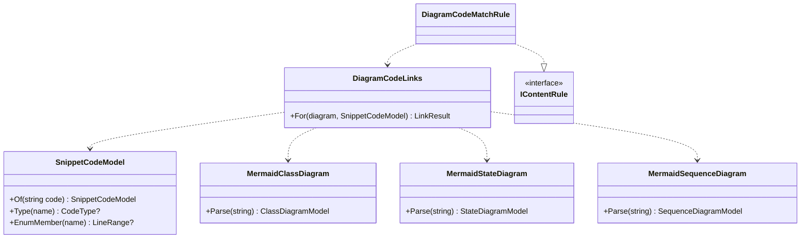

# Spec 008: Implementation plan

Companion to [`spec.md`](./spec.md). Written 2026-10-20 after the owner approved the spec and delegated the open
questions (CD-001..CD-004 in `docs/claude-decisions.md`). Design choices made while planning are logged there too
(CD-005 onwards).

## 1. Packages
None. Mermaid 12 (already used) draws every diagram; Roslyn (already used, pinned 5.0.0) reads the paired snippets;
the legend sheet reuses Base UI `Popover` / `Drawer` as the outline and picker do; the pair view reuses the
`CodeCompare` fit-and-switch logic.

## 2. Design

### 2.1 Projects
```
samples/Lld.Samples.Uml        NEW  class library: ClassBasics/ Relationships/ Multiplicity/ Sequence/ State/ Activity/
tests/Lld.Samples.Tests        + Uml/ tests, references the new library
Lld.Content.Authoring          + template `diagram`, MISTAKES callout, `code=` / `steps` fence keys, picker `title`,
                                 Uml/ (Mermaid readers, snippet code model, link map), new rules, pair packing
Lld.Contracts                  ModulePicker.Title (optional)
web/                           Mistakes stamp, CodeUmlPair, ArrowLegend, state Run, activity Step through,
                               picker on any module, picker title
content/                       uml/ (10 lessons + cheat sheets + module.yml)
```
Pack format stays **3** and there is no device schema step (CD-006): the template is not packed, the link map and
flags travel inside the packed fences (like Before / After marks), and the picker is stored as JSON, so its optional
`title` needs no column.

### 2.2 Template `diagram`
- `ContentSchemas.DiagramTemplate = "diagram"`, added to `Templates`.
- `ContentContext.ConceptLessons` includes `diagram` modules (REMEMBER first, icon, hook, interview questions, C# only
  from snippets). New `ContentContext.DiagramLessons` for the diagram-only rules.
- `Callouts.Types` gains `MISTAKES` (C# list and `rehypeContent.ts`); label "Common mistakes", warning colour, drawn
  by the same stamp component as Overuse.
- Sections are found with the existing `LessonSections` helper (spec 006).

### 2.3 Fence keys
| Key | On | Meaning | Packed as |
|---|---|---|---|
| `code="path#Symbols"` | `mermaid` | the snippet this diagram stands for (same syntax as `snippet=`) | `mermaid pair links="…"` + a following ```` ```csharp paired ```` fence with the snippet code |
| `steps` (flag) | `mermaid` flowchart | activity step-through | unchanged |
| `uml-arrows` (language) | empty fence | the arrow legend drawn inline | unchanged |

`FenceInfoRule` allows `code` and `steps` on `mermaid` fences only; `paired` and `links` are packer output and are
rejected in source. The packer emits the code as its own fence (CD-006) so the reader gets Shiki highlighting and
line marks for free, and older readers would still show diagram + code.

### 2.4 Reading diagrams and code (`Lld.Content.Authoring/Uml/`)

- **Mermaid readers** parse only what the check needs, line by line, never throwing: class names (incl. `class X {`
  blocks, `X~T~` generics, `<<interface>>`), relationships with their arrow kind (`<|--`, `<|..`, `*--`, `o--`,
  `-->`, `..>`, either direction, optional cardinalities and labels); state names and transitions (`A --> B : event`,
  `[*]`); sequence participants (`participant` / `actor`, `as` aliases, and names that appear only in messages).
- **`SnippetCodeModel`** parses the extracted snippet code (the same text the reader shows) with Roslyn: for each type,
  its line range, base list entries (with lines), members with their type names (unwrapping `List<T>`,
  `IReadOnlyList<T>`, arrays, `?`) and whether a collection is created inside the type (`= new()` / `[]`), and every
  other mention of a type name (parameters, locals, `new`) with its line. Enum members with their lines.
- **`DiagramCodeLinks`** returns the link map and the mismatches:

  | Diagram element | Linked to | Mismatch when |
  |---|---|---|
  | class / participant / state | its type, or enum member, line range | no such type or enum member |
  | `<\|--` / `<\|..` | the base-list entry | the subtype does not list the supertype |
  | `-->` / `o--` / `*--` | the member(s) of that type | no member of that type (either side, in the arrow's direction) |
  | `..>` | the first mention | no mention at all |
  | state transition | not linked (states only) | — |

  Composition vs aggregation is not judged from code (ownership is a design claim); the samples' tests prove it.
- **Link format** in the packed fence: `links="Order=3-12;OrderLine=14-18;Order*--OrderLine=5;Order-->Customer=6"`.
  Keys are names (classes) or `From<arrow>To` (relationships, as written in the diagram); values are 1-based line
  ranges in the paired code. The web parses it with `parseLineRanges`.

### 2.5 Rules (each its own class, one fixture each)
| Rule | Issue code | Checks |
|---|---|---|
| `DiagramSectionsRule` | `diagram-section-missing` | *The idea*, *In an interview*; plus either *Notation* + *Read it* + (*Code ↔ UML* or *From requirements*), or *Which diagram for which question* + *Worked example* (the interview lesson) |
| `DiagramSectionDiagramRule` | `diagram-section-no-diagram` | *Notation*, *Read it* and *From requirements* each hold a `mermaid` fence; *Code ↔ UML* holds a `code=` fence |
| `MistakesStampRule` | `diagram-mistakes-stamp` | exactly one `[!MISTAKES]` in a diagram lesson |
| `CodePairSnippetRule` | `code-pair-unresolved` | `code=` parses and resolves (reuses `SnippetReference` / `ICodeSnippetSource`) |
| `DiagramCodeMatchRule` | `code-pair-mismatch` | §2.4 mismatches, one issue each, at the diagram line |
| `FenceInfoRule` (changed) | existing codes | `code`, `steps` only on `mermaid`; `steps` only on a flowchart |
| `PickerRule` (changed) | existing | reachability only for `pattern` modules (CD-003); optional `title` ≤ 40 chars |

### 2.6 Packing
`FenceEdits` gains a third case: a `mermaid` fence with `code=` is rewritten as `mermaid pair links="…"` (`code`
removed) and followed by a new ```` ```csharp paired ```` fence holding the snippet code. Both fences keep the
container prefix logic (`Rewrite`), so pairs inside lists or quotes stay valid.

### 2.7 Web
- **Grouping:** `rehypePair` (next to `rehypeCompare`): a `pre` mermaid with the `pair` flag directly followed by a
  `pre` csharp `paired` → `<div data-pair>`; `MarkdownView` renders it as `CodeUmlPair`.
- **`CodeUmlPair`**: the `CodeCompare` layout (side by side when the code fits, else a *Diagram · Code* switch, both
  panes in one grid cell so the height never jumps). State: `selected: {kind: 'node' | 'edge', key} | null`. The
  diagram side gets `selected` and `onSelect`; the code side marks the linked lines (`mark` kind, reusing
  `CodeLines`) and scrolls the first into view (`block: 'nearest'`). Tapping a marked code line selects the
  narrowest link that covers it. On phone, tapping in the diagram switches to *Code* only after a 300 ms highlight
  (so the learner sees what was picked). Esc / the clear button / tap outside clears.
- **Edges become tappable** (pair diagrams and the legend's arrows only): each class-diagram edge path gets a
  transparent 16 px wide clone for the hit area, `tabindex="0"`, `role="button"` and an `aria-label` ("Order
  composes OrderLine"). `interactive.ts` gains `edgeKeyOf` (from / arrow / to from the Mermaid source, matched to the
  SVG edge order, since Mermaid draws edges in source order; verified on fixtures).
- **`InteractiveDiagram`** takes the Mermaid `source` (state Run and activity steps need the graph) and optional
  controlled selection (`selected`, `onSelect`) for the pair; uncontrolled stays as today.
- **Arrow legend** (`uml/ArrowLegend.tsx`, data `uml/arrowLegend.ts`): six rows, each a tiny `classDiagram` (`A --> B`
  …) rendered through `renderMermaid` when the legend first opens, the name, a one-line meaning and the C#. An
  *arrows* button in the strip of every class diagram opens it: `Popover` on wide screens, `Drawer` on phones (as the
  outline). Android Back closes it first (the existing back-stack hook). ```` ```uml-arrows ```` renders the same rows
  inline.
- **State Run** (`uml/stateMachine.ts` + `useStateRun`): the graph comes from the source (states, `[*]` start / end,
  `A --> B : event`); SVG elements are found by Mermaid's state ids (`state-<Name>-n`) and transition order. Tap a
  state → its transitions highlighted, the rest dimmed (same CSS as class focus). *Run* → current state marked;
  one button per outgoing event below the diagram (unlabelled transitions show "next"); a final state shows
  *Done · Reset*. The mark moves with a 200 ms ease-out (reduced motion: no transition). Composite states: the run
  stays at the top level; inner states are tappable but not run (said in Go deeper).
- **Activity Step through** (`uml/activityWalk.ts` + `useActivitySteps`): only for `mermaid steps` flowcharts. Graph
  from source: nodes, labelled edges, `:::fork` / `:::join` classes for bars, `((" "))` start, `(((" ")))` end.
  *Next* follows the single edge; at a decision (several outgoing edges) one button per edge label; at a fork, all
  branches light up and *Next* moves to the join; *Back* pops the path; *Reset*. Same strip style as the sequence
  controls.
- **Picker everywhere:** `ModulePage` shows the picker button on any module with a picker, labelled
  `picker.title ?? 'Which pattern?'`; the sheet title uses the same text (CD-005).
- **Mistakes stamp**: `Callout` maps `MISTAKES` to the Overuse stamp style with its own label and icon.

### 2.8 Content
- `content/uml/module.yml`: title, `order: 4`, `template: diagram`, `map:` (subgraphs *Structure*, *Behaviour*,
  *Practice*), two phrase mnemonics, `picker:` with `title: "Which diagram?"`.
- Activity conventions (CD-007): forks / joins are `:::fork` nodes styled as thin bars by a `classDef` the renderer
  injects (authors write only `:::fork`), start is `start((" "))`, end is `stop(((" ")))`.
- Use case conventions: the actor is an emoji node outside a `subgraph` system box, use cases are stadium nodes
  `(["…"])`; `<<include>>` / `<<extend>>` as dashed labelled links.
- "In this app" diagrams quote `src/` with `code=` where a pair makes sense (`AccessRequest` states, `RefreshToken`,
  `AggregateRoot`, `IPasswordPolicy`); component / deployment / use case use *From requirements*.

## 3. Testing
| Level | What |
|---|---|
| Unit (C#) | Mermaid readers (each arrow kind, both directions, generics, aliases, `[*]`); `SnippetCodeModel` (base lists, collections, nullable, enum members, line ranges); `DiagramCodeLinks` (link map + each mismatch); every new / changed rule with a fixture; `FenceEdits` pair packing (incl. inside a list) |
| Samples | `Lld.Samples.Uml` behaviour: composition / aggregation lifetimes, state machine allows exactly the drawn transitions, activity sample takes the drawn branch |
| Vitest | `rehypePair`; link parsing; `CodeUmlPair` both directions + phone switch; edge keys on a real Mermaid fixture; `stateMachine` + Run on real fixtures (UML lesson, Auth); `activityWalk` (decision, fork / join, back); legend open / close; picker title; Mistakes stamp |
| Playwright | `e2e/uml.spec.ts`: A1, A5–A11 on phone and desktop viewports; existing specs unchanged |
| Manual | Windows and Android app: module offline, pair switch on phone, legend + Android Back, Run, step-through, notes and progress kept after upgrade (A12) |

## 4. Risks
| Risk | Plan |
|---|---|
| Mermaid's SVG ids for state / flowchart elements differ from what the code expects | T-task captures real fixtures first (as spec 003 did); if an element cannot be found the diagram stays static and the Run / steps controls do not show (never a broken control) |
| Edge order in the SVG differs from source order | verified on fixtures; fallback: match by the from / to node ids in Mermaid's edge `data-id` (as class focus does) |
| Roslyn on a member-only snippet (`Type.Member`) | pairs should quote types or whole files; `CodePairSnippetRule` says so when the code model finds no type |
| Ten lessons + four features is a big PR | one review on the PR (owner choice); tasks keep commits small and the PR body maps every criterion |

## 5. Outcomes

### Changes from this plan
| Plan | As built | Why |
|---|---|---|
| Dependency link = "the first mention" | Every line that mentions the target | Lights up all the uses, which reads better |
| Taps on sequence participants select code | Class boxes, arrows and states select code; sequence participants don't (their code still links) | Mermaid's sequence actors are drawn twice (top and bottom); kept out of scope |
| Code pane as tall as the code | The code pane scrolls inside a box as tall as the diagram (`--pair-diagram-height`) and the lit line comes to a third of it | Screenshots showed a screen of empty grid under the diagram on phones |
| GoF State lesson gets the Run | No `stateDiagram-v2` there (it draws a class diagram); Run is on the Auth case study and UML | Found while capturing fixtures; spec and CD-004 corrected |
| — | `web/scripts/check-mermaid.mjs`: renders every content diagram with the real Mermaid | The validator checks structure; only Mermaid can say a diagram parses |
| — | `web/scripts/render-mermaid-fixtures.mjs` for the UML fixtures | Fixtures must be real Mermaid 12 output, regenerated when Mermaid changes |
| Relationships cheat sheet quotes `Order` | One line mapping each C# shape to its arrow, under the inline legend | Kept the sheet within 3 phone screens (A11) |

### Findings
- Mermaid ids: class edges `id_A_B_<n>` (n = source order from 1), state edges `edge<n>` (from 0), state nodes
  `state-<Name>-<n>`, flowchart nodes `flowchart-<id>-<n>`, flowchart edges `L_<from>_<to>_<n>`.
- Flowchart edge labels may be quoted (`-->|"no"|`); the Playwright run caught the quotes reaching the buttons.
- A forced Playwright click hits the middle of an L-shaped edge's box, not the line; real taps hit the 16 px twin.
- Pressing "step through" (or "run") replaced the button that had focus, so ← → went to the page: a race the
  full parallel Playwright run hit (spec 003's A14). Focus now stays in the diagram figure while stepping.
- Locators filtered by "has a run button" move to the next diagram once Run is pressed: pin the element first.
- The Windows app uses the owner's real device database: browsing in a manual run writes progress, so back it up and
  remove the test rows afterwards (done: two `LessonProgress` rows and one `ActivityDays` row).

### T18: manual run (2026-10-21)
| Check | Where | Result |
|---|---|---|
| A1, A12 upgrade | Windows (owner DB, backed up first) | ✅ 55 lessons, UML at position 4, content version updated, 17 progress rows kept; test rows removed |
| A5, A7 | Windows | ✅ pair arrow lights its code; Run to Cancelled (`windows-3-pair.png`, `windows-4-state-run.png`) |
| A1 offline, A12 upgrade | Android emulator, airplane mode (spec 007 build with SRP Done, 1 note, 1 bookmark) | ✅ schema 6, 55 lessons, SRP Done, note and bookmark kept |
| A6, A7, A8 | Android | ✅ legend sheet closed by Android Back (`lldBack` → closed), Run, activity choices (`android-*.png`) |

### Final numbers
.NET: domain 97 · application 38 · API 55 · admin 11 · server status 30 · content 377 · progress and notes stores 86 ·
lesson samples 172 · Aspire integration 4. Web: Vitest 311 · Playwright 122 passed (phone + desktop, 2 skipped).
0 build warnings; lint and guardrails clean; 48 of 48 UML diagrams draw.
