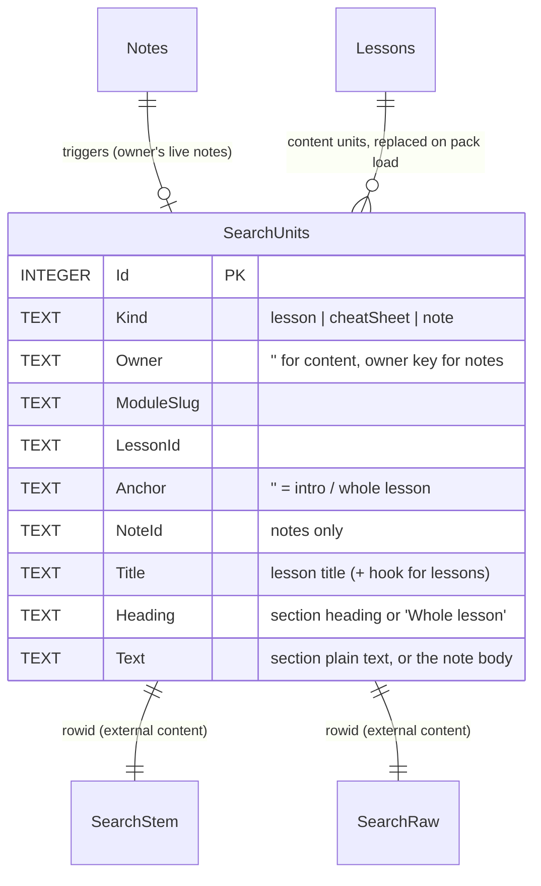
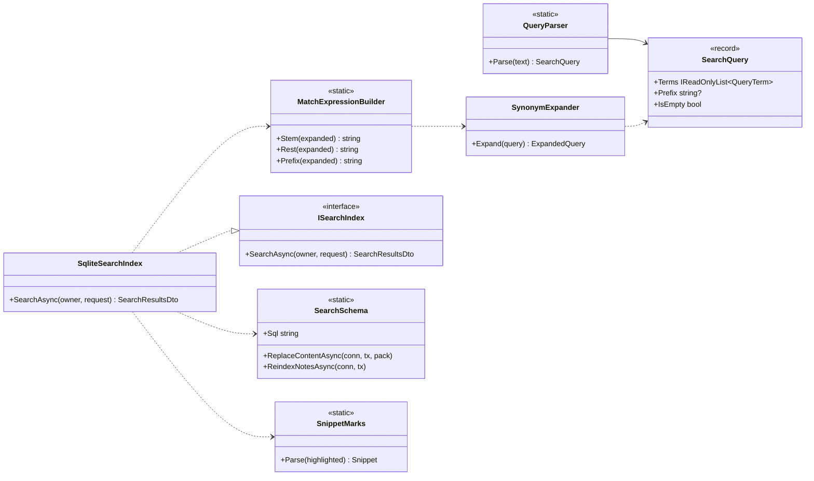

# Spec 009: Implementation plan

Companion to [`spec.md`](./spec.md). Written 2026-10-21 after the owner approved the spec (all §8 recommendations).

## 1. Packages
None.
- **C#:** FTS5, the `porter` tokenizer and JSON1 are compiled into `e_sqlite3`, the native SQLite that
  `Microsoft.Data.Sqlite` already ships on every platform. T1 checks this on Android before anything else is built.
- **Web:** quick search uses the Base UI `Dialog` the app already has. Marks use the CSS Custom Highlight API, which the
  browser provides (Chromium 105+, WebView2, Android System WebView; Safari 17.2+ for Phase 2), so no package is needed.

## 2. Design

### 2.1 Where the logic lives
| Concern | Lives in | Why |
|---|---|---|
| Section plain text (Markdown stripped, code and diagrams dropped, folds kept) | **C#** `Lld.Content.Authoring/Search/SearchText` (Markdig, at pack time) | The packer already parses every document; the device never needs a Markdown parser |
| `search.yml` reading and rules | **C#** `Lld.Content.Authoring` (`SearchVocabularyFile`, 4 `IContentRule` classes) | Same place and style as `module.yml` and its rules |
| Query parsing, synonym expansion, MATCH building, ranking, snippets, matched words | **C#** new `Lld.Search` library | One engine for the device and the API dev mode, with one contract suite (spec §3.8) |
| Notes index on the device | **SQL triggers** in schema step V7 | A note write, delete, adoption or `DeleteAll` changes the index in the same statement's transaction; the C# store can't forget it |
| Grouping, Best match, filters → URL, recent searches | **TypeScript** `features/search/*` (pure) | Only the UI uses them |
| Marks in the reader, match bar, fold opening | **TypeScript** `features/search/marks/*` | DOM work |

### 2.2 Why two FTS5 indexes (checked while planning)
FTS5's `porter` tokenizer stems prefix queries too. A word typed halfway is stemmed into something the index never
holds, so results vanish mid-word:

| Query | Stemmed index | Unstemmed index |
|---|---|---|
| `decor*` | ✅ | ✅ |
| `decorat*` | ❌ (no token starts with `decorat` after stemming: Decorator → `decor`) | ✅ |
| `inherits` | ✅ (matches *Inheritance*) | ❌ |

So one content table feeds **two** external-content FTS5 tables over the same rows: `SearchStem` (`porter unicode61
remove_diacritics 2`) and `SearchRaw` (`unicode61 remove_diacritics 2`). Every finished word must match in
`SearchStem`. The last word, while typing, may match either as a stem or as a raw prefix:

```sql
-- stemExpr: all words stemmed (last one included as a whole word); restExpr: all but the last; prefix: 'decorat*'
SELECT u.Id, bm25(SearchStem, 10.0, 5.0, 1.0) AS Rank, 'stem' AS Via FROM SearchStem JOIN SearchUnits u ON u.Id = SearchStem.rowid
 WHERE SearchStem MATCH $stemExpr AND u.Owner IN ('', $owner) [AND filters]
UNION ALL
SELECT u.Id, bm25(SearchRaw, 10.0, 5.0, 1.0), 'raw' FROM SearchRaw JOIN SearchUnits u ON u.Id = SearchRaw.rowid
 WHERE SearchRaw MATCH $prefixExpr AND ($restExpr = '' OR u.Id IN (SELECT rowid FROM SearchStem WHERE SearchStem MATCH $restExpr))
   AND u.Owner IN ('', $owner) [AND filters]
```
Duplicate ids keep their best rank. Snippets and matched words come from `highlight()` / `snippet()` on the table each
hit came through. A query that ends with a space, or whose last word is in quotes, has no prefix part.

### 2.3 Tables (device schema V7; the API dev index runs the same SQL in memory)

- `SearchStem` / `SearchRaw`: `fts5(Title, Heading, Text, content='SearchUnits', content_rowid='Id', tokenize=…)`, kept in
  step by the three usual external-content triggers on `SearchUnits`.
- **Notes triggers** (`AFTER INSERT`, `AFTER UPDATE`, `AFTER DELETE` on `Notes`): drop the note's unit, then insert one
  when `DeletedAt IS NULL`. `Title` comes from `Lessons`, `Heading` from the lesson's `OutlineJson` via `json_each`
  (falls back to "Whole lesson" when the anchor no longer exists, spec §3.1), `ModuleSlug` from `Lessons` (empty for a
  removed lesson).
- **Content reload** (`ContentPackLoader`, same transaction as today): delete content units, insert the pack's units,
  then rebuild note units (`DELETE … WHERE Kind = 'note'` + `INSERT … SELECT FROM Notes JOIN Lessons`) so renamed
  lessons and sections show their new names.
- **Upgrade V6 → V7:** the step creates the tables and triggers and indexes the existing notes. Content units come from
  the next pack load. Pack format 4 changes the pack version hash, so the loader reloads on the first launch after the
  upgrade (a test pins this: "V6 database + format-4 pack → content units present").

### 2.4 Pack (format 4)
```csharp
public sealed record SearchSection(string Anchor, string Heading, string Text);           // Anchor "" = intro
PackedLesson    { …, IReadOnlyList<SearchSection> Search }                                // h2 units of lesson.md
PackedCheatSheet{ …, IReadOnlyList<SearchSection> Search }                                // h2 units of cheatsheet.md
ContentPack     { …, SearchVocabulary Vocabulary }                                        // from content/search.yml
public sealed record SearchVocabulary(IReadOnlyDictionary<string, IReadOnlyList<string>> Synonyms, IReadOnlyList<string> Suggestions);
```
- `SearchText` walks Markdig blocks per `h2`: paragraphs, list items, table cells, quote blocks (callouts, Q&A, Go
  deeper) and inline code become text. Fenced code, Mermaid, HTML blocks, link URLs and image sources are dropped.
  Callout markers such as `[!REMEMBER]` and fence keys are removed. Anchors use the same `HeadingSlugger` as the outline.
- The lesson's `Title` field holds the title and the hook, so `Title` matches lift any section of that lesson. Only the
  intro unit gets the hook, so the hook doesn't count once per section.
- The device ignores the extra JSON in older code paths; only `ContentPackJson` readers that check `Format` change.

### 2.5 `Lld.Search` (new library: `Microsoft.Data.Sqlite`, `Lld.Contracts`)

- **`QueryParser`:** splits on anything that isn't a letter or digit (Unicode), keeps `"…"` phrases, drops words the
  tokenizer would drop, caps 100 characters and 8 terms. The output is plain words, and every word is emitted as a
  quoted FTS5 string (`"word"`), so `AND`, `NEAR`, `*`, `(`, `:` are only ever text. One fixed vector,
  `tests/fixtures/search/queries.json`, holds inputs with their expected parse and MATCH output.
- **`SynonymExpander`:** a term whose lower-cased form is a vocabulary key becomes `("srp" OR "single responsibility")`.
  It returns the expansions used, which the UI shows as "Also searching: …".
- **Ranking (Q1):** `bm25(…, 10, 5, 1)`; then, in C#, hits whose `Title` column matched sort first (a lesson-title match
  is the Best match). Ties go by course order (module order, lesson order, section order).
- **Snippet (Q3):** `snippet(…, 2, '', '', '…', 24)` on the `Text` column (about 160 characters). `SnippetMarks`
  turns the private-use markers into `{ text, marks: [[start, length]] }`, at most 3 marks, so no HTML crosses the
  bridge.
- **Matched words:** `highlight()` over the hit's columns gives the surface forms (`Inheritance`, `inherits`). The
  union per lesson is returned for the reader's marks (§2.8).
- **Results:** up to 50 hits, plus a total count and per-kind counts (for the filter chips), the expansions and, when
  asked with `lessonId`, that lesson's matched words.

### 2.6 Contracts (`Lld.Contracts/SearchContracts.cs`, mirrored in `web/src/data/types.ts`)
```csharp
public static class SearchKinds { public const string Lesson = "lesson", CheatSheet = "cheatSheet", Note = "note"; }
public sealed record SearchRequestDto(string Query, string? Kind, string? Module, string? LessonId, int Limit = 50);
public sealed record SearchSnippetDto(string Text, IReadOnlyList<int[]> Marks);
public sealed record SearchHitDto(string Kind, string ModuleSlug, string LessonId, string LessonSlug, string LessonTitle,
    string Anchor, string Heading, string? NoteId, SearchSnippetDto Snippet, bool TitleMatch);
public sealed record SearchResultsDto(string Query, IReadOnlyList<string> Expansions, int Total,
    IReadOnlyDictionary<string, int> CountsByKind, IReadOnlyList<SearchHitDto> Hits, IReadOnlyList<string> Words);
```

### 2.7 Where each side calls it
| Side | Path |
|---|---|
| **App** | `BridgeService.Search(requestJson)` → `DeviceSearch` (owner from `IProgressOwnerSource`, never from JS) → `SqliteSearchIndex` over `DeviceDatabase` |
| **Browser dev** | `GET /api/search?q=&kind=&module=&lessonId=`, mapped only in Development next to the content API. `DevSearchIndex` keeps one open in-memory SQLite connection, refills content units when `DevContentCatalog`'s version changes, and per request replaces the caller's note units from `GetNotes` (signed in), or none for a guest (Q7) |
| **Web** | `DataSource.search(request)`; `BridgeDataSource` → bridge, `HttpDataSource` → `/api/search`; `fakeDataSource` runs a tiny TS matcher for unit tests only |

The `ISearchIndex` contract suite (`tests/Lld.Search.Tests`) runs against the device database (file, V7) and the API
dev index. It covers kinds, owners, deleted notes, renamed and removed sections, filters, prefix mid-word, stems,
phrases, synonyms, hostile input and ranking order.

### 2.8 Web
```
features/search/
  SearchPage.tsx          box, filters, results, empty and no-results states (replaces ComingSoon)
  QuickSearch.tsx         Ctrl+K / ⌘K / "/" dialog (wide + fine pointer only)
  useSearch.ts            debounce 120 ms, AbortController, latest-wins, min 2 chars
  searchResults.ts        pure: Best match + module groups by best hit, rows by rank (Q2)
  searchParams.ts         pure: q / kind / module ↔ URL
  recentSearches.ts       pure + storage: 8, per owner key, newest first, de-duplicated (Q6)
  ResultRow.tsx           kind icon, reference, snippet with <mark data-search>, «my note» + tags
  marks/
    useSearchMarks.ts     ?q= → source.search({ query, lessonId }) → words → DOM ranges → CSS.highlights
    findRanges.ts         pure-ish: whole-word, case- and diacritic-insensitive; skips pre, svg, [data-mermaid]
    MatchBar.tsx          "word · 3 of 7 · ↑ ↓ · ✕"; Esc / Android Back / ✕ clear and drop ?q=
    FoldRegistry.tsx      folds register { element, open }; the current mark opens its fold
```
- **Folds:** `GoDeeper`, interview answers and `RecallSection` keep their content in the DOM while closed
  (`hiddenUntilFound` on the Base UI panels), so marks can be found inside them. Each fold registers with
  `FoldRegistry`, and the match bar opens the fold that holds the current mark.
- **Cheat sheet:** `CheatSheetPage` gains `useAnchorScroll` (it has none today). With recall on and `?q=`, the matched
  section's id is added to `revealed` (Q8). `?at=` is set for cheat sheet hits.
- **Notes hits** link exactly as Notes-tab rows do (`?at=&note=`), plus `q`.
- **Recent searches** live in `localStorage` under `lld.search.recent.<owner>`. The owner comes from the auth context
  (`guest` or the user id), reads and writes are wrapped in try/catch, and the key is removed on "Clear".
- **Android Back:** the match bar registers as an overlay (`role="dialog"`-free, so it uses a small hook into
  `handleBack`: marks shown → clear them first). The quick-search dialog is a Base UI dialog, so the existing rule
  already closes it.
- **Section tab:** remove `comingIn` from the Search section; route `search` → `SearchPage`.

### 2.9 Visual (T12)
- `--tone-match` is a highlighter fill (warm yellow in light, a muted amber in dark) with `--ink` text, chosen from 3
  candidates by contrast check. It is used by `::highlight(search)`, `mark[data-search]` and the match-bar count.
  `::highlight(search-current)` adds an underline in `--ink` (an outline isn't available to highlights), so the current
  mark is not shown by colour alone.
- Result rows use the mono label style for the reference (*UML · Sequence › Read it*). Kind glyphs: lesson page, cheat
  sheet bolt (the Revise icon), note pencil with the redline tone.
- No animation while typing. The dialog uses the app's existing overlay enter (opacity + 4 px, 150 ms) and the match bar
  slides up 8 px; both are removed under reduced motion.

## 3. Risks and how they are handled
| Risk | Handling |
|---|---|
| FTS5 or JSON1 missing from `e_sqlite3` on Android | T1 spike on the emulator before any other task; fallback: notes triggers without `json_each` (heading resolved in C# on write) |
| 200 ms on device | T1 times a 30-query set over the bridge with the real pack; the debounce and latest-wins cover typing; a .NET timing test guards regressions in CI (generous bound, real numbers come from the device log) |
| CSS Highlight API not on an older WebView | Feature check: without it the reader still scrolls to the section and opens the fold, and the match bar shows the count without stepping |
| Folds rendered while closed cost time on long lessons | Measure lesson open (PRD: under 300 ms) before and after `hiddenUntilFound` in T9 |
| Identifiers such as `SessionManager` are one token (`manager` doesn't find it) | Accepted for this spec (code search is out of scope); noted in plan §5 outcomes |
| Note triggers and the API's note re-indexing drift apart | Both run the same contract suite |

## 4. Order of work
See [`tasks.md`](./tasks.md). The spike comes first, then the engine (pure code, then SQL), then pack and device, then
API dev mode, then web data, UI, marks, visuals, tests, manual run and docs.

## 5. Outcomes
(Filled in at the end: deviations, measurements, findings.)
