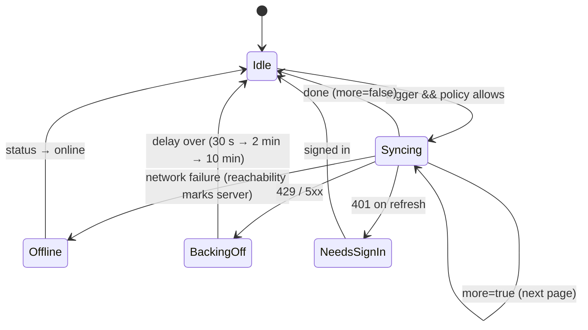

# Spec 010: Implementation plan

Companion to [`spec.md`](./spec.md). Written 2026-10-21, at the owner's request, together with the spec and before
its review. It assumes the §8 recommendations. If the review changes one, the sections marked with that question
(e.g. *(Q3)*) change with it before any code is written.

## 1. Packages
None. Sync uses `HttpClient` (the app's existing `ApiClient` pipeline: tunnel headers, reachability handler),
EF Core and `Microsoft.Data.Sqlite`, all already referenced.

## 2. Design

### 2.1 Where the logic lives
| Concern | Lives in | Why |
|---|---|---|
| Conflict rules (progress field merge, note later-wins + copy, bookmark later-wins, day union) | **C#** `Lld.Domain/Sync` (pure) | One set of rules for the API and the device (spec §3.9), table-tested |
| Version stamping, cursor pull, paging, echo suppression, conflict copies | **C#** `Lld.Application/Sync/SyncUserData` + `Lld.Infrastructure` (`EfSyncLedger`) | The server is the one place that orders changes |
| Wire shapes | **C#** `Lld.Contracts/SyncContracts.cs` + `Lld.Wire/SyncWire.cs` | Same split as progress and notes |
| Pending flags, cursor, applying pulled records | **C#** `Lld.App.Data/Sync` (`SqliteSyncLedger`) | Device-only. The existing stores keep their contract suites |
| When to sync, one at a time, back-off, status | **C#** `Lld.App/Sync` (`SyncEngine`, `SyncPolicy`, `SyncStatus`) | Lifecycle and server status already live in C# |
| Sync row, sign-out sheet, store reloads | **TypeScript** `features/sync/*`, existing stores | UI only. React never talks to the API in the app |

### 2.2 Conflict rules (`Lld.Domain/Sync`)
```csharp
public static class ProgressSync          // spec §3.4, owner decision
{
    // Ticks: union, minus the ticks of a side whose UpdatedAt < max(ResetAt).
    // Status/DoneBy/CompletedAt: from the side with the later StatusChangedAt (tie → higher DeviceId).
    // Position: from the side with the later LastReadAt. LastReadAt / LastRevisedAt / ResetAt: max.
    // UpdatedAt/DeviceId: from the later edit. Normalise: ticks present && NotStarted → InProgress.
    public static LessonProgress Merge(LessonProgress stored, LessonProgress incoming);
}

public static class NoteSync
{
    // Concurrent = incoming.BaseVersion < stored.Version && incoming.DeviceId != stored.DeviceId.
    // Winner by UpdatedAt (tie → DeviceId). Copy when the loser is live and its body differs from the winner's
    // (a deleted winner counts as different). Not concurrent → plain NoteRules.Newer.
    public static NoteResolution Resolve(StoredNote stored, IncomingNote incoming);
}
public sealed record NoteResolution(Note Winner, ConflictCopy? Copy);   // Copy → new Guid, same lesson + anchor
```
- `ProgressRules.Newer` stays for local writes on one device. `ProgressRules.Merge` stays for guest adoption
  ("furthest status wins", spec 005). The server uses `ProgressSync.Merge` for **every** write that can come from
  another device: sync pushes and the browser-mode `PUT /api/progress/lessons`.
- `ConflictCopyText.Header(label, at)` builds the first line (Q9). Label and date format are shared by C# and
  TypeScript through one vector (`tests/fixtures/sync/conflict-copy.json`), like the tag parser in spec 007.
- **Clock guard (Q7):** `ClockGuard.Clamp(record, serverNow, 5 min)` runs on the server before any rule.

### 2.3 Model changes
- `LessonProgress` gains `StatusChangedAt` and `ResetAt` (`DateTimeOffset?`). `ProgressLimits.Validate` adds:
  `ResetAt` and `StatusChangedAt` are not after `UpdatedAt`. The web reader sets `statusChangedAt` whenever
  it changes the status and `resetAt` on a reset. Old clients that don't send them: the server fills
  `StatusChangedAt = CompletedAt ?? UpdatedAt`.
- `LessonProgressDto` / `types.ts` gain both fields (optional on the wire).

### 2.4 Wire (`POST /api/sync`)
```jsonc
// request
{ "deviceId": "…", "deviceLabel": "Pixel 8 (Android)", "cursor": 1234,
  "refreshToken": "…",                     // only when the access token is missing or expired (Q3)
  "push": { "lessons": [ … + statusChangedAt, resetAt ], "activityDays": ["2026-10-21"],
            "notes": [ { …NoteDto, "baseVersion": 1200 } ], "bookmarks": [ …BookmarkDto ] } }
// response
{ "cursor": 1301, "more": false,           // more → call again at once (paging)
  "acks": { "lessons": [ { "lessonId": "…", "updatedAt": "…", "version": 1290 } ], "notes": [ … ], … },
  "changes": { "lessons": [ … ], "activityDays": [ … ], "notes": [ { …, "version": 1299 } ], "bookmarks": [ … ] },
  "rejected": [ { "kind": "note", "id": "…", "code": "notes.body", "message": "…" } ],
  "session": { "accessToken": "…", "refreshToken": "…", "expiresAt": "…" } }   // only when refreshed (Q3)
```
- **Auth (Q3):** the endpoint accepts a valid bearer token, or no bearer and a `refreshToken` in the body. In the
  second case it runs the existing `RefreshSession` use case first (rotation, reuse detection, audit) and returns the
  new pair in `session`. 401 on a bad or reused token, the same as `/api/auth/refresh`. Rate limit: the existing
  per-IP limit plus the auth endpoints' limiter on the refresh path.
- **Paging:** the device sends at most 400 records or ~900 KB per call (the existing `MaxRequestBytes`). The server
  returns at most 1,000 changes per call. `more` is true when either side has more.
- **Echo suppression:** records the server stored exactly as pushed come back only as `acks` (key, `updatedAt`, new
  version), not again in `changes`. Merged progress and conflict copies differ from what was sent, so they come back
  in `changes`.

### 2.5 Server (API)
- **Migration `AddSync`:** `Version` (long, indexed with `OwnerId`) on `LessonProgress`, `ActivityDays`, `Notes`,
  `Bookmarks`; `StatusChangedAt`, `ResetAt` on `LessonProgress` (backfilled as §2.3); tables
  `SyncCounters (OwnerId PK, LastVersion)` and `SyncDevices (OwnerId, DeviceId PK, Label, LastSyncAt)`.
- **`EfSyncLedger`** (port `ISyncLedger` in `Lld.Application/Sync`): in one transaction it applies the push (rules
  §2.2), stamps each changed row with `++LastVersion`, adds conflict copies, then reads changes with
  `Version > cursor` across the four tables up to the page size. The cursor returned is the highest version included.
  SQLite has one writer at a time, so the counter needs no extra locking.
- The existing `EfProgressStore` / `EfNotesStore` writes (browser mode) go through the same stamping, so devices pull
  them. Their contract suites stay green, and a new test checks "browser write → device pulls it".
- **Tombstones (Q6):** the nightly backup job (spec 002) also clears `Body` of notes deleted more than 30 days ago.
  The row and its version stay.
- `SyncUserData` use case: validate (`ProgressLimits`, `NoteLimits`, per-record so one bad record is `rejected`, not
  the call), clamp clocks, upsert the device label, call the ledger.

### 2.6 Device storage (schema V8)
```sql
ALTER TABLE LessonProgress ADD COLUMN StatusChangedAt TEXT NULL;
ALTER TABLE LessonProgress ADD COLUMN ResetAt TEXT NULL;
ALTER TABLE LessonProgress ADD COLUMN Pending INTEGER NOT NULL DEFAULT 1;
ALTER TABLE LessonProgress ADD COLUMN SyncedVersion INTEGER NULL;
-- same Pending + SyncedVersion on Notes and Bookmarks; Pending on ActivityDays
CREATE TABLE SyncState (Owner TEXT PRIMARY KEY, Cursor INTEGER NOT NULL DEFAULT 0, LastSyncAt TEXT NULL,
                        LastError TEXT NULL, RejectedJson TEXT NOT NULL DEFAULT '[]') WITHOUT ROWID;
UPDATE LessonProgress SET StatusChangedAt = COALESCE(CompletedAt, UpdatedAt),
       ResetAt = CASE WHEN Status = 0 AND ReadSectionsJson = '[]' THEN UpdatedAt END;
```
- **Every local write sets `Pending = 1`** inside the existing store SQL (`ProgressRows`, `NotesRows`), so no caller
  can forget it. Guest rows are pending too but never sent; adoption moves them to the user still pending.
- **`SqliteSyncLedger`** (device-only):
  - `ReadPendingAsync(owner, page)`: pending rows with their `UpdatedAt` and `SyncedVersion` (= `baseVersion`).
  - `ApplyAsync(owner, response)`: in one transaction: for each ack, clear `Pending` and set `SyncedVersion` **only if
    the row's `UpdatedAt` still equals the acked one** (an edit during the flight stays pending, A5). For each change,
    a row that isn't pending is replaced; a pending row is merged with the same domain rules and stays pending; then
    the cursor is saved.
  - Notes written here fire the spec 009 index triggers, so pulled notes are searchable at once (A13).
- One contract suite still holds for the stores. The ledger has its own device tests (temp-file SQLite).

### 2.7 Device engine (`Lld.App/Sync`)

- **`SyncPolicy`** (pure, fake `TimeProvider` in tests): `ShouldSync(trigger, lastSyncAt, pendingCount, lastBackgroundSyncAt, status, backingOffUntil)`.
  Thresholds: open/resume 6 h (Q1), background 30 min (Q2).
- **`SyncEngine`**: single-flight (`SemaphoreSlim`; a trigger during a run sets "run again once" instead of queuing),
  loops pages, uses `SessionService` for the bearer token or hands over the refresh token (Q3) and stores the
  returned pair, writes `SyncState`, raises `StatusChanged` and `DataChanged`.
- **Triggers:** `App.OnStart` / `OnResume` (open), `App.OnSleep` (background: waits 1.5 s so React's
  `visibilitychange` flush lands first), `ServerStatusTracker.Changed` → online, `BridgeService.Login` /
  `RestoreSession` (sign-in), `BridgeService.SyncNow`.
- **Cold start (Q3):** when the open sync is due, `RestoreSession` runs it and takes the session from it (one
  request). Otherwise restore works as today.
- **Device label:** `DeviceInfo.Model` + platform (`Windows PC` on Windows), at most 40 characters.

### 2.8 Bridge and web
- Bridge: `GetSyncStatus()`, `SyncNow()`, `GetPendingCount()`; events `syncStatus` (`BridgeEvent.SyncStatusType`)
  and `dataChanged` (kinds that changed). `DataSource` gains `getSyncStatus`, `syncNow`, `onSyncStatus`,
  `onDataChanged`. `HttpDataSource` returns "not available" (browser mode has no sync), `FakeDataSource` scripts them.
- **Store reloads:** on `dataChanged`, `ProgressStore` / `NotesStore` flush their own queue, then re-read the
  device snapshot and notify (Observer). A note open in the sheet keeps the text being typed (spec §3.6). Its
  autosave is a normal later write.
- **Reader writes:** set `statusChangedAt` on every status change and `resetAt` on reset (progress store helpers).
- **UI:** `features/sync/SyncRow.tsx` in Profile (status line, Sync now, rejected list), `SignOutSheet.tsx` (pending
  warning). Wording through `ux-copy`. Critique with `emil-design-eng`, `mobile-native`, `break-ui`.

### 2.9 Tests
| Level | What |
|---|---|
| Domain (xUnit table tests) | `ProgressSync.Merge` (stories 1, 2, 5, ties, normalisation), `NoteSync.Resolve` (concurrent / not, delete vs edit, same device resend), `ClockGuard`, conflict-copy header vector |
| Application | `SyncUserData`: per-record rejection, clamp, label upsert, refresh path |
| Infrastructure | `EfSyncLedger`: stamping, cursor, paging, echo suppression, copies, browser writes stamped |
| Device | V7 → V8 upgrade (backfill, all pending), `SqliteSyncLedger` ack-only-if-unchanged, pending merge on pull, notes index after pull |
| Integration (Aspire) | Two simulated devices (two device DBs + `SyncEngine` with a real `HttpClient`) against the real API: A1–A6, A9, A10, A12 |
| App unit | `SyncPolicy` (A7), `SyncEngine` single-flight, back-off, state machine with a fake server |
| Web (Vitest) | Sync row states, sign-out sheet, store reload on `dataChanged`, statusChangedAt / resetAt set by the reader |
| Playwright | Profile Sync row with the fake data source (phone + desktop), sign-out sheet |
| Manual | A8, A11 on Android (airplane mode) + Windows, `status budget` before / after |

## 3. Risks
| Risk | Mitigation |
|---|---|
| Android kills the app during a background sync | Every step is safe to repeat (§2.4, §2.6). A resend gives the same state |
| React's write-behind queue still holds an edit when the app sleeps | 1.5 s delay before the background sync; anything later is pending for the next sync |
| Folding refresh into sync weakens auth separation | The same `RefreshSession` use case runs (rotation, reuse detection, audit). Integration tests cover reuse → family revoked |
| Device clocks wrong | Versions decide what to pull; clocks only rank concurrent edits; future clamp (Q7) |
| A big first sync on a slow phone | Pages, one transaction per page, cursor saved per page, so it resumes |
| Budget overrun at scale | Estimate in spec §3.7; the R63 quota guard already turns the app "offline (quota)" |

## 4. Order
Domain rules → model + migrations (API, device V8) → server ledger + endpoint → device ledger → engine + triggers
→ bridge + web → UI pass → Playwright → manual two-device run → docs → PR. The case study (T18–T19) follows on
the same branch once the code is green, after the owner interview.

## 5. Outcomes
_Filled in during implementation._
